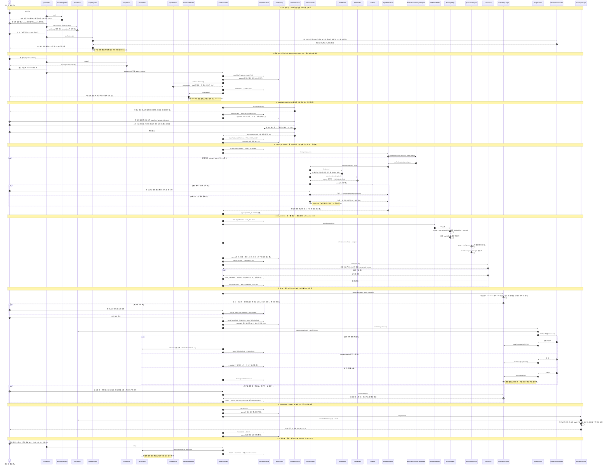
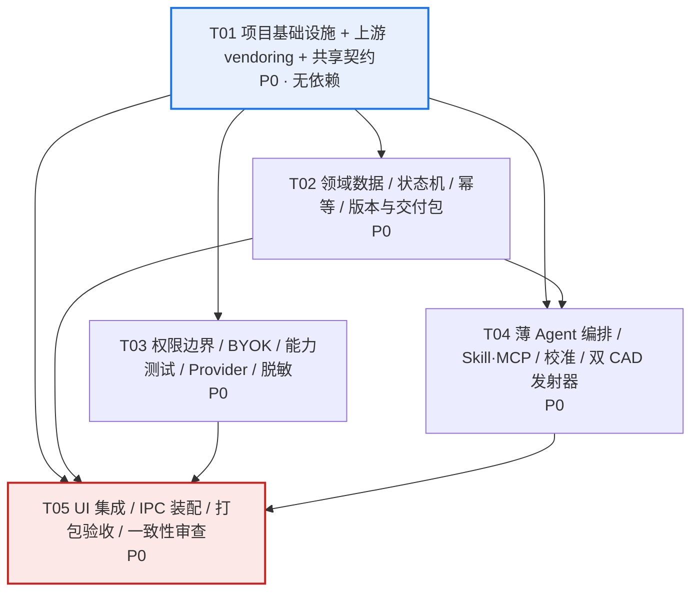

# 系统架构设计与任务分解（第 2 轮）

> 项目 `local_interior_design_agent` ｜ 架构师 高见远（Gao）｜ 2026-11-07 ｜ 中文
> 输入：`docs/PRD.md`（425 行，PM 许清楚）＋ `docs/RESEARCH.md`（第 1 轮 11 仓尽调/选型/风险/路线）＋ 主理人补充的一手实测证据。
> 本文件不修改 `docs/PRD.md`；`docs/RESEARCH.md` 的 §5/§6 已改为本文件的索引。
> 配套图：`docs/class-diagram.mermaid`、`docs/sequence-diagram.mermaid`。

---

## 0. 证据基线与「不得虚构」声明

| 项 | 一手证据 | 状态 |
|---|---|---|
| 运行时 | `node -v` = **v22.22.2**、`npm -v` = 10.9.7；`npx --yes pnpm@9.14.2 --version` = **9.14.2 EXIT=0** | 【亲自验证】 |
| 源码获取 | `git clone` 被代理 502 拦（EXIT=128）；`codeload.github.com` zipball HTTP 200 → **vendoring 走 zipball** | 【亲自验证】 |
| opencalque | `pnpm install --frozen-lockfile` EXIT=0；`pnpm test` **71 文件 / 664 用例全过 / 14.00s**；CLI **15 命令全部 EXIT=0**（`describe`/`quantities`/`check` 返回 `[]`/`dxf` 137125 B/`svg` 112561 B/`guide`/`apply`/`mcp`/`schema`）；`pnpm build` EXIT=0 → `apps/desktop/dist/win-unpacked/OpenCalque.exe` **246302208 B** + 完整 Chromium 运行时 | 【亲自验证】主理人实测 ＋ 本轮复核文件/日志/`cli.ts:39-60,124-145,203-208` |
| 打包 | `electron-builder --publish never` **两次 EXIT=1**：① 宿主 `"type":"module"` → `icon-tool.js` ESM 报错（隔离 `ELECTRON_BUILDER_CACHE` + `{"type":"commonjs"}` 已绕过，本轮复核 `eb-cache/package.json`）；② NSIS `!include: could not open FileAssociation.nsh`（文件确实存在，4943 B，本轮 `find` 复核）→ **nsis/portable 安装包未产出** | 【亲自验证·失败】**不写「打包通过」** |
| GUI 冒烟（三分法） | **三分法（主理人裁决，不得混淆）**：① `pnpm smoke`（经 pnpm 包装）在本机**未跑通**，根因宿主预设 `ELECTRON_RUN_AS_NODE=1` 使脚本被当纯 Node 执行、`app undefined`；② 但 `env -u ELECTRON_RUN_AS_NODE -u NODE_OPTIONS timeout 100 <electron.exe> scripts/smoke.cjs`（清除宿主变量后**直接调用 Electron 二进制运行同一个 `smoke.cjs`**）**EXIT=0**，输出 `Screenshots: …/opencalque-smoke-4UlY9I`，真实生成 4 张 PNG（120428 / 122691 / 109772 / 84485 B）；③ 该证据证明的是**上游 opencalque 桌面壳在本机可启动并完成鼠标键盘交互**，**本产品自身的 GUI 冒烟仍未验证**，仍列 T05 待验收；**DoD-1 仅以 `win-unpacked` 免安装目录交付**。→「上游壳已实测通过 / 包装命令未跑通 / 产品自身待验证」三者并列；**不得把上游通过写成产品通过，也不得把真实 EXIT=0 抹成「未验证」**。 | **启动前置**：由子进程显式移除 `ELECTRON_RUN_AS_NODE`（及 `NODE_OPTIONS`），写进 T01 `scripts/verify-env.mjs` 与 Shared Knowledge 第 13 条。**不改变 nsis/portable 安装包两次 EXIT=1 未产出** |
| archlang | `npx -y tsx src/cli.ts compile` **EXIT=0**：`$ACADVER=AC1015`、`$INSUNITS=4`、19 个 AIA 图层、`LINE/TEXT/INSERT/HATCH/DIMENSION`、双编 sha256 一致、`ezdxf.audit()` **0 errors / 5 fixes**；`validate --strict` EXIT=0，损坏样本 EXIT=2 带可应用 `fix` | 【亲自验证】 |
| opencalque MCP Server | `docs/VALIDATION.md` §4：stdio `initialize` 返回 `serverInfo{name:"opencalque",version:"1.6.0"}`、`instructions` 含 "Call read_guide once before your first edit"；`tools/list` 返回 `read_guide/open_drawing/describe_drawing/apply_operations/check_drawing/measure_drawing/view_drawing` | 【亲自验证】**解除**第 1 轮「opencalque MCP 未在本机运行」的限制；archlang MCP 仍未实测 |
| 双引擎闭环 | `docs/VALIDATION.md` §4 全部 EXIT=0：`archlang one-room.dxf → opencalque import (47 objects) → describe(line:20/polyline:2, 7 图层) → validate OK → dxf --out roundtrip.dxf (4692 B)`；另有 `new fresh.opencalque → apply studio.ops.json (Applied 23 operations) → check [] → dxf 8868 B`。首次 `apply` 打到已有内容文档 EXIT=1 `Layer "furniture" already exists`（测试输入用错，非缺陷） | 【亲自验证】**T04 实现约束**：`OpencalqueProjector` 必须先 `new` 空文档再 `apply`；验收补此闭环路径 |
| `safeStorage` | `docs/VALIDATION.md` §6 探针 `{"available":true,"roundtripOK":true,"plaintextLeaked":false}`；**Electron 内置 Node 24.21.0**（≠ 命令行 22.22.2，应用运行时不受宿主 Node 门槛约束） | 【亲自验证】`SecretVault` 有实证；**构建仍用命令行 Node 22.22.2**，不改变「不升级 Node / 淘汰两底座」结论 |
| archlang 打包前提 | codeload zipball **不含 `dist/`**（`package.json:33,46-49` 指向 `dist/index.js`/`dist/cli.js`，`tsup.config.ts` 存在）；`tsup build` 出 `dist/` 在本机**尚未验证**。 | **T01 回退顺序（主理人裁决）**：优先 **`npx -y tsx src/cli.ts` 子进程**（本机已验证、零风险）→ 其次 **in-process 引入 `src/` 由 electron-vite 打包**→ 最后才考虑 **`tsup build` 出 `dist/`**（本机**尚未验证**，**不得放在关键路径上**）。 列为 §9 假设 A1，T01 必验 |
| **opencalque CLI 全链路（主理人补测，全部 EXIT=0）** | `new fresh.opencalque --force` → `apply fresh.opencalque examples/studio.ops.json` **`Applied 23 operations`** → `describe`（`wall:5`/`instance:2`，含 `arch.door`/`arch.window`/`dimension`）→ `check` 返回 `[]` → `dxf --out fresh.dxf` **8868 B**。首次 `apply` 打到已有内容文档 **EXIT=1** `Layer "furniture" already exists`（测试输入用错，非缺陷）〔`VALIDATION.md` §4〕 | 【亲自验证】**主链路「结构化方案→可编辑平面→导出 DXF」不依赖任何模型 Key 即可跑通**；T04 `OpencalqueProjector` 必须先 `new` 空文档再 `apply` |
| **`guide` = 现成 Agent 编辑规范** | 输出专为 AI Agent 写的图纸编辑规范：毫米单位、墙由 `a→b` 中线 + `thickness` + `justify`、共享角点须坐标完全相同、门/窗 `cutWalls`、30+ 参数化构件（`arch.door/window/stair/washbasin/…`、`note.scalebar/level`、`elec.socket/switch/light`、`furn.table/bed/shelf`）〔`VALIDATION.md` §4〕 | 【亲自验证】**装修 Skill 的现成素材，不需另写一套 DSL**；`ArchSourceEmitter` 直接按此规范生成 `.arch` |
| **启动前置（QA 必读）** | 宿主预设 `ELECTRON_RUN_AS_NODE=1`；启动桌面/GUI 冒烟**必须为子进程显式移除**该变量（及 `NODE_OPTIONS`），不能继承宿主 env〔`VALIDATION.md` §5〕 | 【亲自验证】写进 T01 `scripts/verify-env.mjs`、`src/main/index.ts` 启动脚本与 Shared Knowledge 第 13 条 |
| 本机缺失 | `cargo` EXIT=127、`.NET SDK` EXIT=145、4 个 CAD COM ProgID 全 False、无 `pywin32`/`fastmcp`/客户 API Key、Chrome 4 命令全无 | 【亲自验证】→ 架构不依赖以上任何一项 |
| 已淘汰 | deepseek-harness（Node≥24.9 / 3 命令全 EXIT=1 / 商标 / 未过审计）、deepchat（Node≥24.22.1<25 / 2 次 EXIT=124 / 无白标 / Apache §6）、CodexPPP（AGPL-3.0）、draw2cad（无 LICENSE） | 见 `RESEARCH.md` §2.1–2.2 |

> **与 PRD 0.3 的一处事实冲突（如实标注）**：PRD 第 44 行写「Electron + Windows nsis/portable 打包方案测试通过」，但主理人后续一手实测 `electron-builder` 两次 EXIT=1、`nsis`/`portable` 安装包**未产出**，只有 `win-unpacked` 免安装目录成立。本架构按**更严格的一手证据**设计：DoD-1 当前以 `win-unpacked` 免安装形态交付，安装包本体列为待验证阻塞项（§7、§9），不虚构通过。

---

## 1. 实现方案与框架选型

### 1.1 核心技术难点（逐条给对策）

| # | 难点 | 对策 | 承载文件 |
|---|---|---|---|
| D1 | **不重写通用 Agent**：PRD 要求内置专业 Agent，但两个成熟底座（harness/deepchat）本机不可构建且与商标/白标冲突 | **复用 opencalque 现成 6 项通用 Agent 能力，只补一层薄「任务编排」**（详见 §1.3 必答题） | `src/main/agent/AgentOrchestrator.ts` ＋ 对上游 `agent.ts` 的**单处**预执行钩子 |
| D2 | **真实任务状态机 + 防重复扣费**：PRD 4.4 的 12 态 + FAILED/CANCELLED、重做=新 Task+新 versionId、`taskId+stepId+idempotencyKey`、提交前落盘、仅用户显式重试、超时结果未知禁止重提 | 纯函数状态机（显式转移表 + guard）＋ append-only 事件日志 ＋ 预写账本（write-ahead）三段分离；`subProgress` 只由真实事件计数驱动，**无 `setInterval`/无 ETA/无百分比** | `task/state-machine.ts`、`task/TaskEventLog.ts`、`task/IdempotencyLedger.ts` |
| D3 | **「调用本机 CAD 能力」不能是 AutoCAD COM** | 程序化生成：唯一权威 `StructuredPlan` → 两条发射器（archlang 出**交付 DXF**；opencalque 出**可编辑工作文档**）＋ SVG/PDF 预览；全程 in-process，零 COM/零 AutoCAD | `cad/*`、`vendor/archlang/` |
| D4 | **校准是正式必经阻塞步骤**，不能虚构图片自动识别 | `AWAITING_CALIBRATION` 由 `CalibrationService` 产生**待确认项清单**并硬阻塞；比例来自用户两点+已知距离（复用上游 `placeFloorPlan`/`tool.calibrate`/`applyCalibration`），确认前候选值不写入结构化数据 | `calibration/*` ＋ `vendor/opencalque/apps/web/src/floorplan.ts` |
| D5 | **权限边界**：只许当前项目路径 + 明确绘图操作；denylist 不是安全边界 | 白名单（非黑名单）＋ 规范化路径沙箱 ＋ zod 参数校验 ＋ **预执行用户确认门**（覆盖 `agent.ts:76` 的「无需确认」默认）＋ append-only 审计；**不嵌入 Autocad-MCP** | `security/*` |
| D6 | **BYOK 两组配置 + 5 项能力独立测试 + Key 零明文** | `SecretVault`（Electron `safeStorage` 扩展）+ `ModelSettingsStore`（明文项与密钥分离）+ `CapabilityTester`（5 个独立结论）+ `Redactor`（日志/对话/项目文件/导出包统一脱敏）+ `ImageGenTool`（调用时从本地设置读 Key 并发 HTTP，Skill 不存 Key） | `settings/*`、`model/*`、`security/Redactor.ts` |
| D7 | **双 DXF 引擎不重复实现** | `StructuredPlan` 单一数据源；archlang = 确定性标准交付图纸；opencalque = 可交互文档模型 + Agent 工具面 + 校准；分工表见 `RESEARCH.md` §2.5.1 | `cad/ArchSourceEmitter.ts`、`cad/OpencalqueProjector.ts` |
| D8 | **无客户 API Key 仍要可交付** | 生图链路做成「可配置、可调用、待联调」：请求组装/幂等/记录/错误映射全实现，用**模拟端点**验收；真实出图不计入 V1 DoD | `model/ImageGenTool.ts` ＋ `tests/fixtures/mock-endpoint.mjs` |
| D9 | **版本与人工编辑保护** | 每次生成写 `versions/<versionId>/` 新目录，永不覆盖；人工编辑文件带 `manualEdited` 标记 + 内容哈希；导出包在写入前做 Key 明文自检与哈希比对 | `project/VersionStore.ts`、`project/DeliveryPackager.ts` |

### 1.2 框架选型（**只选本机已验证能跑的**）

| 层 | 选型 | 依据 / 为什么不用别的 |
|---|---|---|
| 桌面容器 | **Electron 44.7 + electron-vite 5 + electron-builder 26.15.3**（复用 opencalque `apps/desktop`） | `pnpm build` EXIT=0 已产出 246 MB `win-unpacked`；不用 Tauri（cc-switch/CodexPPP 需 cargo，本机 EXIT=127）、不用 harness/deepchat（Node≥24、未构建通过） |
| 渲染 UI | **React 18 + Vite 7**（复用 opencalque `apps/web` 的画布/面板/停靠/i18n/prefs）；**新增产品页按 PRD 默认用 MUI + Tailwind CSS**，Tailwind 加 `prefix: 'ida-'` 作用域隔离，避免与上游原生 CSS 冲突 | PRD §0 默认 Vite+React+MUI+Tailwind；复用画布保持零重写；两套样式系统以作用域前缀隔离，登记为 §9 假设 A2 |
| 语言/校验 | TypeScript（沿用 opencalque 锁定版本）+ **zod ^4.6.5** | 上游 `packages/core` 已用 zod 产出 3 个 JSON Schema；`OpSchema`/`documentJsonSchema()` 可直接复用于工具参数校验 |
| 状态机 | **自研纯 TS 显式转移表**（不引第三方 FSM 库） | 12 态 + guard 用一张表即可表达，纯函数可单测；引库反而增加维护面 |
| 本地存储 | JSON 文件 + 上游 `writeSafely()` 原子写（临时文件+rename，Windows `EPERM/EBUSY/EACCES` 重试）+ `backups/` 30 份 + `recent.json` | 复用 `apps/desktop/src/main/index.ts:47-91,166`；不引 SQLite/electron-store 原生依赖 |
| 密钥 | `safeStorage.encryptString/decryptString`（Windows DPAPI）→ `secrets.json` | 复用 `index.ts:180-208`；把 `SECRET_NAMES` 从 `['anthropic','compatible']` 扩为 `['text','image']` 两组 |
| 网络 | 主进程 `net.request`（复用 `platform.request` / `preload` 的 `net:request` IPC） | 避免渲染进程 CORS/Origin 问题；opencalque 已有该接缝（`apps/web/src/platform.ts:32-40`） |
| CAD 交付引擎 | **archlang v1.57.0**（零运行期依赖、字节级确定性、AC1015+AIA 图层+DIMENSION） | 本机 EXIT=0 且 `ezdxf.audit()` 0 errors；不用 openPlan3D `exportDWG()`（实为 `return exportDXF()`） |
| CAD 工作引擎 | **opencalque `@opencalque/core`**（Document/ops/`toDXF`/`dxfOps`/`DRAWING_TOOLS`/`checkDrawing`） | 664 测试全过；CLI 15 命令 EXIT=0；`guide` 专为 Agent 编写 |
| MCP | 复用 **opencalque MCP Server 的工具面** `DRAWING_TOOLS`（`@modelcontextprotocol/sdk ^1.32.2` 已在 `packages/cli` 依赖中）；新增可选 `McpClientAdapter` 作扩展点 | 见 §1.3；V1 主路径 in-process 调 `runDrawingTool()`，**与 MCP Server 同一份工具注册表**，不另起进程 |
| 测试 | Vitest + Playwright（沿用 opencalque）＋ Python `ezdxf` **仅作 QA 验收脚本**，不是运行时依赖 | 本机 `ezdxf 1.4.5` 已装成；运行时不依赖 Python |

**架构模式**：分层 + 端口与适配器（Hexagonal-lite）+ **单写者状态机**。
- `src/shared/contracts/` 定义端口接口（`ProjectPort`/`ProviderPort`/`PermissionPort`/`IdempotencyPort`），使 T02/T03/T04 可并行开发、只在 T05 组装；
- 主进程（Node 22）持有全部文件 IO、密钥、网络与状态机；渲染进程只通过 `preload` 的 `contextBridge` 调用窄 IPC，**渲染进程永不接触 API Key 明文、永不直接 spawn**；
- `TaskOrchestrator` 是唯一允许推进状态的对象，`CAD_BUILDING`/`IMAGE_GENERATING` 等阶段只上报真实计数事件。

### 1.3 必答题：淘汰 harness/deepchat 后，如何只补一层薄 Agent 编排？

**结论：不写 Agent Loop、不写会话状态机、不写 Provider 抽象、不写桌面壳、不写画布编辑器、不写 DXF 读写器、不写图片/PDF 放置与两点校准。** 只补 **5 组薄模块 + 1 处上游钩子**，通用对话 Agent 的六项能力零重写。

**（A）opencalque 已提供、直接复用（六项零重写）**〔证据：`RESEARCH.md` §2.3.2；本轮复核 `agent.ts:222-243`、`types.ts:33-47`、`ARCHITECTURE.md:683-690,797`〕

| PRD/团队要求的通用 Agent 能力 | 复用的现成实现 |
|---|---|
| 桌面 UI | `apps/desktop/`（Electron 主进程 + preload + NSIS/portable 配置）＋ `apps/web/src/`（React 画布、停靠面板、i18n、prefs） |
| Agent Loop | `apps/web/src/ai/agent.ts::runRequest(session, host, text, events, signal, images, context)`：`MAX_STEPS`、stop reason `done/tools/refused/truncated`、`AbortController`、拒绝/截断不执行任何工具 |
| 会话管理 | `apps/web/src/ai/chat.ts`（`opencalque.chats` 最近 30 条、`snapshot()`/`shorten()`、`createSession({history})`、`/new /resume /model /clear /help`） |
| 本地项目存储 | `apps/desktop/src/main/index.ts::writeSafely()` 原子写 + `backups/` + `recent.json` + 崩溃恢复；文档 JSON + 3 个 Schema |
| Provider 管理 | `apps/web/src/ai/types.ts::Provider/ChatSession` 接缝、`anthropic.ts`（官方 SDK）、`compatible.ts`（任意 OpenAI 兼容端点含 Ollama）、`claudecli.ts`；`prefs.ts` 每 Provider 独立 key；桌面 `safeStorage` 加密 `secrets.json` |
| 工具调用能力 | `packages/core/src/tools.ts::DRAWING_TOOLS`（7 工具：`apply_operations`/`read_document`/`describe_drawing`/`view_image`/`view_drawing`/`measure_drawing`/`check_drawing`）＋ `runDrawingTool(name, input, host)`；`ops.ts::OpSchema` 保证 `apply_operations` 全有或全无 |
| MCP | `packages/cli/src/mcp.ts` 是官方 SDK 的 **MCP Server**（stdio），`apps/desktop/src/main/bridge.ts` 是 `127.0.0.1` + `randomBytes(32)` token + `timingSafeEqual` + 带 `Origin` 一律 403 + `bridge.json` mode 0o600 的本地桥。**关键**：MCP Server 与 in-app 助手共用**同一份 `DRAWING_TOOLS`**（`apps/web/src/ai/bridge.ts::startAgentBridge()` 调 `runDrawingTool`），所以 in-process 调用即等价于复用其 MCP 能力，无需另起进程。**`VALIDATION.md` §4 已实测该 MCP Server 真实启动**（`initialize` + `tools/list` 返回 7 个工具），故 L1 `McpClientAdapter` 若启用有真实可用服务端 |
| DXF/校准 | `packages/core/src/dxf.ts::toDXF()`、`dxf-import.ts::dxfOps()`、`apps/web/src/floorplan.ts::placeFloorPlan()/applyCalibration()`、`commands.ts:337 tool.calibrate` |

**（B）只补的薄层（约 5 组模块，无新语言/无新原生依赖）**

| 薄层 | 新增文件（相对 `src/`） | 做什么 | 挂点 / 为什么薄 |
|---|---|---|---|
| **L1 扩展点** | `main/agent/McpClientAdapter.ts` | 用已在依赖树的 `@modelcontextprotocol/sdk/client` 连接**外部/自定义** MCP Server（含 archlang `packages/mcp` 的 11 工具），把其工具登记进统一 `ToolRegistry` | V1 主路径是 in-process，`McpClientAdapter` 只是可选扩展点；不写协议栈 |
| **L2 Skill** | `main/agent/SkillRegistry.ts`、`skills/interior-render/SKILL.md`、`skills/vendor/archlang-*/SKILL.md` | 读 SKILL.md front-matter → 拼进 `systemPrompt` / 映射为斜杠命令；装修效果图 Skill 按 PRD 4.7 只是**工作流指令**，不存 Key、不发起网络请求 | 纯 markdown 装载；复用 `agent.ts` 的 `systemPrompt` 与 `AssistantPanel.tsx` slash 机制。**`guide` 与 archlang 5 个 SKILL.md 是现成素材，不需另写 DSL**〔主理人实测；`VALIDATION.md` §4〕 |
| **L3 权限门（必须）** | `main/security/{ToolWhitelist,PathSandbox,ParamValidator,PermissionGate,AuditLog}.ts` ＋ 对上游 `apps/web/src/ai/agent.ts` 的**单处** `runTool()` 前置钩子 | 每次工具调用：白名单 → 路径规范化 → zod 校验 → **弹窗让用户确认** → 审计 → 才执行。**覆盖 `agent.ts:76` 原文 "it is fine to act … without asking for confirmation first" 与 `ARCHITECTURE.md:891` "undo is the safety net"** | 策略切面，不是新 Agent；桌面已有 `labels.connect`/`allow`/`deny` 弹窗样板可复用（`index.ts:33-38`） |
| **L4 领域工具** | `main/cad/*`、`main/calibration/*`、`main/model/ImageGenTool.ts` | 把「结构化平面 → archlang compile → 交付 DXF → 几何自检」「编辑器工作文档」「生图请求」包装成 2–3 个 `DRAWING_TOOLS` 风格工具；生图工具调用时从 `SecretVault` 读 Key 并用 `platform.request` 发 HTTP | 新增工具登记到 `ToolRegistry`，循环/调度/错误仍用 `runRequest()` |
| **L5 任务编排 glue** | `main/task/{TaskOrchestrator,state-machine,TaskEventLog,IdempotencyLedger}.ts`、`main/project/{ProjectStore,VersionStore,DeliveryPackager}.ts` | 把 PRD 12 态状态机、幂等账本、版本目录、交付包串起来；`LAYOUT_PLANNING` 与「对话修改」两步调用 `runRequest()`，其余步骤是本地确定性计算 | **这是「薄 Agent 编排」的本体**：不是通用对话 Agent，而是把一次 `runRequest()` 嵌进一个可核对的任务流水线 |

**（B-2）L3 精确改造点（主理人已核到行号，架构师本轮 `sed` 复核原文，工程师可直接用）**

| 位置 | 现状 | 改造 |
|---|---|---|
| `apps/web/src/ai/agent.ts:76` | `systemPrompt()` 内 "…so it is fine to act on a clear request without asking for confirmation first." | 改为「执行前须经权限确认门」；**不能只改文案，必须真的加门** |
| `apps/web/src/ai/agent.ts:211` | `async function runTool(call, host, events) { const { note, ...result } = await runDrawingTool(call.name, call.input, drawingHost(host)) }` | **单处前置切面挂点**：在 `runDrawingTool` 之前插入 `whitelist → path → validate → confirm → audit` |
| `apps/desktop/src/main/index.ts:180-206` | `safeStorage` 加/解密 `secrets.json`（`SECRET_NAMES = ['anthropic','compatible']`） | 扩为 `['text','image']`；`canEncrypt()` 不可用时拒绝保存并提示；本机探针实证可用 |
| `apps/desktop/src/main/index.ts:100-116` | `mayReach()` 用 `labels.connect` / `labels.allow` / `labels.deny` 弹确认框（`allowed-hosts.json`） | 复用为 P-7 权限确认对话框样板（仅本次允许 / 拒绝 / 记住本次选择） |

**（C）明确不做**：不引入 deepseek-harness（商标 + Node≥24.9 + `SAFETY.md` 未过审计）、不引入 deepchat（Node≥24.22.1<25 + 无白标 + Apache §6）、不升级 Node、不装 Rust/COM/CAD、不写第二个聊天引擎、不把 `undo` 当安全边界。备选分支 B（升级 Node 保留两者）的可执行路径与交付影响见 `RESEARCH.md` §2.3.5，**不推荐**。

---

## 2. 分层与运行时边界

```
┌─────────────────────────────────────────────────────────────┐
│ 渲染进程 (React 18 + Vite 7 + MUI/Tailwind[新页])              │
│  P-1 Home / P-2 Settings / P-3 Wizard / P-4 Calibration      │
│  P-5 Chat / P-6 Results / P-7 PermissionDialog                │
│  + 复用的 opencalque 画布/校准/面板 (apps/web/src)              │
│  ⚠ 永不接触 Key 明文；永不 spawn；只走 contextBridge 窄 IPC     │
└───────────────────────┬─────────────────────────────────────┘
                        │ preload: net:request / secret:* / file:* / task:* / gate:*
┌───────────────────────▼─────────────────────────────────────┐
│ 主进程 (Node 22.22.2, Electron 44) — 唯一写者                 │
│  TaskOrchestrator ── TaskStateMachine ── TaskEventLog          │
│       │            IdempotencyLedger (write-ahead)             │
│       ├─ AgentOrchestrator ──[复用 runRequest / ChatSession]── Provider 适配器
│       │        └─ ToolRegistry ── PermissionGate ── AuditLog     │
│       ├─ IngestService / CalibrationService                   │
│       ├─ CAD: StructuredPlan → ArchSourceEmitter → archlang      │
│       │                  └→ OpencalqueProjector → core       │
│       ├─ ImageGenTool ─ SecretVault(safeStorage) ─ net.request  │
│       └─ ProjectStore / VersionStore / DeliveryPackager         │
└───────────────────────┬─────────────────────────────────────┘
                        │ 本地文件 (userData/projects/<projectId>/...)
┌───────────────────────▼─────────────────────────────────────┐
│ vendor/opencalque (zipball v1.6.0)  vendor/archlang (v1.57.0) │
│ 全部 in-process；无 COM / 无 Python 运行时 / 无公网后端         │
└─────────────────────────────────────────────────────────────┘
```

**主进程/渲染进程契约**：所有 IPC 返回 `{code, data, message}`；`message` 与 `data` 均由 `Redactor` 过滤；错误只用 `ErrorCatalog` 的员工可读中文码，禁止把原始堆栈/英文错误码直接上屏（PRD 4.5）。

---

## 3. 文件列表（相对工作区根目录）

> 标注：**【复用】**＝vendoring 上游快照后原样使用；**【改】**＝上游文件的最小改动；**【新增】**＝本产品编写。

### 3.1 根 / 配置 / 入口（T01）

| 路径 | 类型 | 说明 |
|---|---|---|
| `package.json` | 新增 | 根 workspace，`packageManager: "pnpm@9.14.2"`，脚本 `dev/build/test/dist/verify:env/acceptance` |
| `pnpm-workspace.yaml` | 新增 | 声明 `apps/*`、`packages/*`、`vendor/opencalque/*`、`vendor/archlang` |
| `tsconfig.json` / `tsconfig.node.json` | 新增 | 沿用上游 TS 版本，不升级 |
| `electron.vite.config.ts` | 新增 | main/preload/renderer 三入口；renderer alias 到 `vendor/opencalque/apps/web/src` 与 archlang `src/`（in-process 为**次选**；首选 `npx -y tsx src/cli.ts` 子进程，见 A1） |
| `electron-builder.yml` | 新增 | `win.target: ["dir"]` 为 V1 已验证目标；`nsis`/`portable` 保留但 marked 待验证；`extraResources` 附 `LICENSE.txt` + `THIRD-PARTY-NOTICES.txt` |
| `tailwind.config.ts` / `postcss.config.cjs` | 新增 | Tailwind `prefix: 'ida-'` 作用域隔离（PRD 默认 UI 栈） |
| `index.html` | 新增 | 渲染进程入口 |
| `.gitignore` | 新增 | 排除 `dist/`、`userData/`、`*.local`、`secrets.json` |
| `LICENSE.txt` / `THIRD-PARTY-NOTICES.txt` | 新增 | 合并 opencalque MIT / archlang MIT / theLodgeStudio(openPlan3D) MIT / roomsmith MIT（若引用提示词）；**不含** draw2cad / CodexPPP 任何代码 |
| `vendor/opencalque/**` | 复用 | codeload zipball `refs/tags/v1.6.0` 快照（无 `.git`） |
| `vendor/archlang/**` | 复用 | codeload zipball `refs/tags/v1.57.0` 快照（无 `.git`、无 `dist/`） |
| `scripts/verify-env.mjs` | 新增 | 开机自检：Node/pnpm 版本、`win-unpacked` 存在性、COM ProgID 缺失声明、上游快照 hash |
| `scripts/acceptance.mjs` | 新增 | 三条无人值守回归（见 §8.2 DoD 验收） |

### 3.2 共享契约（T01，供 T02/T03/T04 并行）

| 路径 | 类型 | 说明 |
|---|---|---|
| `src/shared/contracts/ports.ts` | 新增 | `ProjectPort` / `ProviderPort` / `PermissionPort` / `IdempotencyPort` / `TaskEventSink` 接口 |
| `src/shared/types/task.ts` | 新增 | `TaskState`（PRD 12 态 + FAILED/CANCELLED）、`Task`、`TaskEvent`、`SubProgress`、`Transition` |
| `src/shared/types/project.ts` | 新增 | `Project`、`Version`、`VersionManifest`、`SourceAsset`、`RequirementSpec`（8 字段）、`CandidateValue` |
| `src/shared/types/plan.ts` | 新增 | `StructuredPlan`（mm，版本化）、`Wall`/`Room`/`Opening`/`Furniture`/`Dimension`/`Layer`、`CalibrationItem` |
| `src/shared/types/settings.ts` | 新增 | `ModelGroupConfig`（text-vision / image-gen 两组）、`CapabilityKey`（5 项）、`CapabilityResult`、`InterfaceType` |
| `src/shared/types/render.ts` | 新增 | `RenderRecord`、`ImageRequest`、`ImageResult`、`ErrorCode` |
| `src/shared/schema/*.json` | 新增 | zod → JSON Schema（document/ops/plan/requirement/render-record）；复用上游 `opsJsonSchema()`/`documentJsonSchema()` |
| `src/shared/constants/ui-copy.ts` | 新增 | **UI 禁用词表**：`MCP`/`Skill`/`JSON`/`YAML`/`终端`/`Agent Runtime` 一律不出现在界面文案（PRD G1 / P0-01 / 5.2）＋ 全部员工可读中文文案 |
| `src/shared/constants/errors.ts` | 新增 | `ErrorCatalog`：PRD 4.5 全部错误码 → 中文文案 + 下一步动作 |

### 3.3 主进程 · 任务与项目（T02）

| 路径 | 类型 | 说明 |
|---|---|---|
| `src/main/task/state-machine.ts` | 新增 | **纯函数**：显式转移表 + guard，覆盖 PRD 4.4 全部边（含 `CAD_CHECKING → STRUCTURE_READY` 回退、`FAILED → LAYOUT_PLANNING / IMAGE_AWAITING_CONFIRM` 显式重试、`DONE → INGESTING` 重做） |
| `src/main/task/TaskOrchestrator.ts` | 新增 | 唯一状态推进者；串联 12 态；每态上报真实计数事件 |
| `src/main/task/TaskEventLog.ts` | 新增 | append-only `events.ndjson`（脱敏），S2「状态变更 ↔ 日志 1:1」 |
| `src/main/task/IdempotencyLedger.ts` | 新增 | `taskId+stepId+idempotencyKey`；**提交前** write-ahead 落盘「已提交」；`chargeSubmittedCount`；超时→`resultUnknown` 禁止直接重提；仅显式重试建新键 |
| `src/main/task/SubProgress.ts` | 新增 | 只由真实事件计数（文件数/房间数/自检项数/写入文件数）；**无定时器/百分比/ETA** |
| `src/main/project/ProjectStore.ts` | 新增 | `userData/projects/<projectId>/`，`writeSafely()` 原子写（复用上游），`recent.json` |
| `src/main/project/VersionStore.ts` | 新增 | `versions/<versionId>/`，永不覆盖；`manualEdited` + 内容哈希；重做=新 `taskId`+新 `versionId` |
| `src/main/project/DeliveryPackager.ts` | 新增 | ZIP（DXF+SVG+PDF+效果图+边界声明+版本记录+脱敏自检报告）；导出前 Key 明文自检 |
| `src/main/project/BoundaryNote.ts` | 新增 | PRD 5.3–5.6 的 CAD/效果图边界声明文案（UI 与交付包同一份） |

### 3.4 主进程 · 安全与 BYOK（T03）

| 路径 | 类型 | 说明 |
|---|---|---|
| `src/main/security/ToolWhitelist.ts` | 新增 | **白名单**（非黑名单）：仅 `DRAWING_TOOLS` 7 工具 + 本产品领域工具；**显式拒绝**任意命令/脚本/未受控绝对路径；拒绝项写审计 |
| `src/main/security/PathSandbox.ts` | 新增 | `realpath` 规范化 → `isWithin(projectRoot)`；拒 `..`/UNC/`\\?\`/ADS/符号链接逃逸/后缀黑名单；**不依赖任何 denylist 作为边界** |
| `src/main/security/ParamValidator.ts` | 新增 | zod（复用 `OpSchema`）+ 单位恒 mm + 坐标/实体/面积/输出大小上限 + 文件后缀白名单 |
| `src/main/security/PermissionGate.ts` | 新增 | 预执行确认门：显示当前项目**绝对路径** + 工具白名单 + 禁止项；「仅本次允许」/「拒绝」/「记住本次选择」（仅同范围生效，扩大范围重确认）；拒绝→保持原状态 + 审计，**不得静默放行** |
| `src/main/security/AuditLog.ts` | 新增 | 每次工具调用记录时间/操作类型/目标路径/结果（允许·拒绝），append-only 脱敏，任务面板可查 |
| `src/main/security/Redactor.ts` | 新增 | 统一脱敏：日志/Agent 对话/项目文件/导出包/错误对象中的 `Authorization`、Key 片段（S4 = 0） |
| `src/main/settings/ModelSettingsStore.ts` | 新增 | 两组独立配置（Provider/接口类型、Base URL、模型名、能力说明、测试结论）；**不含 Key**；不硬编码任何服务商 |
| `src/main/settings/SecretVault.ts` | 新增/改 | 复用上游 `index.ts:180-208` `safeStorage`；`SECRET_NAMES` 扩为 `['text','image']`；`canEncrypt()` 不可用时拒绝保存并提示 |
| `src/main/settings/CapabilityTester.ts` | 新增 | **5 项独立测试**：文本生成 / 工具调用 / 图片理解 / 图片生成 / 图片编辑；各自 `{pass,unsupported,failed,reason}` 独立存储展示，按结论启用/禁用功能；端点不支持图像能力时**不发出任何生图请求** |
| `src/main/model/TextProviderAdapter.ts` | 新增 | 复用上游 `compatible.ts`（OpenAI 兼容含 Ollama）/ `anthropic.ts`；按 `InterfaceType` 分发；Key 调用时从 `SecretVault` 取 |
| `src/main/model/ImageProviderAdapter.ts` | 新增 | 生图/编辑适配器按接口类型区分（`/images/generations`、`/images/edits`、chat-with-image、自定义）；主进程 `net.request` |
| `src/main/model/ImageGenTool.ts` | 新增 | 生图请求工具：调用时读 Key、绑定幂等键、组装 CAD 视图/布局图 + 参考图 + 需求描述、`IMAGE_GENERATING` 不显示百分比/ETA；失败映射 `ErrorCatalog`；**禁止自动重试** |
| `src/main/model/HttpErrors.ts` | 新增 | 401/403/429/超时/5xx/能力不支持/结果校验失败 → 中文码；超时 `resultUnknown` 交 `IdempotencyLedger` |

### 3.5 主进程 · Agent 薄层 / CAD / 校准（T04）

| 路径 | 类型 | 说明 |
|---|---|---|
| `src/main/agent/AgentOrchestrator.ts` | 新增 | **薄编排本体**：`LAYOUT_PLANNING` 与「对话修改」两步调 `runRequest()`；其余为本地确定性计算；不写新 Loop |
| `src/main/agent/ToolRegistry.ts` | 新增 | 统一工具表：`DRAWING_TOOLS`（复用）＋ 领域工具；所有调用先过 `PermissionGate` |
| `src/main/agent/McpClientAdapter.ts` | 新增 | 可选扩展点：`@modelcontextprotocol/sdk/client` 连接外部/自定义 MCP Server（含 archlang MCP 11 工具） |
| `src/main/agent/SkillRegistry.ts` | 新增 | 加载 SKILL.md front-matter → `systemPrompt` / 斜杠命令；Skill **不存 Key、不发起网络** |
| `src/main/agent/agent-hooks.ts` | **改** | 对上游 `vendor/opencalque/apps/web/src/ai/agent.ts::runTool()` 加**单处**前置钩子：`whitelist → path → validate → confirm → audit`；覆盖 `agent.ts:76` 的「无需确认」默认 |
| `src/skills/interior-render/SKILL.md` | 新增 | PRD 4.7 装修效果图工作流（6 步），显式写「图像模型可能改变结构与尺寸」「效果图不作为施工依据」 |
| `src/skills/vendor/archlang-*/SKILL.md` | 复用 | archlang 5 个 SKILL.md（`archlang`/`brief-to-plan`/`edit-plan`/`export`/`review-plan`） |
| `src/main/ingest/IngestService.ts` | 新增 | 3.5 格式表：JPG/PNG/HEIC/WEBP 缩略图+去重（**不自动矢量化**）；PDF 逐页渲染（复用 `pdfjs-dist`）+ 文本层；DXF 解析为候选线段（`dxfOps`）；**DWG 不解析**，只提示「请用 CAD 另存为 DXF 后导入」 |
| `src/main/ingest/CandidateExtractor.ts` | 新增 | 8 字段候选值 + **来源文件标注 + 待确认**；确认前不写入 `StructuredPlan` |
| `src/main/calibration/CalibrationService.ts` | 新增 | 生成待确认项（比例未知/尺寸缺失/薄内墙/洞口/结构墙）；**阻塞 `AWAITING_CALIBRATION`**；「确认并继续」在必填项完成前不可用 |
| `src/main/calibration/CalibrationEditor.ts` | 新增/复用 | 复用 `floorplan.ts::placeFloorPlan()`、复用 `commands.ts:337 tool.calibrate`、`applyCalibration(real)` 两点已知距离；人工补漏/合并/核对 → `StructuredPlan` 唯一权威源 |
| `src/main/cad/StructuredPlan.ts` | 新增 | 校准后确认的权威数据（mm、版本化、来源可追溯） |
| `src/main/cad/ArchSourceEmitter.ts` | 新增 | `StructuredPlan` → `.arch` 文本（墙中线+thickness+justify、共享角点坐标必须相同、门/窗 `cutWalls`、尺寸链） |
| `src/main/cad/ArchlangBridge.ts` | 新增 | in-process 调 archlang 编译器（`compile`/`validate --strict`/`lint`/`fix`）；解析 `--json` 信封与退出码 0/2/1/3；产物 `plan.dxf`/`plan.svg`/`plan.pdf`；**双编 sha256 一致性**作为回归 |
| `src/main/cad/OpencalqueProjector.ts` | 新增 | `StructuredPlan` → `ops.json`（`add_node`/`update_node`）→ `applyEdit()` → `drawing.opencalque`（可编辑工作文档）→ `checkDrawing()`/`quantities()`/`describeDrawing()` 自检与统计 |
| `src/main/cad/CadChecker.ts` | 新增 | PRD S3 六类元素（墙/门窗/家具/图层/标注/尺寸）＋ DXF 可解析性（`ezdxf.audit()` 结果或 `dxfOps()` 解析）；不通过 → 回退 `STRUCTURE_READY` 并附缺失项清单 |
| `src/main/cad/PreviewRenderer.ts` | 新增 | SVG/PDF 预览（archlang SVG/PDF 后端；PNG 用已在依赖中的 `@resvg/resvg-js`） |

### 3.6 渲染进程 · UI / IPC（T05）

| 路径 | 类型 | 说明 |
|---|---|---|
| `src/renderer/main.tsx` / `App.tsx` | 新增 | 挂载 MUI Theme + Tailwind（作用域前缀）＋ 复用画布路由 |
| `src/renderer/pages/Home.tsx` | 新增 | P-1：新建/最近项目/模型配置状态徽标 |
| `src/renderer/pages/Settings.tsx` | 新增 | P-2：两组配置 + 测试连接 + `CapabilityMatrix` |
| `src/renderer/pages/Wizard.tsx` | 新增 | P-3：5 步（基本信息/资料上传/需求 8 字段+候选值/校准/确认提交）；确认提交显示将调用模型组、费用由公司账户承担、仅访问本项目路径 |
| `src/renderer/pages/Calibration.tsx` | 新增 | P-4：底图+候选线段、待确认项清单、结构化编辑区（复用上游画布） |
| `src/renderer/pages/Chat.tsx` | 新增 | P-5：消息流 + `TaskStatusPanel` + 修改布局/重做（提示「将生成新版本，旧版本保留」） |
| `src/renderer/pages/Results.tsx` | 新增 | P-6：图纸/效果图预览、版本列表、「本版本无效果图」显式标注、导出交付包、边界声明常驻 |
| `src/renderer/components/PermissionDialog.tsx` | 新增 | P-7 模态框（允许范围/禁止项/仅本次允许/拒绝/记住本次选择） |
| `src/renderer/components/TaskStatusPanel.tsx` | 新增 | 真实阶段名 + 阶段内真实计数；阻塞态显示「等待你操作」、进度条停住；可展开脱敏日志 |
| `src/renderer/components/CapabilityMatrix.tsx` | 新增 | 5 项能力独立徽标（通过/不支持/失败含原因） |
| `src/renderer/components/ErrorCard.tsx` | 新增 | `ErrorCatalog` 中文文案 + 下一步动作；超时「结果未知，未自动重发以避免重复计费」 |
| `src/preload/index.ts` | 新增/改 | 复用上游 `contextBridge`；新增窄 IPC：`task:*`、`settings:*`、`secret:*`、`capability:*`、`gate:*`、`net:request`；**不暴露 Key 明文给渲染进程** |
| `src/main/ipc/*.ts` | 新增 | 各 IPC handler，`{code,data,message}` 统一响应 + `Redactor` |
| `tests/fixtures/mock-endpoint.mjs` | 新增 | 模拟文本/视觉/生图端点，可注入 401/403/429/5xx/超时/能力不支持/错误 Key（DoD-2/7 验收） |
| `tests/acceptance/*.spec.ts` | 新增 | 状态机、幂等、权限、脱敏、版本哈希、DXF 六类元素验收 |

---

## 4. 数据结构与接口（classDiagram）

> 完整可渲染版本见 `docs/class-diagram.mermaid`。下图同时给出**数据模型**、**服务类**与**关系标注**（`*--` 组合 / `o--` 聚合 / `-->` 关联 / `..|>` 实现 / `..>` 依赖）。

```mermaid
classDiagram
    direction TB

    class Task {
        +string taskId
        +string projectId
        +string versionId
        +TaskState state
        +string stateEnteredAt
        +SubProgress subProgress
        +TaskEvent[] events
        +string errorCode
        +string idempotencyKey
        +int chargeSubmittedCount
    }
    class TaskEvent {
        +string eventId
        +string at
        +TaskState from
        +TaskState to
        +string reason
        +int done
        +int total
        +string unit
    }
    class SubProgress {
        +int done
        +int total
        +string unit
        +advance(realCount int) void
    }
    class Project {
        +string projectId
        +string name
        +string customer
        +string createdAt
        +string currentVersionId
        +string rootPath
    }
    class Version {
        +string versionId
        +string taskId
        +string createdAt
        +string[] artifactPaths
        +bool manualEdited
        +string contentHash
    }
    class VersionManifest {
        +string versionId
        +Record~string,string~ sha256
        +string cadVersion
        +string boundaryNote
    }
    class SourceAsset {
        +string assetId
        +string path
        +string mime
        +string role
        +bool readable
        +string thumbnail
    }
    class RequirementSpec {
        +float area
        +DimensionSpec dimensions
        +float ceilingHeight
        +string[] roomUses
        +int occupants
        +string style
        +string budget
        +string special
        +CandidateValue[] candidates
    }
    class CandidateValue {
        +string field
        +string value
        +string sourceFile
        +bool confirmed
    }
    class StructuredPlan {
        +string planVersion
        +string units
        +Wall[] walls
        +Room[] rooms
        +Opening[] openings
        +Furniture[] furniture
        +Dimension[] dimensions
        +Layer[] layers
        +CalibrationItem[] calibration
        +confirmedAt string
    }
    class CalibrationItem {
        +string itemId
        +string kind
        +string description
        +bool resolved
        +float knownDistanceMm
    }
    class RenderRecord {
        +string recordId
        +string cadVersionId
        +string[] inputImages
        +string prompt
        +string modelName
        +string at
        +string resultPath
    }
    class ModelGroupConfig {
        +string group
        +string interfaceType
        +string baseUrl
        +string modelName
        +string capabilityNote
        +CapabilityResult[] results
    }
    class CapabilityResult {
        +string key
        +string status
        +string reason
        +string testedAt
    }
    class IdempotencyRecord {
        +string taskId
        +string stepId
        +string idempotencyKey
        +string inputHash
        +string modelName
        +string status
        +string submittedAt
        +bool resultUnknown
    }
    class PermissionScope {
        +string projectRoot
        +string[] allowedTools
        +string[] forbidden
        +bool rememberChoice
    }
    class AuditEntry {
        +string at
        +string tool
        +string targetPath
        +string result
    }

    class TaskStateMachine {
        +transitions Table
        +canTransition(from TaskState, to TaskState, guard Guard) bool
        +next(from TaskState, event string) TaskState
        +assertBlocking(state TaskState) void
    }
    class TaskOrchestrator {
        +Task current
        +start(projectId string) Task
        +transition(to TaskState, evidence Evidence) void
        +retryExplicitly(stepId string) void
        +redo() Task
        +cancel() void
    }
    class TaskEventLog {
        +append(event TaskEvent) void
        +since(stateEnteredAt string) TaskEvent[]
        +redactAndExport() string
    }
    class IdempotencyLedger {
        +beginCharge(taskId string, stepId string, inputHash string) IdempotencyRecord
        +markResult(key string, status string) void
        +markUnknown(key string) void
        +canResubmit(key string) bool
        +countFor(taskId string) int
    }
    class ProjectStore {
        +create(name string, customer string) Project
        +open(projectId string) Project
        +listRecent() Project[]
        +writeSafely(path string, content string) void
    }
    class VersionStore {
        +newVersion(projectId string, taskId string) Version
        +writeArtifact(versionId string, path string, bytes Uint8Array) void
        +hash(versionId string) string
        +markManualEdited(versionId string) void
    }
    class DeliveryPackager {
        +pack(versionId string) string
        +assertNoPlaintextKey(zipPath string) void
        +writeBoundaryNote(versionId string) void
    }
    class SecretVault {
        +available() bool
        +get(group string) string
        +set(group string, key string) void
        +redact(input string) string
    }
    class ModelSettingsStore {
        +load() ModelGroupConfig[]
        +save(config ModelGroupConfig) void
        +capability(group string, key string) CapabilityResult
    }
    class CapabilityTester {
        +testFive(configs ModelGroupConfig[]) CapabilityResult[]
        +assertEnabled(key string) bool
    }
    class TextProviderAdapter {
        +complete(prompt string, tools ToolSpec[]) ChatOutput
        +toolCallsSupported() bool
    }
    class ImageProviderAdapter {
        +generate(req ImageRequest) ImageResult
        +edit(req ImageRequest) ImageResult
        +supports(key string) bool
    }
    class ImageGenTool {
        +name string
        +submit(req ImageRequest) ImageResult
        +readKeyAtCallTime() string
    }
    class ToolWhitelist {
        +allow(name string) bool
        +forbidden() string[]
    }
    class PathSandbox {
        +resolve(projectRoot string, p string) string
        +isWithin(projectRoot string, p string) bool
        +assertContained(p string) void
    }
    class ParamValidator {
        +validate(name string, input unknown) Result
        +assertUnitsMm(input unknown) void
    }
    class PermissionGate {
        +confirm(scope PermissionScope) Decision
        +assertAllowed(name string, input unknown) void
    }
    class AuditLog {
        +record(entry AuditEntry) void
        +list(taskId string) AuditEntry[]
    }
    class AgentOrchestrator {
        +planLayout(plan StructuredPlan, req RequirementSpec) StructuredPlan
        +handleChat(text string) void
        +runToolGuarded(name string, input unknown) ToolResult
    }
    class ToolRegistry {
        +register(spec ToolSpec, handler Handler) void
        +list() ToolSpec[]
        +dispatch(name string, input unknown) ToolResult
    }
    class McpClientAdapter {
        +connect(server string) void
        +listTools() ToolSpec[]
        +callTool(name string, input unknown) ToolResult
    }
    class SkillRegistry {
        +load(dir string) Skill[]
        +systemPrompt() string
        +slashCommands() string[]
    }
    class IngestService {
        +validateAndDedupe(files string[]) SourceAsset[]
    }
    class CandidateExtractor {
        +extract(assets SourceAsset[]) CandidateValue[]
        +attachSource(value CandidateValue, file string) void
    }
    class Redactor {
        +scrub(input string) string
        +assertNoPlaintextKey(path string) void
    }
    class CalibrationService {
        +buildPendingItems(assets SourceAsset[], plan StructuredPlan) CalibrationItem[]
        +assertBlocking(items CalibrationItem[]) bool
        +confirm(items CalibrationItem[], plan StructuredPlan) StructuredPlan
    }
    class ArchSourceEmitter {
        +emit(plan StructuredPlan) string
    }
    class ArchlangBridge {
        +compile(archSource string) CadArtifacts
        +validateStrict(archSource string) Diagnostic[]
        +assertDeterministic(a string, b string) bool
    }
    class OpencalqueProjector {
        +toOps(plan StructuredPlan) Op[]
        +apply(file string, ops Op[]) Document
        +check(doc Document) Problem[]
        +quantities(doc Document) Stats
    }
    class CadChecker {
        +check(dxfPath string) CheckReport
        +assertSixElementClasses(report CheckReport) void
    }
    class PreviewRenderer {
        +svg(plan StructuredPlan) string
        +pdf(plan StructuredPlan) Uint8Array
        +png(plan StructuredPlan) Uint8Array
    }
    class OpencalqueRuntime {
        <<reused upstream>>
        +runRequest(session ChatSession, host AgentHost, text string, events AgentEvents, signal AbortSignal) void
        +runDrawingTool(name string, input unknown, host DrawingHost) ToolResult
        +DRAWING_TOOLS ToolSpec[]
        +placeFloorPlan(file File) void
        +applyCalibration(realMm number) void
        +writeSafely(path string, content string) void
        +safeStorage SafeStorage
    }
    class ArchlangCompiler {
        <<reused upstream>>
        +compile(source string, format string) string
        +validate(source string, strict bool) Diagnostic[]
        +lint(source string) Diagnostic[]
        +guide() string
    }

    class ProjectPort { <<interface>> }
    class ProviderPort { <<interface>> }
    class PermissionPort { <<interface>> }
    class IdempotencyPort { <<interface>> }

    Project *-- Version : contains
    Version *-- VersionManifest : has
    Version o-- RenderRecord : records
    Version o-- SourceAsset : references
    Project *-- RequirementSpec : owns
    RequirementSpec *-- CandidateValue : proposes
    Task *-- TaskEvent : emits
    Task *-- SubProgress : reports
    Task o-- IdempotencyRecord : binds
    StructuredPlan *-- CalibrationItem : requires
    ModelGroupConfig *-- CapabilityResult : holds
    PermissionScope o-- AuditEntry : produces

    TaskOrchestrator --> TaskStateMachine : uses
    TaskOrchestrator --> TaskEventLog : writes
    TaskOrchestrator --> IdempotencyLedger : guards charges
    TaskOrchestrator --> AgentOrchestrator : invokes
    TaskOrchestrator --> CalibrationService : blocks at AWAITING_CALIBRATION
    TaskOrchestrator --> ArchlangBridge : CAD_BUILDING
    TaskOrchestrator --> CadChecker : CAD_CHECKING
    TaskOrchestrator --> ImageGenTool : IMAGE_GENERATING
    TaskOrchestrator --> DeliveryPackager : PACKAGING
    ProjectStore ..|> ProjectPort : implements
    VersionStore ..|> ProjectPort : implements
    TextProviderAdapter ..|> ProviderPort : implements
    ImageProviderAdapter ..|> ProviderPort : implements
    PermissionGate ..|> PermissionPort : implements
    IdempotencyLedger ..|> IdempotencyPort : implements
    AgentOrchestrator --> ToolRegistry : dispatches
    ToolRegistry --> PermissionGate : every call passes
    PermissionGate --> ToolWhitelist : checks
    PermissionGate --> PathSandbox : checks
    PermissionGate --> ParamValidator : checks
    PermissionGate --> AuditLog : writes
    AgentOrchestrator --> SkillRegistry : system prompt
    AgentOrchestrator ..> OpencalqueRuntime : reuses runRequest
    ToolRegistry ..> OpencalqueRuntime : reuses DRAWING_TOOLS
    McpClientAdapter ..> ToolRegistry : optional external tools
    CalibrationService ..> OpencalqueRuntime : placeFloorPlan/applyCalibration
    IngestService --> CandidateExtractor : feeds
    ArchSourceEmitter --> ArchlangBridge : emits .arch
    OpencalqueProjector ..> OpencalqueRuntime : applyEdit/checkDrawing
    ArchlangBridge ..> ArchlangCompiler : in-process
    CadChecker --> ArchlangBridge : audits DXF
    CadChecker ..> OpencalqueRuntime : dxfOps parse
    ImageGenTool --> SecretVault : reads key at call time
    ImageGenTool --> ImageProviderAdapter : HTTP
    ModelSettingsStore --> CapabilityTester : drives
    SecretVault ..> OpencalqueRuntime : safeStorage
    DeliveryPackager --> VersionStore : packs
    DeliveryPackager --> Redactor : plaintext self-check
```



---

## 5. 程序调用流程（sequenceDiagram）

> 完整可渲染版本见 `docs/sequence-diagram.mermaid`。覆盖：初始化与 BYOK、5 项能力测试、CRUD（新建/导入/版本/导出）、**PRD 12 态状态机**、**`AWAITING_CALIBRATION` 硬阻塞**、**权限确认门**、**双 CAD 发射器 + 自检回退**、**幂等预写与超时结果未知禁止重提**、**重做=新 Task+新 versionId**。



---

## 6. 权限边界落点（PRD P0-13 / DoD-8 / S7）

**唯一入口**：`AgentOrchestrator::runToolGuarded()` → `PermissionGate::assertAllowed()`。所有工具调用（含 `DRAWING_TOOLS`、领域工具、可选 MCP 外部工具）**必须**经过下列 5 道，顺序不可调换：

| 序 | 模块 | 实现要点 | 对应 PRD |
|---|---|---|---|
| 1 | `ToolWhitelist` | **白名单**（`DRAWING_TOOLS` 7 工具 + 本产品登记工具）；未登记一律拒绝。**显式禁止**任意系统命令、任意脚本执行、未受控绝对路径读写；不提供 `system_run_command`/`system_run_lisp` 类似逃逸工具 | P0-13 / 5.10 |
| 2 | `PathSandbox` | `realpath` 规范化 → `isWithin(projectRoot)`；拒 `..`、UNC、`\\?\`、ADS、符号链接逃逸、可执行文件后缀；所有输出写到 `versions/<versionId>/` 内 | P0-13 / 4.6 |
| 3 | `ParamValidator` | zod（复用上游 `OpSchema`）+ 单位恒 mm + 坐标范围/面积/实体数/输出大小上限 + 文件后缀白名单 | P0-13 |
| 4 | `PermissionGate` | 预执行用户确认模态框（P-7）：显示**当前项目绝对路径**、允许绘图操作白名单、禁止项；「仅本次允许」/「拒绝」/「记住本次选择」（仅相同范围生效，扩大范围重确认）。拒绝→任务保持原状态 + 审计，**不得降级静默放行**。此门**覆盖 `agent.ts:76` 的「无需确认」默认与 `ARCHITECTURE.md:891` 的「undo 即安全网」** | P0-13 / 4.6 / DoD-8 |
| 5 | `AuditLog` + `Redactor` | 每次调用记录时间/操作类型/目标路径/结果（允许·拒绝），append-only 脱敏，任务面板可展开对照 | S2 / 4.6 / S4 |

**Autocad-MCP 的 denylist 不得作为边界**（团队硬性约束）：仓库自身 ≥4 处明文否认（`security.py:482-484`、`README.md:362`、`security_lisp.py:56-57`、`server.py:7666/7755`），36 词黑名单可被 `DANGEROUS_COMMANDS_ENABLED=true` / `LISP_POLICY=off` / `MAX_TOOL_COST=escape` 关闭，`ALLOWED_PATHS` 默认空、1.8.0 无用户确认。→ **V1 完全不嵌入 Autocad-MCP**；若未来作为可选后端接入，必须先完成 `RESEARCH.md` §3.2 的 7 项封装改造（工具白名单／钉死逃生开关／路径沙箱／参数校验／HITL 确认与审计／传输层鉴权／强制 `AUTOCAD_MCP_BACKEND=ezdxf`）。

**CAD 输出边界**：`DeliveryPackager` 只写 `.dxf` / `.svg` / `.pdf` / `.png`；**不改后缀为 `.dwg`、不解析 DWG、不声称任何 DXF 库能读写 DWG**；`BoundaryNote` 与 UI 共用同一份声明（PRD 5.3–5.6、DoD-9）。

---

## 7. 「可配置、可调用、待联调」清单与联调所需最少信息

### 7.1 V1 只能做到「可配置、可调用、待联调」的 P0

| PRD 项 | 受限于 | V1 已实现（可验收） | V1 **不**承诺 | 承载文件 |
|---|---|---|---|---|
| **P0-02 / P0-04**（真实端点连通 + 5 项能力真实结论） | 无客户 API Key | 两组配置字段可填/可改/可持久化、Key 存 `safeStorage`、能力测试按钮、5 项独立结论徽标与按结论禁用逻辑；**用模拟端点验收交互** | 真实服务商连通性与真实能力结论 | `ModelSettingsStore` / `SecretVault` / `CapabilityTester` |
| **P0-15**（真实生图） | 无客户 API Key | 装修效果图 Skill 工作流、请求组装、`ImageGenTool` 调用路径、`RenderRecord`、防重复收费、界面可触发 | 真实出图效果 / 风格准确度 | `ImageGenTool` / `SKILL.md` |
| **P0-19**（Agent 对话编排） | 依赖文本/工具调用模型 | `runRequest` 复用链路、薄编排、权限门、状态推进、重做 | 真实编排质量 | `AgentOrchestrator` |
| **P0-21**（真实错误码） | 无客户 API Key | `ErrorCatalog` 中文映射与可读文案，可用注入错误验收 | 真实服务商各类错误码 | `HttpErrors` / `ErrorCard` |
| **DoD-1** 严格意义「独立安装包」 | nsis/portable 两次 EXIT=1（原因已定位） | `win-unpacked` 246 MB 免安装目录可运行（`pnpm build` EXIT=0），且**上游壳 GUI 交互冒烟 EXIT=0**（清除宿主 `ELECTRON_RUN_AS_NODE` 后直接调 Electron 二进制运行上游 `scripts/smoke.cjs`，4 张 PNG 为证；**产品自身 GUI 冒烟待验证，仍列 T05 待验收**）；`pnpm smoke` pnpm 包装命令在本机未跑通（宿主 `ELECTRON_RUN_AS_NODE=1`）。**DoD-1 仅以 `win-unpacked` 免安装目录交付** | 不承诺 NSIS/portable 安装包本体已产出；不承诺**本产品自身** GUI 冒烟已通过 | `electron-builder.yml` / `scripts/acceptance.mjs` |
| **DoD-10** 真实 AutoCAD COM / 原生 DWG | 本机无 CAD、4 个 COM ProgID 全 False | **V1 不做**，只用程序化 DXF | DWG 读写 / CAD 联动 | — |
| **S3** 交付 DXF 被第三方阅读器打开 | 本机无 CAD 软件 | `ezdxf.audit()` 0 errors + 六类元素自检 | 真实 CAD 中打开（含中文文字） | `CadChecker` |

### 7.2 联调所需**最少信息**（请主理人向用户索取）

| # | 需要的信息 | 用于 |
|---|---|---|
| 1 | **文本/视觉组**：接口类型（OpenAI 兼容 chat / Anthropic messages / 其他）、API Base URL、API Key、模型名；是否支持 `tool_calls`、是否支持图片输入；响应格式（是否流式） | `TextProviderAdapter` / `CapabilityTester` 前 3 项 |
| 2 | **图片生成组**：接口类型（`/images/generations`、`/images/edits`、chat-with-image-output 或自定义）、Base URL、Key、模型名；响应图片编码（`b64_json` / URL / 二进制）、尺寸参数、单次计费单位；**各服务商生图接口的请求/响应/任务轮询格式文档**（`VALIDATION.md` §7 明确列为未提供） | `ImageProviderAdapter` / `ImageGenTool` / 后 2 项能力测试 |
| 3 | **是否允许「能力测试」发起可能产生费用的真实请求**（影响 S6 / DoD-7 的测试请求策略） | `CapabilityTester` 是否用 mock 兜底 |
| 4 | **一个可注入错误的测试端点或沙箱 Key**（能返回 401/403/429/5xx/超时/能力不支持） | DoD-7 / P0-21 验收 |
| 5 | **客户机是否有支持 DXF 的 CAD / DXF 阅读器**，以及中文字体是否可用 | DoD-5 / S3 / Q1 / Q12 |
| 6 | **NSIS 修复环境**：短路径 `ELECTRON_BUILDER_CACHE` 权限、`FileAssociation.nsh` 解析问题复现条件；Electron 二进制离线镜像（供 `pnpm smoke`） | DoD-1 / QA |
| 7 | PRD **Q3**（计费方式）、**Q6**（mm/m 默认）、**Q9**（内置编辑器 vs 外部 CAD 回导）、**Q10**（版本保留策略）、**Q11**（多视角/张数上限）、**Q13**（是否必须便携/免管理员） | 影响 `IdempotencyLedger`、`StructuredPlan` 单位、`CalibrationEditor`、`VersionStore`、状态机与打包目标 |

> **最小可行联调**：只要拿到 **#1 + #2**（两组 Base URL/Key/模型名/接口类型）+ **#4**（可注入错误端点），即可完成 P0-02/04/15/19/21 的真实联调；#3/#5/#6/#7 是产品与 QA 决策项，不阻塞代码路径。

---

## 8. 任务分解

### 8.1 Required Packages

```
# 运行时（沿用上游已锁定版本，不升级 Node / 不引入新原生模块）
- electron@^44.7.0            : 桌面容器（opencalque 已验证，win-unpacked 已产出）
- electron-vite@^5.0.0        : main/preload/renderer 三入口构建
- electron-builder@^26.15.3    : win dir/nsis/portable（nsis 待验证）
- vite@^7 / react@^18.3 / react-dom@^18.3 : 渲染层（复用 opencalque）
- typescript                  : 沿用 opencalque 锁定版本
- zod@^4.6.5                  : 复用上游 Schema + 工具参数校验
- @modelcontextprotocol/sdk@^1.32.2 : 已在 opencalque packages/cli 依赖中（L1 扩展点）
- @mui/material@^6 + @emotion/react + @emotion/styled : PRD 默认组件库（仅新页面）
- tailwindcss@^3 + postcss + autoprefixer : PRD 默认样式（prefix 'ida-' 作用域隔离）
- pdfjs-dist                  : PDF 逐页渲染（opencalque apps/web 已有）
- @resvg/resvg-js@^2.6.2      : SVG→PNG（opencalque packages/cli 已有）
- pdfkit                      : archlang PDF 后端（本机已 npm install EXIT=0）
- jszip                       : 交付包 ZIP（纯 JS，无原生依赖）
- vitest + @playwright/test   : 测试（沿用 opencalque）
- tsx@^4.23.15               : **首选**（本机已验证）；archlang 以 `npx -y tsx src/cli.ts` 子进程调用（见假设 A1）
- tsup                        : 仅**最后回退**用于 `dist/` 构建（本机未验证，不放在关键路径上）
```
> **明确不引入**：`cargo`/Rust、`.NET`、`pywin32`/COM、`fastmcp`、Firebase、Chrome 外部依赖、deepexseek-harness/deepchat、Autocad-MCP、draw2cad、CodexPPP、任何公网后端 SDK。`ezdxf` 只作为 **QA 验收脚本**的 Python 依赖，不是运行时依赖。

### 8.2 Task List（按依赖顺序，≤5 个任务，每任务 ≥3 文件，T01 为基础设施）

| Task ID | 任务名称 | 源文件（相对路径） | 依赖 | 优先级 | **可验收标准（工程师据此实现）** |
|---|---|---|---|---|---|
| **T01** | **项目基础设施 + 上游 vendoring + 共享契约** | `package.json`、`pnpm-workspace.yaml`、`tsconfig.json`、`electron.vite.config.ts`、`electron-builder.yml`、`tailwind.config.ts`、`postcss.config.cjs`、`index.html`、`.gitignore`、`LICENSE.txt`、`THIRD-PARTY-NOTICES.txt`、`vendor/opencalque/**`(v1.6.0 zipball)、`vendor/archlang/**`(v1.57.0 zipball)、`scripts/verify-env.mjs`、`scripts/acceptance.mjs`、`src/shared/contracts/ports.ts`、`src/shared/types/{task,project,plan,settings,render}.ts`、`src/shared/schema/*.json`、`src/shared/constants/{ui-copy,errors}.ts`、`src/renderer/main.tsx`、`src/renderer/App.tsx`、`src/main/index.ts`、`src/preload/index.ts` | — | **P0** | ① `npx --yes pnpm@9.14.2 install --frozen-lockfile` **EXIT=0**；② `pnpm test` 至少能加载上游 664 用例不回归；③ `pnpm build` **EXIT=0** 且产出 `dist/win-unpacked/*.exe`；④ `scripts/verify-env.mjs` 打印 Node 22.22.2 / pnpm 9.14.2 / COM 缺失声明，**并检测宿主 `ELECTRON_RUN_AS_NODE` 是否需清除**（启动脚本显式移除该变量）；⑤ **假设 A1 验证与 archlang 接入**：先以 `npx -y tsx src/cli.ts` 子进程跑通 compile/validate/破例检测（本机已验证、零风险），再视需要试 in-process 引入 `src/`；`tsup build` 出 `dist/` 本机未验证、**不得置于关键路径**；逐项记录 EXIT 码；⑥ `LICENSE.txt`/`THIRD-PARTY-NOTICES.txt` 含 opencalque MIT、archlang MIT、theLodgeStudio MIT；⑦ UI 文案全文检索 `MCP\|Skill\|JSON\|YAML\|终端\|Agent Runtime` 命中数 = 0；⑧ 启动脚本显式移除子进程 `ELECTRON_RUN_AS_NODE`（及 `NODE_OPTIONS`），否则 `require('electron')` 报错 |
| **T02** | **领域数据 / 真实状态机 / 幂等账本 / 版本与交付包** | `src/main/task/state-machine.ts`、`TaskOrchestrator.ts`、`TaskEventLog.ts`、`IdempotencyLedger.ts`、`SubProgress.ts`、`src/main/project/ProjectStore.ts`、`VersionStore.ts`、`DeliveryPackager.ts`、`BoundaryNote.ts`、`tests/acceptance/state-machine.spec.ts`、`tests/acceptance/idempotency.spec.ts` | T01 | **P0** | ① 单测覆盖 PRD 4.4 **全部状态边**（含 `CAD_CHECKING→STRUCTURE_READY` 回退、`DONE→INGESTING` 重做、`FAILED→*` 仅显式重试）；② 状态变更与 `events.ndjson` **1:1**；③ 无 `setInterval`/百分比/ETA；④ `beginCharge()` 在 HTTP 前落盘，`resultUnknown` 时 `canResubmit()` 返回 false，`chargeSubmittedCount` 不因超时自增；⑤ 连续 2 次生成后人工编辑文件哈希不变；⑥ 导出包全文检索 Key 片段 = 0 |
| **T03** | **权限边界 + BYOK 两组配置 + 5 项能力测试 + Provider 适配 + 脱敏** | `src/main/security/{ToolWhitelist,PathSandbox,ParamValidator,PermissionGate,AuditLog,Redactor}.ts`、`src/main/settings/{ModelSettingsStore,SecretVault,CapabilityTester}.ts`、`src/main/model/{TextProviderAdapter,ImageProviderAdapter,ImageGenTool,HttpErrors}.ts`、`src/renderer/pages/Settings.tsx`、`src/renderer/components/{CapabilityMatrix,PermissionDialog,ErrorCard}.tsx`、`tests/fixtures/mock-endpoint.mjs`、`tests/acceptance/permission.spec.ts` | T01 | **P0** | ① 构造越权请求（项目路径外 / 任意命令 / 任意脚本）**100% 被拒**并有中文提示 + 审计留痕；② 5 项能力用 `mock-endpoint` 各自独立返回「通过/不支持/失败原因」，不支持时禁用对应功能且**不发出任何生图请求**；③ 故意填错 Key → 401 中文提示且不显示 Key 内容；④ `secrets.json` 为密文，`settings.json`/日志/对话/导出包无 Key 明文（S4=0）；⑤ 429/超时/5xx → `FAILED` 且 `resultUnknown` 阻断重提，自动重复提交次数 = 0 |
| **T04** | **薄 Agent 编排 + Skill/MCP 扩展 + 校准阻塞 + 双 CAD 发射器与自检** | `src/main/agent/{AgentOrchestrator,ToolRegistry,McpClientAdapter,SkillRegistry,agent-hooks}.ts`（`agent-hooks.ts` 对上游 `vendor/opencalque/apps/web/src/ai/agent.ts::runTool()` 加单处前置钩子）、`src/skills/interior-render/SKILL.md`、`src/skills/vendor/archlang-*/SKILL.md`、`src/main/ingest/{IngestService,CandidateExtractor}.ts`、`src/main/calibration/{CalibrationService,CalibrationEditor}.ts`、`src/main/cad/{StructuredPlan,ArchSourceEmitter,ArchlangBridge,OpencalqueProjector,CadChecker,PreviewRenderer}.ts`、`tests/acceptance/cad.spec.ts` | T01、T02（仅版本号/版本目录接口，用 T01 `ProjectPort` 解耦） | **P0** | ① `AWAITING_CALIBRATION` 在必填项未完成前**真实停住**，不自动推进、无「自动识别成功」文案；② 候选值带来源文件 + 待确认，确认前不写入 `StructuredPlan`；③ `ArchlangBridge` 产 `plan.dxf` **双编 sha256 一致**、`ezdxf.audit()` **0 errors**、`$ACADVER=AC1015`、六类元素齐全；④ `OpencalqueProjector` **必须先 `new` 空文档再 `apply` ops**（`VALIDATION.md` §4 首次 apply 打到已有内容文档 EXIT=1 的教训），产物 `drawing.opencalque` 的 `checkDrawing()` 返回 `[]`；⑤ **双引擎闭环验收**：archlang DXF → `import` → `describe` → `validate` → 再 `dxf` 回导，全部 EXIT=0（`VALIDATION.md` §4 已实测），证明「无需自研 DXF 解析器」；⑥ `DWG` 输入只给提示、不解析；导出物无 `.dwg` 后缀；⑦ 每次工具调用均经 `PermissionGate`（覆盖 `agent.ts:76` 默认）；⑧ Skill 文件内无 Key、无网络调用 |
| **T05** | **UI 页面集成 + IPC 装配 + 打包/验收脚本 + 全局一致性审查** | `src/renderer/pages/{Home,Wizard,Chat,Results,Calibration}.tsx`、`src/renderer/components/TaskStatusPanel.tsx`、`src/main/ipc/*.ts`、`src/preload/index.ts`(装配)、`scripts/acceptance.mjs`(补齐三条回归)、`tests/acceptance/e2e.spec.ts`、`docs/ACCEPTANCE.md`（边界声明与「待联调」清单）、`electron-builder.yml`(打包目标复核) | T01、T02、T03、T04 | **P0** | ① P-1…P-7 七页可走通 F2–F10，界面零终端/零配置格式字样（G1）；② `TaskStatusPanel` 每态变化都能在脱敏日志找到对应事件（S2=100%）；③ 交付物含 DXF+SVG+PDF+效果图+边界声明+版本记录，且 `assertNoPlaintextKey` 通过；④ 三条无人值守回归全绿（上游 664 用例 / archlang 双编 SHA256 / `ezdxf.audit()` 0 errors）；⑤ **如实记录 GUI 冒烟三分法**：`pnpm smoke` 包装命令未跑通（宿主 `ELECTRON_RUN_AS_NODE=1`）、清除后直接调 Electron 二进制运行同一 `smoke.cjs` **EXIT=0** 并生成 4 张 PNG（**上游壳**通过）、**本产品自身 GUI 冒烟仍待验收**；nsis/portable 两次 EXIT=1 未产出，DoD-1 以 `win-unpacked` 免安装目录交付并把安装包本体列入待验证；⑥ 全局一致性：PRD 每条 P0/DoD 在本文档与代码中有承载文件 |

### 8.3 Shared Knowledge（跨文件约定，工程师必须遵守）

```
1. 【IPC 契约】所有 IPC 响应统一 {code:number, data:unknown, message:string}；
   message 必须是员工可读中文，禁止原始堆栈/英文错误码上屏；错误码取自 ErrorCatalog。
2. 【状态写入】只有 TaskOrchestrator 可推进状态；其它模块只能上报真实事件。
   subProgress 只由真实计数（文件数/房间数/自检项数/写入文件数）驱动；
   禁止 setInterval 造数、禁止按时间递增百分比、禁止 ETA。
3. 【幂等】每个外部付费请求绑定 taskId + stepId + idempotencyKey；
   「已提交」记录必须在发出 HTTP 之前落盘（write-ahead）；
   仅用户显式点击重试可建新键；超时 → resultUnknown=true → canResubmit()=false；
   禁止自动重试/定时补发/循环重提；能力测试不通过时不发出任何生图请求。
4. 【版本】重做 = 新 Task(taskId) + 新 Version(versionId)，旧版本永不覆盖；
   versionId = `v<UTC ISO 紧凑>-<6hex>`；所有时间用 ISO 8601 UTC；
   人工编辑文件标记 manualEdited 并存内容哈希。
5. 【单位与坐标】StructuredPlan 内部恒为毫米(mm)，Y 轴向上；
   界面单位默认 mm（PRD Q6 待确认），换算只在 UI 边界做一次。
6. 【密钥】Key 只存 SecretVault(safeStorage 加密的 secrets.json)；
   调用时读取，不缓存到 Skill/对话/项目文件/日志/导出包；
   所有日志、错误对象、对话、导出包一律经 Redactor；导出前 assertNoPlaintextKey。
7. 【权限】每次工具调用顺序固定：ToolWhitelist → PathSandbox → ParamValidator
   → PermissionGate(用户确认) → AuditLog → 执行；拒绝不得静默放行；
   Autocad-MCP 的 denylist 不是安全边界，V1 不嵌入该仓。
8. 【CAD 边界】单一权威源 StructuredPlan → ArchSourceEmitter(交付 DXF) 与
   OpencalqueProjector(工作文档) 两条发射器；不重复实现同一件 DXF 事；
   输出后缀仅 .dxf/.svg/.pdf/.png/.opencalque；不改名 .dwg、不解析 DWG。
9. 【双引擎契约】archlang compile 退出码 0=ok / 2=用户源码错误(不盲目重试) /
   1=内部IO / 3=用法错误；--json 信封走 stdout、人读信息走 stderr；
   opencalque apply 的 ops 全有或全无，check 有问题则 exitCode=1。
10.【UI 文案】ui-copy.ts 白名单；界面禁止出现 MCP / Skill / JSON / YAML /
   终端 / Agent Runtime；DXF 边界声明与效果图「不作施工依据」提示常驻。
11.【复用优先】不得改写 vendor/ 内上游源码，唯一例外是 T04 对
   apps/web/src/ai/agent.ts::runTool() 的单处前置钩子（须以 patch 文件记录）；
   上游升级 = 替换 zipball + 重跑三条回归 + 重查 THIRD-PARTY-NOTICES。
12.【构建环境】Node 22.22.2 + npx --yes pnpm@9.14.2；源码走 codeload zipball；
   不依赖 cargo / .NET / COM / AutoCAD / Firebase / Chrome / Node 24 / 公网后端。
13.【Electron 启动】宿主预设 ELECTRON_RUN_AS_NODE=1（WorkBuddy 自身 Electron），
   启动桌面应用或 GUI 冒烟必须为子进程显式移除该变量（及 NODE_OPTIONS），
   否则 require('electron') 返回路径字符串并报 TypeError: setPath；
   清除后**上游 opencalque 壳** GUI 交互冒烟 EXIT=0 已实证（4 张 PNG）；
   **本产品自身 GUI 冒烟仍待 T05 验收**，不得把上游通过写成产品通过。verify-env.mjs 须检测此项。
```

### 8.4 Task Dependency Graph



> **并行性说明**：T02 / T03 / T04 均只依赖 T01 定义的 `src/shared/contracts/ports.ts` 端口接口（T04 额外只需 T02 的 `ProjectPort` 版本号/版本目录契约），三者可并行开发；T05 是唯一集成任务。任务数 = 5（未超上限），每任务文件数 ≥ 3，T01 已含全部配置文件与入口文件。

---

## 9. Anything UNCLEAR（未明确事项与假设）

| ID | 类型 | 内容 | 需确认方 | 影响 |
|---|---|---|---|---|
| **A1** | **假设（未验证）** | archlang codeload zipball **不含 `dist/`**；`tsup build` 出 `dist/` 在本机**尚未验证**。尽调阶段 DXF/SVG/PDF 双编、`validate`、破例检测全部由 `npx -y tsx src/cli.ts` 从 `src/` 直接跑通（`VALIDATION.md` §3） | 架构师在 T01 验证 | **T01 回退顺序（主理人裁决）**：优先 **`npx -y tsx src/cli.ts` 子进程**（本机已验证、零风险）→ 其次 **in-process 引入 `src/` 由 electron-vite 打包**→ 最后才考虑 **`tsup build` 出 `dist/`**（本机**尚未验证**，**不得放在关键路径上**）。 **未验证构建不得放在关键路径上** |
| **A2** | 决策 | PRD §0 默认 UI 为 MUI + Tailwind；复用 opencalque 画布用其原生 CSS → 两套样式系统。本架构用 Tailwind `prefix: 'ida-'` 作用域隔离 | PM / 主理人 | 若 PM 要求单一 UI 栈，可去掉 MUI/Tailwind，全用上游 CSS（需改 PRD 默认） |
| **A3** | 事实冲突 | PRD 第 44 行「nsis/portable 打包方案测试通过」与后续一手实测 `electron-builder` 两次 EXIT=1 冲突 | 主理人 / PM | DoD-1 若严格要求「独立安装包」则 V1 目前**不满足**，只能交 `win-unpacked`；需确认是否接受或先修 NSIS |
| **Q6** | PRD 待确认 | 尺寸单位默认 mm 还是 m；面积与标注格式 | 用户 | `StructuredPlan` 内部恒 mm，界面换算一次；默认待定 |
| **Q9** | PRD 待确认 | 人工修正是「软件内置简易墙/房间编辑器」还是「导出外部 CAD 改后回导」 | 用户 + 架构师 | 本架构按**内置编辑器**设计（复用上游画布 + 结构化编辑区）；若选外部回导，T04 的 `CalibrationEditor` 需大改 |
| **Q3** | PRD 待确认 | 图片模型计费方式（按次/按尺寸/按张） | 用户 | 影响 `IMAGE_AWAITING_CONFIRM` 的费用提示强度与 `IdempotencyLedger` 粒度 |
| **Q10 / Q11** | PRD 待确认 | 版本保留策略与磁盘上限；是否多视角批量生图及每版本张数上限 | 用户 | 影响 `VersionStore` 清理策略与状态机是否需循环态 |
| **Q13** | PRD 待确认 | 是否必须免管理员 / 便携版 | 用户 + 架构师 | 影响 `safeStorage` 落点、`win.target` 选择与 NSIS `perMachine` |
| **Q1 / Q12** | PRD 待确认 | 客户机是否预装 CAD；「打开本地 CAD」兜底是否需内置轻量 DXF 查看器 | 用户 + 架构师 | 本架构 V1 只「导出 DXF + 无 CAD 时提示」，属 P1 |
| **Q2** | PRD 待确认 | 客户实际服务商清单与端点能力 | 用户 | 决定 `InterfaceType` 枚举与 5 项能力真实结论 |
| **S3 验收** | 待联调 | 导出的 DXF 在真实 CAD / DXF 阅读器中打开（含中文文字） | 用户提供 CAD 或阅读器 | opencalque `ARCHITECTURE.md:842` 自列 "Not verified, treat as untested"；本机只能用 `ezdxf.audit()` 代替 |
| **NSIS** | 待验证 | `!include: could not open FileAssociation.nsh` 虽文件存在仍失败，疑似临时长路径 | 用户环境 | `VALIDATION.md` §5 建议把工程放短路径（如 `C:\oc\`）再打包，或以 `--dir` 形态分发；备选：显式 `nsis.include`、先只出 `dir`/`portable` 单目标 |
| **GUI 冒烟（三分法）** | 部分已验证 | **三分法（主理人裁决，不得混淆）**：① `pnpm smoke`（经 pnpm 包装）在本机**未跑通**，根因宿主预设 `ELECTRON_RUN_AS_NODE=1` 使脚本被当纯 Node 执行、`app undefined`；② 但 `env -u ELECTRON_RUN_AS_NODE -u NODE_OPTIONS timeout 100 <electron.exe> scripts/smoke.cjs`（清除宿主变量后**直接调用 Electron 二进制运行同一个 `smoke.cjs`**）**EXIT=0**，输出 `Screenshots: …/opencalque-smoke-4UlY9I`，真实生成 4 张 PNG（120428 / 122691 / 109772 / 84485 B）；③ 该证据证明的是**上游 opencalque 桌面壳在本机可启动并完成鼠标键盘交互**，**本产品自身的 GUI 冒烟仍未验证**，仍列 T05 待验收。→「上游壳已实测通过 / 包装命令未跑通 / 产品自身待验证」三者并列；**不得把上游通过写成产品通过，也不得把真实 EXIT=0 抹成「未验证」**。 | — | §0 / §7.1 / T05 验收 ⑤ / 诚实边界均按三分法表述；**本产品自身 GUI 冒烟列 T05 待验收**；**仍不改变 nsis/portable 未产出** |
| **e2e** | 待验证 | Playwright `pnpm e2e` 未跑（`VALIDATION.md` 未记录） | 用户环境 | 需 Chromium / 离线镜像 |
| **NOTICE 归属** | 法务 | openPlan3D `package.json` repository.url 指向 `theLodgeBots/open3dFloorplan.git`，与 owner `laanlabs` 不同 | 法务 | 若复用 `types.ts`，`THIRD-PARTY-NOTICES.txt` 需并列版权线索 |
| **deepchat NOTICE** | 法务（已淘汰，仅记） | Apache-2.0 §4(c) NOTICE 是否存在【未验证】 | — | 因淘汰不需处理 |

---

## 10. PRD 逐条对齐（架构承载索引）

| PRD 硬约束 / P0 | 架构承载 |
|---|---|
| ① P0 最小真实链路 F2–F10 | `TaskOrchestrator` + §5 时序图全流程 |
| 「调用本机 CAD 能力」= 程序化 DXF（**非 COM**） | `ArchSourceEmitter`/`ArchlangBridge`/`OpencalqueProjector`/`PreviewRenderer`；V1 不嵌入 Autocad-MCP |
| ② `AWAITING_CALIBRATION` 正式必经阻塞 / 不虚构识别 / 不改名 DWG / `exportDWG()` 陷阱 | `CalibrationService::assertBlocking()`、`BoundaryNote`、`DeliveryPackager` 后缀白名单；`RESEARCH.md` §2.5/§2.6/§2.5.1 |
| ③ 12 态状态机 + FAILED/CANCELLED + 重做新 Task/versionId + 幂等防重复扣费 | `state-machine.ts`、`TaskOrchestrator`、`IdempotencyLedger`、`VersionStore`；§4 类图、§5 时序图 ⑥⑧ |
| ④ 权限边界（白名单+路径沙箱+参数校验+用户确认；denylist 不算边界） | §6 全节；`security/*`；V1 不嵌入 Autocad-MCP |
| ⑤ BYOK 两组 / Key 安全存储 / 5 项能力独立测试 / 生图工具从本地设置读 Key / Skill 不存 Key | `ModelSettingsStore`/`SecretVault`/`CapabilityTester`/`ImageGenTool`/`SkillRegistry`/`Redactor` |
| ⑥ 无公网后端 / 无云端代付 / 不依赖 Codex·Claude Code·WorkBuddy·CC Switch·Codex++ | 全部 in-process；`vendor/` 只有 opencalque + archlang；`ui-copy.ts` 禁用词表 |
| DoD-1 | `pnpm build` → `win-unpacked`（**如实标注 nsis/portable 未产出**，§7/§9 A3） |
| DoD-2 / 4.8 能力矩阵 | `CapabilityTester` + `CapabilityMatrix` + `mock-endpoint` |
| DoD-3 候选值带来源 | `CandidateExtractor` + `CandidateValue.sourceFile` |
| DoD-4 状态逐态可核对 | `TaskEventLog` + `TaskStatusPanel` |
| DoD-5 版本/哈希/六类元素 | `VersionStore` + `CadChecker::assertSixElementClasses()` |
| DoD-6 生图记录不含 Key | `RenderRecord` + `Redactor` |
| DoD-7 防重复收费 | `IdempotencyLedger` + `HttpErrors` + `ErrorCard` |
| DoD-8 越权拒绝 | §6 + `PermissionDialog` |
| DoD-9 边界声明 | `BoundaryNote`（UI/交付包同一份） |
| DoD-10 待联调标注 | §7.1 表 + `docs/ACCEPTANCE.md`（T05 产出） |

---

> **诚实边界**：本架构全部落在本机已实测可构建的组合（命令行 Node 22.22.2 / `npx --yes pnpm@9.14.2` / codeload zipball / opencalque 664 测试全过 + `win-unpacked` 246 MB + MCP Server 实测启动 + archlang 确定性 DXF（`npx -y tsx src/cli.ts` 从 `src/`）+ 双引擎闭环 / `safeStorage` 探针往返成功）；**不虚构**任何 nsis/portable 安装包成功、真实生图成功、CAD COM 联调成功或图片自动识别能力。**三分法（主理人裁决，不得混淆）**：① `pnpm smoke`（经 pnpm 包装）在本机**未跑通**，根因宿主预设 `ELECTRON_RUN_AS_NODE=1` 使脚本被当纯 Node 执行、`app undefined`；② 但 `env -u ELECTRON_RUN_AS_NODE -u NODE_OPTIONS timeout 100 <electron.exe> scripts/smoke.cjs`（清除宿主变量后**直接调用 Electron 二进制运行同一个 `smoke.cjs`**）**EXIT=0**，输出 `Screenshots: …/opencalque-smoke-4UlY9I`，真实生成 4 张 PNG（120428 / 122691 / 109772 / 84485 B）；③ 该证据证明的是**上游 opencalque 桌面壳在本机可启动并完成鼠标键盘交互**，**本产品自身的 GUI 冒烟仍未验证**，仍列 T05 待验收。→「上游壳已实测通过 / 包装命令未跑通 / 产品自身待验证」三者并列；**不得把上游通过写成产品通过，也不得把真实 EXIT=0 抹成「未验证」**。 **nsis/portable 安装包仍未产出**；**本产品自身 GUI 冒烟仍未验证（T05 待验收）**。所有「待联调」项与联调所需最少信息见 §7，未验证假设见 §9。
