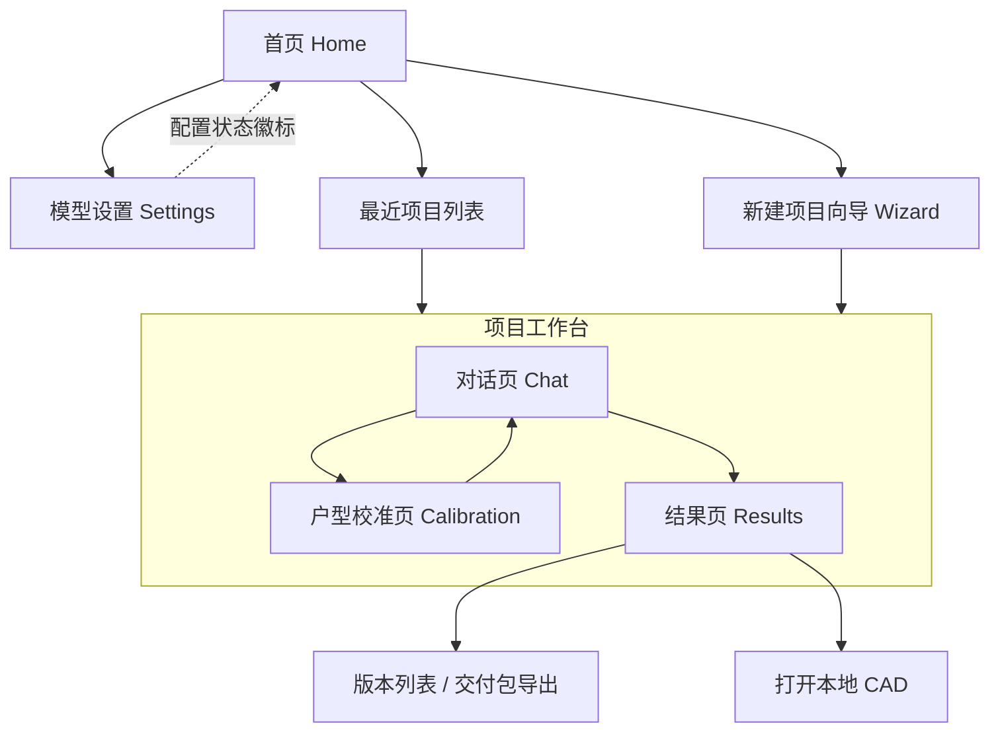
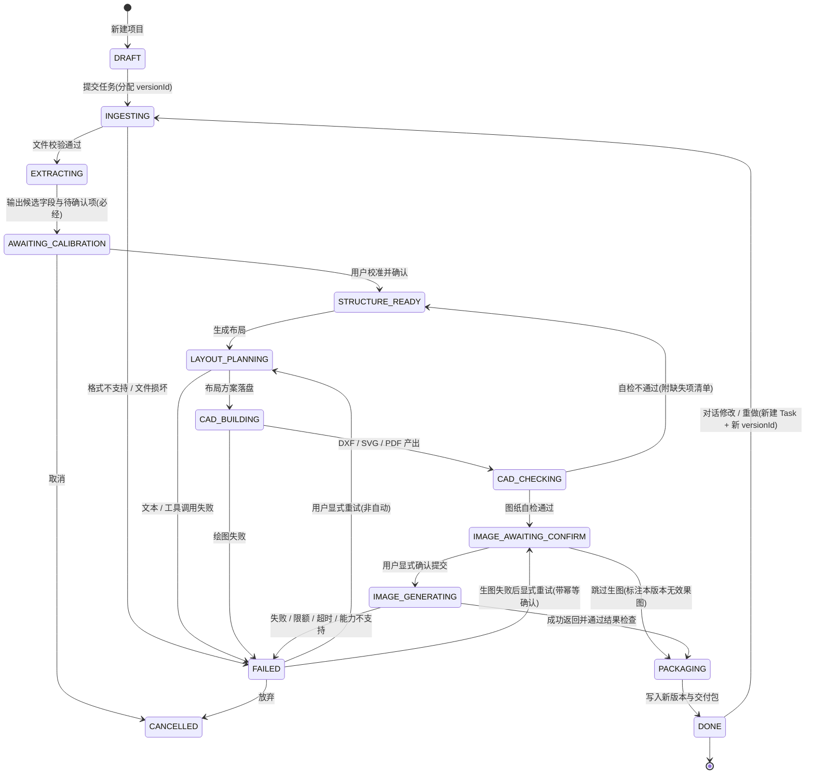

# PRD：本地装修设计 Agent（Windows 桌面版）· 简单 PRD

> 文档版本 v1.0 ｜ 作者：产品经理 许清楚 ｜ 语言：中文
> 本文档为**简单 PRD**，不含竞品分析与许可证尽调（由架构师在 `docs/RESEARCH.md` 负责），不做技术选型。
> 1.1 裁决（2026-11-07）：用户可见文案不使用实现术语（Skill / JSON / YAML / MCP / 终端 / Agent Runtime）；3.5 格式表表述以本条为准。

---

## 0. 项目信息

| 项 | 内容 |
| --- | --- |
| Language | 中文（界面、提示、错误文案、交付说明） |
| Programming Language | UI 默认 Vite + React + MUI + Tailwind CSS；桌面容器、本地运行时、CAD 与模型调用层由架构师依据已核实环境选定，本 PRD 不指定 |
| Project Name | `local_interior_design_agent` |
| 产品形态 | 独立运行的 Windows 本地桌面软件，无公网后端；目标形态为可安装，**第一版以 win-unpacked 免安装目录交付（免安装、可直接启动）**，NSIS/portable 安装包两次 EXIT=1、尚未产出并待验证（见 0.3） |
| 付费与模型 | 客户（装修公司）购买软件，模型费用由客户自己的 API 账户承担（BYOK）；软件不做代付 / 余额 / 充值 / 模型中转 |
| 客户机前置依赖 | **无**。客户不需要另装 Codex / Claude Code / WorkBuddy / CC Switch / Codex++ 等任何外部 Agent 工具 |
| 使用者画像 | 装修公司员工：量房回来、会用普通桌面软件；**不懂** MCP、Skill、JSON、YAML、终端、Agent Runtime |

### 0.1 原始需求复述

装修公司量房并收集业主需求后，员工在本机打开软件，上传户型资料与参考效果图（户型图、CAD 文件、PDF、现场照片、风格参考图），填写或通过对话补充需求；由内置专业 Agent 分析资料与需求，调用本机 CAD 能力生成装修平面方案，再调用客户配置的图片模型生成效果图；员工检查后交付可编辑 CAD 文件与效果图，并可继续对话修改方案、重新出图、导出交付包。软件必须如实说明 CAD 与效果图的能力边界，进度必须反映真实任务状态。

### 0.2 用户主流程（链路基线）

| 步 | 动作 | 产出 |
| --- | --- | --- |
| F1 | 量房并收集业主需求（软件外） | 户型资料、需求记录 |
| F2 | 员工打开软件，新建项目 | 项目目录、版本目录 |
| F3 | 上传户型资料与参考效果图 | 已校验文件清单 |
| F4 | 填写需求 / 对话补充 | 8 项需求字段（含从资料提取的候选值） |
| F5 | Agent 分析资料与需求 | 候选字段 + 待确认项 |
| F6 | **用户校准 + 人工修正**（正式必经步骤） | 版本化结构化平面数据 |
| F7 | 调用本机 CAD 能力生成平面方案 | 可编辑 DXF（+ SVG/PDF 预览） |
| F8 | 调用客户配置的图片模型生成效果图 | PNG/JPG + 生图记录 |
| F9 | 员工检查、继续对话修改 / 重做 | 新版本（旧版本保留） |
| F10 | 导出 CAD 与效果图交付包 | ZIP 交付包（不含密钥） |

### 0.3 已核实环境事实 → 范围收敛（仅用于收敛，不构成选型）

| 已核实事实 | 对 PRD 范围的硬约束 |
| --- | --- |
| 本机未安装任何建筑 CAD（AutoCAD / ZWCAD / 浩辰 / BricsCAD / FreeCAD 均无），4 个 CAD COM ProgID 全部未注册；ezdxf / win32com 未安装 | V1 **不承诺**真实 AutoCAD COM 自动化与原生 DWG 读写；V1 可交付的可编辑 CAD 格式为**程序化生成的 DXF**（可附 SVG/PDF 预览） |
| 程序化生成 DXF/SVG/PDF 已在本机实测跑通（字节级确定性）；Electron 应用构建已产出 win-unpacked 免安装目录（246 MB），上游 GUI 交互冒烟 EXIT=0（本产品自身 GUI 冒烟未验证）；但 nsis/portable 安装包两次 EXIT=1、尚未产出 | 「可编辑方案出图」具备可行性写入 P0；**第一版以 win-unpacked 免安装目录交付，NSIS/portable 安装包列为待验证，不作为 DoD 通过项**；具体库由架构师定 |
| 本机 Node 22.22.2；部分候选框架要求 Node ≥ 24.9 / 24.22 且本机构建未跑通；cargo / Rust 缺失；pnpm 默认 corepack 失败、pnpm@9.14.2 可用 | 运行时与打包方案由架构师收敛；PRD 只要求「第一版 win-unpacked 免安装目录可直接运行、员工零配置」；**NSIS/portable 安装包列为待验证，不作为 DoD 通过项** |
| 无客户 API Key，生图无法真实联调 | 生图链路 V1 只能做到「**可配置、可调用、待联调**」；不把真实出图质量写入 DoD |
| **没有**任何候选开源项目能可靠把上传的户型图片 / PDF 自动转成带尺寸的结构化平面 | 「用户校准 + 人工修正」是 V1 **正式必经步骤**，不设计「自动识别成功」路径，不虚构识别率 |

---

## 1. 产品目标与成功标准

### 1.1 三个正交目标

| 编号 | 目标 | 衡量口径 |
| --- | --- | --- |
| **G1 零门槛** | 员工打开软件即可在图形界面走完 F2–F10（第一版为免安装目录，无需安装），不接触任何外部 Agent 工具与配置格式 | 全流程走查：打开终端 0 次、手工编辑 JSON/YAML 0 次、界面出现 MCP / Skill / Agent Runtime / 命令行字样 0 处 |
| **G2 真实可信** | 每个进度状态、每份成果都对应真实任务事件与可核对文件；CAD 与效果图边界在界面和交付说明中如实写明 | 任务状态变更与本地任务日志 1:1；定时驱动的假进度 0 条；交付包内含边界声明；「自动识别户型成功」类文案 0 处 |
| **G3 资产可控** | 客户自带模型与费用、数据留在本机、密钥不外泄、人工编辑不被覆盖 | 密钥明文自检命中 0；连续 2 次生成后人工编辑文件哈希不变；每次生成产生独立版本目录 |

### 1.2 成功标准（可度量）

| 编号 | 指标 | 目标值 |
| --- | --- | --- |
| S1 | 首次启动 → 完成两组模型配置 → 拿到 5 项能力测试结论，全程在软件内完成 | 1 次走查通过 |
| S2 | 状态面板每次变化都能在本地任务日志找到对应事件 | 匹配率 100% |
| S3 | 交付 DXF 可被第三方 DXF 阅读器打开，且含墙 / 门窗 / 家具 / 图层 / 标注 / 必要尺寸 | 6 类元素齐全 |
| S4 | 项目文件、导出包、日志、Agent 对话中 API Key 明文出现次数 | 0 |
| S5 | 阻塞态（尺寸 / 比例 / 结构墙不确定）真实停住且不自动推进 | 100% 触发并停住 |
| S6 | 生图失败 / 超时后自动重复提交付费请求次数 | 0 |
| S7 | 越权请求（项目路径外 / 任意命令 / 任意脚本）被拒绝并提示 | 100% |

### 1.3 Definition of Done（逐条可验收）

| ID | 验收项 | 验收方法 | 归属 |
| --- | --- | --- | --- |
| DoD-1 | 第一版以 win-unpacked 免安装目录在干净 Windows 本机直接启动，无需预装任何 Agent 工具、无需手工改配置文件；**NSIS/portable 安装包不作为 DoD 通过项** | 免安装目录启动走查（本产品自身 GUI 冒烟未验证） | 免安装目录 ✅；安装包待验证 |
| DoD-2 | 两组模型配置可填 / 可改 / 可保存；5 项能力测试各自返回「通过 / 不支持 / 失败原因」 | 用模拟端点 + 故意填错 Key 验证结论展示 | 真实端点待联调（无 Key） |
| DoD-3 | 新建项目并导入至少 1 张户型图 + 1 份参考效果图；向导 8 字段可见，≥1 字段带「从资料提取」候选值及来源标注 | 界面逐项核对 | V1 可实现 |
| DoD-4 | 提交后状态机依次经过：读取资料 → 解析资料 → **等待校准（真实停住）** → 人工确认 → 生成布局 → 调用 CAD → 检查图纸 → 生图提交确认 → 生成效果图 → 整理交付 | 对照任务日志逐状态核对，无定时假进度 | 生图段待联调 |
| DoD-5 | 产出 DXF 满足 S3；每次生成写入新版本目录；人工编辑过的文件不被覆盖 | 连续生成 2 次 + 文件哈希比对 + 第三方阅读器打开 | V1 可实现 |
| DoD-6 | 生图记录含：对应 CAD 版本、输入图片、用户提示、模型名、时间；不含 API Key | 打开记录文件 + 全文检索 Key 片段 | V1 可实现 |
| DoD-7 | 未配置 / 无效 Key / 429 / 超时 / 端点不支持图像能力时，界面给出可读错误，且不产生重复收费请求 | 模拟错误注入 + 幂等记录核对 | V1 可实现 |
| DoD-8 | Agent 请求项目路径外访问或任意命令 / 脚本执行时被拒绝并在界面提示 | 构造越权请求 | V1 可实现 |
| DoD-9 | CAD 边界声明（不改名 DWG、不承诺整套施工图、不承诺自动识别、效果图不承诺几何一致）在界面与交付说明中可核对 | 文案逐条核对 | V1 可实现 |
| DoD-10 | 「真实 AutoCAD COM / DWG 原生读写」「真实客户生图 API 效果」与「NSIS/portable 安装包」明确标注为待联调 / 待验证，**不计入 V1 验收通过项** | 文档核对 | 待联调 / 待验证 |

---

## 2. 用户故事（员工视角，覆盖主流程与失败 / 重试）

| ID | 用户故事 | 覆盖场景 | 验收线索 |
| --- | --- | --- | --- |
| US-1 | 作为员工，我希望量房回来把户型图、PDF、现场照片和风格参考图一次性拖进软件，填完需求就能拿到可编辑 CAD 和效果图，以便直接整理给业主 | 主流程 F2–F10 | DoD-3 / DoD-5 |
| US-2 | 作为员工，我希望软件把资料里能看出的面积、尺寸、房间、风格先带出来并标明「来自哪份资料」，以便我少打字、也不把猜测当事实 | 减少重复输入 | 候选值带来源标注，必须人工确认 |
| US-3 | 作为员工，当比例不清、尺寸缺失、承重墙拿不准时，我希望软件**明确停下来**让我补漏薄内墙、合并房间、核对洞口与尺寸，而不是硬生成一张错图 | 校准 / 阻塞 | DoD-4 / S5 |
| US-4 | 作为员工，我希望在对话里继续说明要求、看到每一步真实在做什么、要求改布局或重做，并且旧成果还在，以便反复比较不丢版本 | 对话 / 重做 / 版本 | DoD-5 |
| US-5 | 作为员工，我希望用公司自己的 API 账号配置文本模型和生图模型、分别测试能力，遇到无效 Key / 限额 / 超时能看懂错在哪、知道该找谁 | 模型配置 / 失败 | DoD-2 / DoD-7 |
| US-6 | 作为员工，我希望在我用的 OpenAI 兼容端点不支持图片生成或图片编辑时，软件明确告诉我「这项能力测试结果不支持」并禁用对应功能，而不是点了没反应或静默失败 | 端点能力差异 | DoD-2 / 4.8 矩阵 |
| US-7 | 作为员工，我希望重试生图前软件先告诉我上一次是成功、失败还是结果未知，并让我明确确认，避免公司账户被重复扣费 | 失败 / 重试 / 收费 | DoD-7 / S6 / 4.4 幂等规则 |
| US-8 | 作为员工，我希望 Agent 只在我这个项目文件夹里干活；它若想访问别处或执行命令，软件能拦下并告诉我 | 权限确认态 | DoD-8 / S7 |
| US-9 | 作为员工，我希望在结果页预览图纸和效果图、打开本机 CAD、查看项目文件、导出交付包，并且软件如实告诉我效果图不能当施工依据 | 交付 / 边界 | DoD-9 / 4.3 结果页 |

---

## 3. 需求池（P0 / P1 / P2）

### 3.1 P0：最小真实链路（必须打通，缺一不可）

**链路基线（P0 逐段映射）：**

```
①模型配置 → ②新建项目 → ③导入资料 → ④提交需求 → ⑤生成或校准户型
   → ⑥调用本机 CAD 能力生成可编辑方案 → ⑦导出 CAD
   → ⑧用客户配置的生图 API → ⑨保存效果图与交付文件
```

> 状态列说明：**✅ V1 可实现并验收** ／ **⚠️ 可配置、可调用、待联调**（缺客户 API Key 或缺本机建筑 CAD，只交付可配置与可调用能力，不承诺真实联调结果）。

| ID | 链路环节 | 需求（must） | 可核对点 | 状态 |
| --- | --- | --- | --- | --- |
| P0-01 | 前置 | 第一版交付 win-unpacked 免安装目录（可直接启动，无需安装）；启动后无需安装任何外部 Agent 工具，UI 不暴露 MCP / Skill / JSON / YAML / 终端 / Agent Runtime；**NSIS/portable 安装包待验证、不作为 DoD 通过项** | DoD-1 | 免安装目录 ✅；安装包待验证 |
| P0-02 | ① | 模型设置分**两组**：文本 / 视觉模型、图片生成模型；每组含 Provider 或接口类型、API Base URL、API Key、模型名称、必需能力说明、测试连接按钮 | 字段可填可改可持久化 | ⚠️ 真实端点待联调（无 Key） |
| P0-03 | ① | URL / Key / 模型名 / 服务商**不得硬编码**，客户可自行更改；密钥存本机安全凭据存储 | DoD-2 / S4 | ✅（存储实现由架构师定） |
| P0-04 | ① | **分别**测试 5 项能力：文本生成、工具调用、图片理解、图片生成、图片编辑；各自独立结论，按结论启用 / 禁用功能；不假设所有 OpenAI 兼容端点都支持图像能力 | 4.8 能力矩阵 | ⚠️ 结论展示可验收；真实端点待联调 |
| P0-05 | ① | API Key 不明文进入日志、Agent 对话、项目文件、导出包；导出前做明文自检 | S4 / DoD-6 | ✅ |
| P0-06 | ② | 首页：新建项目、最近项目、模型设置入口；显示模型配置状态徽标（未配置 / 部分可用 / 全部可用） | 4.3 首页 | ✅ |
| P0-07 | ③ | 项目向导按阶段明确支持格式与处理方式（3.5 表）；上传时校验格式、可读性、去重 | 3.5 表逐行可核对 | ✅ |
| P0-08 | ④ | 需求字段含面积、尺寸、层高、房间用途、居住人数、风格、预算、特殊要求（3.4 表）；尽量从已提供资料提取**候选值**，标注来源，减少重复输入；候选值必须人工确认 | DoD-3 | ✅ |
| P0-09 | ⑤ | **用户校准 + 人工修正为正式必经步骤**：设定比例、补漏薄内墙、合并房间、核对洞口与尺寸、确认结构墙判断 | 该步骤不可跳过 | ✅ |
| P0-10 | ⑤ | 尺寸缺失 / 比例不清 / 结构墙不确定时，任务**阻塞在等待确认态**并列出具体待确认项，不自动推进、不虚构自动识别成功 | DoD-4 / S5 | ✅ |
| P0-11 | ⑥ | 调用本机 CAD 能力生成**原始结构图 + 平面布置方案**：墙、门窗、家具、图层、标注、必要尺寸；输出可编辑 DXF（+ SVG/PDF 预览） | DoD-5 / S3 | ✅ |
| P0-12 | ⑥ | 图纸自检：图层完整性、标注与尺寸存在性、DXF 可解析；不通过则回退并列出缺失项 | 4.4 状态机 | ✅ |
| P0-13 | ⑥ | Agent 工具权限最小范围：仅当前项目路径 + 明确绘图操作白名单；禁用任意系统命令、任意脚本执行、未受控绝对路径读写 | DoD-8 | ✅ |
| P0-14 | ⑦ | 导出可编辑 CAD（DXF）；**不得把 DXF 改后缀称 DWG**；交付说明写明 CAD 边界 | DoD-9 | ✅ |
| P0-15 | ⑧ | 装修效果图 Skill 作为工作流指令（4.7）；调用**客户配置的**图片生成模型，按能力结论选择生成 / 编辑动作；优先把 CAD 视图或程序生成的布局图作为参考输入 | 4.7 逐条 | ⚠️ 可配置、可调用、待联调（无 Key，无法验证图像质量） |
| P0-16 | ⑧ | 防重复收费：提交前显式确认（显示模型 / 输入 / 计费提示）、每次外部请求绑定唯一幂等键、禁止自动重试、超时结果未知时不允许直接重提 | DoD-7 / S6 | ✅（可用模拟端点验收） |
| P0-17 | ⑧ | 保存生图记录：对应 CAD 版本、输入图片、用户提示、模型名、时间；**不保存 API Key** | DoD-6 | ✅ |
| P0-18 | ⑨ | 结果页预览图纸与效果图；每次生成写入**新版本**，不自动覆盖或破坏人工编辑；导出交付包 | DoD-5 | ✅ |
| P0-19 | 全程 | 对话：继续说明要求、查看生成进度、修改布局、重做成果；每次重做生成新版本 | 4.4 状态机 | ⚠️ 可调用、待联调（依赖文本 / 工具调用模型） |
| P0-20 | 全程 | 真实任务状态机与进度（4.4）：禁止假固定进度条、禁止按时间递增百分比、禁止 ETA | S2 / DoD-4 | ✅ |
| P0-21 | 全程 | 错误态：无效 Key / 401 / 403 / 429 限额 / 超时 / 5xx / 能力不支持 / 结果校验失败，界面清楚报错并给出下一步（4.5） | DoD-7 | ✅ 错误展示可验收；真实错误码待联调 |
| P0-22 | 全程 | CAD 与效果图边界声明文案在 UI 与交付说明中可见：V1 仅原始结构图 + 平面布置方案、不生成整套施工图、不承诺户型图自动识别、不承诺效果图与 CAD 几何一致 | DoD-9 | ✅ |

#### 3.1.1 「可配置、可调用、待联调」清单（必须显式标注，不得计入验收通过）

| 项 | 受限于 | V1 交付到什么程度 | V1 **不**承诺 |
| --- | --- | --- | --- |
| P0-02 / P0-04 真实端点连通与 5 项能力真实结论 | 无客户 API Key | 配置界面、字段持久化、能力测试按钮、结论展示与按结论禁用逻辑；可用模拟端点验证交互 | 真实服务商的连通性、真实能力结论 |
| P0-15 / P0-19 真实生图与 Agent 对话编排 | 无客户 API Key | 生图 Skill 工作流、请求组装、调用代码路径、生图记录、防重复收费；界面可触发 | 真实出图效果、效果图风格准确度、Agent 编排质量 |
| P0-21 真实错误码 | 无客户 API Key | 错误分类映射与可读文案，可用注入错误验证 | 真实服务商返回的各类错误码 |
| 真实 AutoCAD COM / 原生 DWG 读写 | 本机无任何建筑 CAD、4 个 COM ProgID 未注册、ezdxf/win32com 未安装 | **V1 不做**（见 5.3）；P0 只用程序化 DXF 满足「可编辑 CAD」 | DWG 读写、CAD 软件联动 |
| 「打开本地 CAD」与 DWG 导入适配 | 同上 | 降级到 P1；V1 仅提供「导出 DXF + 无 CAD 时的提示」 | 在客户机 CAD 中直接打开编辑 |
| NSIS / portable 安装包（P0-01 / DoD-1 / DoD-10） | electron-builder 两次 EXIT=1（宿主 `type:module` 污染图标脚本；NSIS 报 `!include: could not open FileAssociation.nsh`），安装包未产出 | 第一版以 win-unpacked 免安装目录交付（246302208 B）；上游 GUI 交互冒烟 EXIT=0，**本产品自身 GUI 冒烟未验证**；安装包列为待验证、不作为 DoD 通过项 | 安装包已产出 / 已验证、本产品 GUI 冒烟通过 |

### 3.2 P1（Should have）

| ID | 需求 | 可核对点 |
| --- | --- | --- |
| P1-01 | 结果页「打开本地 CAD」：调用系统关联程序；本机无 CAD 时提示「请安装支持 DXF 的 CAD 或用 DXF 阅读器查看」，不假装已打开 | 无 CAD 环境下文案正确 |
| P1-02 | DWG 上传引导：提示「请用 CAD 另存为 DXF 后导入」；为后续适配预留入口，V1 不解析 DWG | 上传 DWG 时不崩溃、提示明确 |
| P1-03 | 版本对比视图：并排查看两版图纸 / 效果图，标注「本版本无效果图」的情况 | 版本列表可选两版对比 |
| P1-04 | 效果图与 CAD 视图并排对照 + 「图像模型可能改变结构与尺寸」提示常驻 | 结果页可见 |
| P1-05 | 交付包模板：含方案说明、CAD 边界声明、版本记录、脱敏自检报告 | 导出 ZIP 内容清单 |
| P1-06 | 项目模板与常用需求预设（风格 / 房间用途字典） | 新建项目可套用 |
| P1-07 | 图片编辑（基于 CAD 视图 / 参考图）动作接入；端点能力测试不通过时禁用 | 依赖 4.8 矩阵结论 |
| P1-08 | 诊断日志导出（自动脱敏，导出前再次自检 Key 明文） | 导出文件全文检索 Key = 0 |

### 3.3 P2（Nice to have，均不引入公网后端）

| ID | 需求 | 备注 |
| --- | --- | --- |
| P2-01 | 轻量 3D / 全景预览 | 仅本地渲染，是否可行由架构师评估 |
| P2-02 | 施工图扩展（水电、立面、节点、材料表） | 明确不在 V1，见 5.4 |
| P2-03 | 多视角批量生图（客厅 / 主卧等）与每版本张数上限 | 直接影响费用与状态机，需先确认 Q11 |
| P2-04 | 内置轻量 DXF 查看器（客户机无 CAD 时的兜底） | 工作量由架构师评估 |
| P2-05 | 多语言界面、批量项目管理 | — |

### 3.4 需求字段表（8 项， P0-08）

| 字段 | 必填性 | 来源 | 校验与缺失处理 |
| --- | --- | --- | --- |
| 面积 | 建议必填 | 资料提取候选 / 用户填写 | 数值 > 0；与校准后尺寸明显不一致时提示核对，不自动改写 |
| 尺寸（开间 / 进深 / 各房间尺寸） | 校准后必填 | 校准步骤 | 缺失 → 阻塞 `AWAITING_CALIBRATION`；单位（mm / m）见 Q6 |
| 层高 | 建议 | 用户填写 / 资料候选 | 缺失时是否允许先出平面方案见 Q5 |
| 房间用途 | 必填 | 资料候选 + 用户确认 | 至少 1 个房间；支持合并房间（P0-09） |
| 居住人数 | 建议 | 用户填写 | 非负整数 |
| 风格 | 生图必填 | 用户填写 / 参考图线索 | 缺失 → 生图提交确认态提示，不静默补默认值 |
| 预算 | 可选 | 用户填写 | 数值 / 区间；V1 仅作方案说明文本，**不产出造价清单**（见 5.4） |
| 特殊要求 | 可选 | 用户填写 / 对话补充 | 自由文本，进入 Agent 需求说明与生图提示 |

> 所有「从资料提取」的值一律标记为**候选值 + 来源文件 + 待确认**，确认前不得作为事实写入结构化平面数据。

### 3.5 按阶段的支持格式与处理方式（P0-07 / P0-14 / P0-22）

| 阶段 | 输入 / 格式 | V1 处理方式 | 产出 | 诚实边界（必须写进 UI / 交付说明） |
| --- | --- | --- | --- | --- |
| ③ 资料上传 | 户型图 / 现场照片：JPG、PNG、HEIC、WEBP | 校验可读性与去重、生成缩略图、作为**校准底图**与视觉线索 | 底图 + 图片元数据 | **不自动矢量化**；图片识别只给候选线索，不产出带尺寸的结构化平面 |
| ③ | PDF（户型图 / 量房草图） | 逐页渲染为图像 + 抽取文本层；若含矢量线条，仅作为校准参考 | 页图 + 文本片段 | 比例未知，必须人工校准；不承诺自动提取尺寸 |
| ③ | DXF | 解析图层 / 线段，作为结构化**候选**输入 | 候选墙 / 门窗线段 | V1 可读 DXF；**不写 DWG** |
| ③ | DWG | **不解析**；提示「请用 CAD 另存为 DXF 后导入」 | 提示信息 | 不声称任何 DXF 库能直接读写 DWG |
| ③ | 参考效果图：JPG、PNG | 作为效果图风格 / 材质 / 光照的参考输入 | 参考图引用 | 图像模型可能改变结构与尺寸 |
| ④ 需求 | 表单输入 + 对话文本 | 从已上传资料抽取候选值（面积 / 尺寸 / 房间 / 风格），标注来源 | 8 字段候选值 | 候选值须人工确认，不自动当事实 |
| ⑤ 校准 | 底图 + 候选线段 | **人工**补漏薄内墙、合并房间、核对洞口与尺寸、设定比例 | 版本化结构化平面数据 | 正式必经步骤，不可跳过 |
| ⑥ 出图 | 结构化平面 + 布局方案 | 程序生成 DXF / SVG / PDF：墙、门窗、家具、图层、标注、必要尺寸 | 可编辑 DXF + 预览 | 仅原始结构图 + 平面布置方案；不生成整套施工图 |
| ⑧ 生图 | CAD 视图 / 程序生成布局图 + 参考图 + 需求描述 | 调用客户配置的图片生成 / 编辑能力 | PNG/JPG + 生图记录 | **不承诺**透视效果图与 CAD 几何 / 尺寸一致 |
| ⑨ 交付 | 上述产物 | 写入新版本目录 + 导出 ZIP 交付包 | 交付包（不含密钥） | 不覆盖人工编辑 |

---

## 4. UI 设计稿

### 4.1 信息架构



### 4.2 页面清单与基础布局

| 页面 | 入口 | 基础布局 | 核心元素 |
| --- | --- | --- | --- |
| P-1 首页 Home | 启动默认页 | 顶部：产品名 + 模型配置状态徽标；左：主操作卡「新建项目」；右：最近项目卡片列表 | 新建项目、最近项目（项目名 / 客户 / 更新时间 / 当前阶段徽标）、模型设置入口 |
| P-2 模型设置 Settings | 首页 | 上下两个配置组 + 底部能力测试矩阵 | 两组字段表、测试连接按钮、5 项能力结论徽标、安全说明 |
| P-3 项目向导 Wizard | 首页「新建项目」 | 左侧步骤条（5 步）+ 右侧内容区 + 底部上一步 / 下一步 | 基本信息 → 资料上传（格式表） → 需求确认（8 字段 + 候选值） → 校准与人工修正 → 确认提交 |
| P-4 户型校准页 Calibration | 向导第 4 步 / 阻塞态跳转 | 左：底图与候选线段；右：待确认项清单 + 结构化数据编辑区 | 比例设定、补漏薄内墙、合并房间、洞口与尺寸核对、结构墙判断确认 |
| P-5 对话页 Chat | 项目工作台默认 | 左：消息流；右：任务状态面板（可展开日志） | 补充要求输入框、修改布局 / 重做成果按钮、真实阶段进度、待确认卡片 |
| P-6 结果页 Results | 任务完成 / 版本列表 | 上：图纸与效果图预览；下：版本列表 + 操作区 | 预览、「打开本地 CAD」、「查看项目文件」、「导出交付包」、边界声明 |
| P-7 权限确认对话框 | 见 4.6 | 模态框 | 允许范围、禁止项、允许 / 拒绝、记住本次选择 |

### 4.3 每页关键状态

| 页面 | 状态 | 界面表现 |
| --- | --- | --- |
| P-1 首页 | 模型未配置 / 部分可用 / 全部可用 | 徽标变色；「新建项目」在未配置时仍可进入，但提交任务前引导去 P-2 |
| P-1 首页 | 最近项目空 | 空状态插画 + 「新建项目」主按钮，无假数据 |
| P-2 设置 | 未测试 / 测试中 / 通过 / 不支持 / 失败（含原因） | 每项能力独立徽标；不支持明确写出「该端点不支持 X 能力」 |
| P-3 向导 | 上传中 / 格式不支持 / 提取到候选值 / 无候选值 | 格式表按 3.5 显示处理方式；不支持的文件逐条列出原因，不静默丢弃 |
| P-3 向导 | 确认提交 | 显示「将执行的操作、将调用的模型组、费用由公司 API 账户承担、仅访问本项目路径」；需用户点击确认 |
| P-4 校准 | 待确认项 > 0（阻塞） | 逐条列出：比例未知 / 某尺寸缺失 / 某薄内墙待补 / 洞口待核对 / 结构墙判断待确认；「确认并继续」在必填项完成前不可用 |
| P-5 对话 | 任务进行中 / 等待用户操作 / 失败 / 完成 | 右侧状态面板与 4.4 状态机同步；阻塞态显示「等待你确认」而非百分比 |
| P-5 对话 | 重做 | 明确提示「将生成新版本，旧版本保留」，需确认 |
| P-6 结果 | 有图纸无效果图 / 有两者 / 多个版本 | 「本版本无效果图」显式标注；版本列表显示版本号、时间、对应 CAD 版本、生图模型名 |
| P-6 结果 | 打开本地 CAD 失败（本机无 CAD） | 提示「未检测到可用 CAD 程序，可导出 DXF 后用 DXF 阅读器打开」，不显示成功态 |

### 4.4 真实任务进度状态机（P0-20）

**任务对象（可落盘、可核对）：**
`Task { taskId, projectId, versionId, state, stateEnteredAt, subProgress{done,total,unit}, events[], errorCode, idempotencyKey, chargeSubmittedCount }`



**状态表（界面文案与真实依据一一对应）：**

| 状态码 | 界面文案 | 真实进度依据（可核对） | 类型 | 可取消 |
| --- | --- | --- | --- | --- |
| `DRAFT` | 草稿，尚未提交 | 无 | 初始 | — |
| `INGESTING` | 读取资料（已校验 3/7 个文件） | 已校验文件数 / 总文件数 | 计算 | 是 |
| `EXTRACTING` | 解析资料（已解析 3/7 个文件） | 已解析文件数 / 总文件数；产出候选字段条数 | 计算 | 是 |
| `AWAITING_CALIBRATION` | 等待尺寸确认：N 项待确认 | 待确认项清单长度（**不显示百分比**） | **阻塞·等用户** | 是 |
| `STRUCTURE_READY` | 户型已确认（结构化数据 vN） | 落盘的结构化平面数据版本号 | 已完成 | — |
| `LAYOUT_PLANNING` | 生成布局（已完成 4/6 个房间） | 已处理房间数 / 总房间数 | 计算 / 外部调用 | 是 |
| `CAD_BUILDING` | 调用 CAD（墙体→门窗→家具→标注→尺寸） | 5 个真实写入子阶段的完成计数 | 计算 | 是 |
| `CAD_CHECKING` | 检查图纸 | 自检项通过数 / 总项数（图层、标注、尺寸、可解析） | 计算 | 是 |
| `IMAGE_AWAITING_CONFIRM` | 等待你确认生图提交（将调用：模型名 / 输入 / 费用提示） | 幂等键已生成、尚未发出请求 | **阻塞·等用户** | 是 |
| `IMAGE_GENERATING` | 已提交生图请求，等待返回 | 已提交请求数（1）；**不显示百分比、不显示 ETA** | 外部等待 | 是（结果可能未知） |
| `PACKAGING` | 整理交付（写入新版本与交付包） | 已写入文件数 / 总文件数 | 计算 | 否 |
| `DONE` | 完成：版本 vN 已生成 | 版本目录与交付包路径 | 终态 | — |
| `FAILED` | 失败：可读原因 + 下一步操作 | errorCode + 失败状态 + 幂等键 | 终态 | — |
| `CANCELLED` | 已取消（已生成文件保留为草稿版本） | 取消事件 + 保留文件清单 | 终态 | — |

**进度 UI 规则（硬性）：**
1. 只显示「当前阶段名 + 阶段内真实计数」，**不得**出现按时间递增的百分比、固定进度条动画或 ETA。
2. 阻塞态（等待尺寸确认 / 等待生图提交确认）进度条停住，显示「等待你操作」。
3. 已完成阶段打勾、未完成阶段显示「未开始」；每次状态变更写入本地任务日志，用户可展开对照（日志脱敏）。
4. 阶段内计数必须来自真实事件（文件数、房间数、自检项数、写入文件数），不允许用 `setInterval` 造数。

**重试与幂等规则（防重复收费，P0-16）：**
1. 每个外部付费请求绑定 `taskId + stepId + idempotencyKey`；**提交前**先落盘「已提交」记录（含时间、模型名、输入哈希、请求 ID）。
2. `FAILED` 后的重试按钮仅接受**用户显式点击**，弹窗必须显示上次结果（成功 / 失败 / **结果未知**）与「可能已产生费用」提示。
3. 超时 → 结果未知 → **不允许直接重提**；先提供「检查结果 / 放弃并新建任务」选项。
4. **禁止自动重试、禁止定时器补发、禁止在循环中重新提交。**
5. 端点能力测试不通过时，不发出任何生图请求（见 4.8）。

### 4.5 错误态（P0-21）

| 类别 | 触发 | 界面文案要点 | 允许操作 | 收费风险 | 处理 |
| --- | --- | --- | --- | --- | --- |
| 未配置模型 | 提交任务时配置缺失 | 「尚未配置文本 / 图片模型，请先在模型设置中完成配置与能力测试」 | 前往设置 / 保存草稿 | 无 | 不发出请求 |
| 无效 Key / 401 / 403 | 鉴权失败 | 「API Key 无效或无权限（不显示 Key 内容），请检查模型设置」 | 前往设置 / 显式重试 | 无 | 日志脱敏，记录错误码 |
| 429 限额 | 服务端限流 | 「接口返回限额（429），请稍后再试或更换模型配置」 | 稍后显式重试 / 改配置 | 可能已产生 | **不自动重试** |
| 超时 | 请求超时 | 「请求超时，结果未知，未自动重发以避免重复计费」 | 检查结果 / 放弃 / 显式确认后重试 | **未知** | 保留幂等键，禁止直接重提 |
| 5xx / 网络不可达 | 服务异常 | 「模型服务暂时不可用，请稍后重试或检查 API Base URL」 | 显式重试 / 改配置 | 未知 | 保留幂等键 |
| 能力不支持 | 能力测试结论为不支持 / 调用返回能力错误 | 「当前端点不支持【图片生成 / 图片编辑 / 工具调用 / 图片理解】，请更换 Provider 或接口类型」 | 前往设置 / 仅交付 CAD | 无 | 禁用对应功能，不静默失败 |
| 结果校验失败 | 返回内容不可解码 / 未通过检查 | 「生成结果未通过检查（原因），未写入版本」 | 修改提示 / 重做 | 可能已产生 | 不落盘为正式版本 |
| 校准阻塞 | 比例 / 尺寸 / 结构墙不确定 | 「N 项需要你确认：…（逐条列出）」 | 进入校准页 | 无 | 停在阻塞态 |
| 权限越界 | 请求项目路径外 / 命令 / 脚本 | 「已拒绝：Agent 请求了项目路径外的访问 / 命令执行」 | 查看请求详情 / 继续 | 无 | 写审计日志 |
| 图纸自检不通过 | 缺图层 / 标注 / 尺寸 | 「图纸检查未通过：缺失项 …」 | 回到校准 / 重新生成 | 无 | 附缺失项清单回退 |

> 所有错误文案用员工能懂的中文，给出「下一步做什么」；禁止只显示原始堆栈或英文错误码了事。错误对象中的 Key、Authorization 头一律脱敏。

### 4.6 权限确认态（P0-13）

| 项 | 规定 |
| --- | --- |
| 触发时机 | 首次启动任务；每次请求扩大访问范围；请求不在白名单内的绘图操作 |
| 弹窗内容 | 本次允许范围（当前项目**绝对路径**）、允许的绘图操作白名单、明确禁止项：**任意系统命令、任意脚本执行、未受控绝对路径读写** |
| 用户操作 | 「仅本次允许」/「拒绝」；可勾选「记住本次选择」（仅对相同范围生效，扩大范围时重新确认） |
| 拒绝后 | 任务保持原状态，记录审计日志；**不得降级为静默放行** |
| 审计 | 每次工具调用记录：时间、操作类型、目标路径、结果（允许 / 拒绝），写入脱敏日志，可在任务面板查看 |

### 4.7 装修效果图 Skill（功能描述，P0-15）

**定位：它是一份工作流指令，不存密钥、不直接承担安全职责、不直接发起网络请求；网络与凭据由软件运行时按模型设置统一处理。**

Skill 指导 Agent 依次完成：

1. 读取**当前 CAD 版本**与已确认需求，生成效果图说明；把用户上传的参考效果图作为风格 / 材质 / 光照参考。
2. 明确写出：空间、视角、风格、材质、光照，以及**禁止改变的结构**（承重墙、门窗洞口、房间划分、关键尺寸）。
3. 依据 4.8 能力测试结论，选择合适的动作：**图片生成**（文生图）或**图片编辑**（图生图 / 局部重绘）；结论不支持的动作不得选用。
4. 优先把 CAD 视图或程序生成的布局图作为参考输入；**必须同时如实说明**：图像模型可能改变结构和尺寸，**不能承诺透视效果图与 CAD 几何 / 尺寸完全一致**，效果图不作为施工依据。
5. 检查生成结果；结果可疑或未通过检查时**请求人工确认**，不自动写入正式版本。
6. 保存生图记录：对应 CAD 版本、输入图片、用户提示、模型名、时间；**不保存 API Key**。

### 4.8 模型设置字段与能力测试矩阵（P0-02 / P0-04）

**配置字段（两组同构，均可修改、不得硬编码）：**

| 字段 | 文本 / 视觉模型组 | 图片生成模型组 | 说明 |
| --- | --- | --- | --- |
| Provider / 接口类型 | 必填 | 必填 | 可选预设 + 允许自定义；不得写死服务商 |
| API Base URL | 必填 | 必填 | 客户可自行更改 |
| API Key | 必填 | 必填 | 存本机安全凭据存储，界面掩码显示 |
| 模型名称 | 必填 | 必填 | 客户可自行更改 |
| 必需能力说明 | 静态文案 + 实测结论徽标 | 静态文案 + 实测结论徽标 | 说明该组所需图像 / 工具调用能力 |
| 测试连接按钮 | 有 | 有 | 触发该组相关能力测试 |

**5 项能力分别测试（不得假设 OpenAI 兼容端点普遍支持图像能力）：**

| 能力 | 归属组 | 测试动作 | 通过标准 | 不通过时 UI 行为 |
| --- | --- | --- | --- | --- |
| 文本生成 | 文本 / 视觉 | 发送固定短提示 | 返回非空合法文本 | 禁用布局与对话生成，提示更换配置 |
| 工具调用 | 文本 / 视觉 | 发送带 1 个白名单工具的请求 | 返回合规结构化 tool_call | 禁用依赖工具调用的自动化步骤，明确标注「该端点不支持」 |
| 图片理解 | 文本 / 视觉 | 上传测试图并要求描述 | 返回与图片相关的文本 | 资料解析降级为「仅人工填写」，**不假装已识别** |
| 图片生成 | 图片生成 | 固定提示请求一张小图 | 返回可解码图片 | 禁用「生成效果图」，允许仅交付 CAD |
| 图片编辑 | 图片生成 | 测试图 + 编辑提示请求编辑 | 返回可解码图片 | 禁用「基于 CAD 视图 / 参考图编辑」动作 |

> 5 项结论**独立存储、独立展示**，按结论启用 / 禁用功能；测试请求本身也需遵守最小权限与脱敏要求。

---

## 5. 第一版不做什么（逐条可核对）

| ID | 明确不做 | 核对方式 |
| --- | --- | --- |
| 5.1 | 不做公网后端、账号体系、云端代付 / 余额 / 充值 / 模型中转；模型费用全部走客户自己的 API 账户 | 无服务端部署物、无充值 / 余额界面 |
| 5.2 | 不要求也不依赖客户另装 Codex / Claude Code / WorkBuddy / CC Switch / Codex++；员工无需接触 MCP、Skill、JSON、YAML、终端、Agent Runtime | 第一版 win-unpacked 免安装交付目录依赖清单 + 界面文案走查 |
| 5.3 | 不做真实 AutoCAD / ZWCAD / 浩辰 / BricsCAD COM 自动化与原生 DWG 读写；**不把 DXF 改后缀称 DWG**；**不声称任何 DXF 库能直接读写 DWG** | 导出物后缀与说明文档核对 |
| 5.4 | 只做**原始结构图 + 平面布置方案**（墙、门窗、家具、图层、标注、必要尺寸）；不生成整套施工图（水电 / 立面 / 节点 / 大样 / 材料表 / 造价清单） | 交付说明与成果清单核对 |
| 5.5 | 不承诺把上传的户型图片 / PDF 自动转成带尺寸的结构化平面；不做「自动识别成功」的假象、不编造识别率；校准与人工修正是正式必经步骤 | 状态机中 `AWAITING_CALIBRATION` 必经且阻塞 |
| 5.6 | 不承诺透视效果图与 CAD 几何 / 尺寸完全一致；不把效果图当施工依据 | 生图 Skill 说明与结果页常驻提示 |
| 5.7 | 不硬编码任何服务商 URL / Key / 模型名；不假设所有 OpenAI 兼容端点都支持图像能力 | 配置可改 + 5 项能力独立测试 |
| 5.8 | 不自动重试生图请求造成重复收费；不把 API Key 写入日志、Agent 对话、项目文件、导出包 | 幂等记录 + 明文自检 |
| 5.9 | 不覆盖或破坏人工编辑成果（每次生成写新版本） | 版本目录与哈希比对 |
| 5.10 | 不允许任意系统命令、任意脚本执行、未受控绝对路径读写 | 权限确认态与审计日志 |
| 5.11 | 不做竞品分析、许可证尽调与技术选型（由架构师负责）；不在 PRD 内指定第三方库 | 本文档无竞品章节、无选型结论 |

---

## 6. 待确认问题（列给用户，PRD 不代为臆断）

| ID | 问题 | 影响范围 | 需确认方 |
| --- | --- | --- | --- |
| Q1 | 目标客户机是否预装建筑 CAD？若预装，是否需要 V1 就支持「打开本地 CAD / COM 联动」的可选适配（本机无 CAD，无法联调） | P0-14 / P1-01 / 5.3 | 用户 + 架构师 |
| Q2 | 客户实际使用的 API 服务商清单与端点能力（是否支持工具调用 / 图片理解 / 图片生成 / 图片编辑）；是否接受「能力测试不通过即禁用对应功能」 | P0-02 / P0-04 / 4.8 | 用户 |
| Q3 | 图片模型计费方式（按次 / 按尺寸 / 按张）；软件内计费提示与提交确认需要做到多强（影响防重复收费交互） | P0-16 / 4.4 | 用户 |
| Q4 | 户型资料主要来源占比（纸质草图拍照 / PDF / DXF / 业主提供的效果图），决定向导默认阶段与字段提取优先级 | P0-07 / P0-08 / 3.5 | 用户 |
| Q5 | 需求字段的必填规则：层高、预算、居住人数缺失时是否允许先出平面方案；哪些字段可在校准态标「待补」继续 | P0-08 / 3.4 | 用户 |
| Q6 | 尺寸单位默认 mm 还是 m；面积单位与标注格式规范 | 3.4 / 4.4 | 用户 |
| Q7 | 交付包内容清单与命名规范：是否含业主可读方案说明、CAD 边界声明、版本记录、生图记录 | P0-18 / P1-05 | 用户 |
| Q8 | 校准由量房员工完成还是设计师复核；是否需要在软件内留「校准人 / 校准时间」审计字段 | P0-09 / 4.3 | 用户 |
| Q9 | 人工修正的操作形态：软件内置简易墙 / 房间编辑器，还是导出到外部 CAD 修改后回导（V1 工作量差异大） | P0-09 / 4.3 P-4 | 用户 + 架构师 |
| Q10 | 版本保留策略（全部保留 / 最近 N 个 / 手动清理）与磁盘占用上限 | P0-18 | 用户 |
| Q11 | 是否需要多视角批量生图（客厅 / 主卧等）及每版本生图张数上限（影响费用与状态机） | P0-15 / P2-03 | 用户 |
| Q12 | 「打开本地 CAD」兜底：客户机无 CAD 时仅提示安装 DXF 阅读器，还是要内置轻量 DXF 查看器 | P1-01 / P2-04 | 用户 + 架构师 |
| Q13 | 安装包形态：第一版已定为 win-unpacked 免安装目录（NSIS/portable 两次 EXIT=1 未产出）；后续是否仍需 NSIS 安装版 / portable 便携版、是否必须免管理员权限（影响凭据存储位置与自动更新方案） | P0-01 / P0-03 | 用户 + 架构师 |
| Q14 | 界面语言是否仅中文；交付说明是否需要业主可读版本（简化术语） | 0 项目信息 / 5.6 | 用户 |
