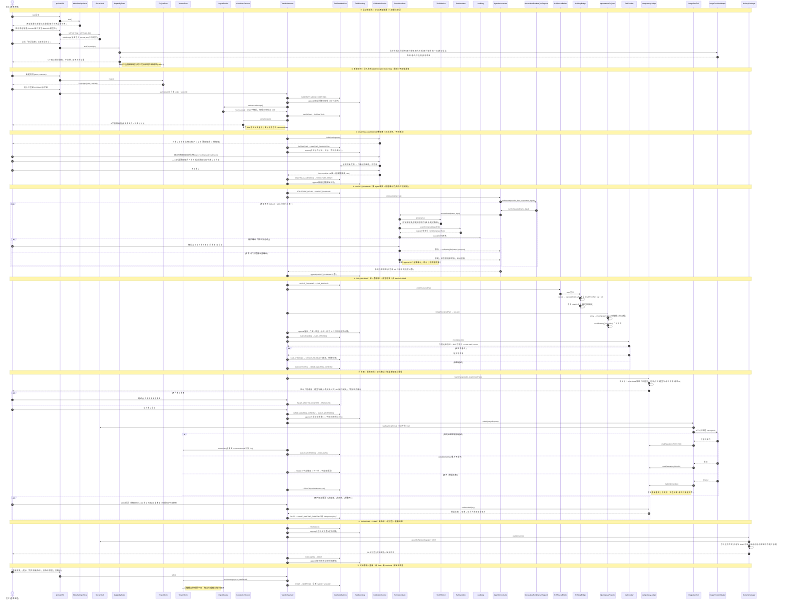
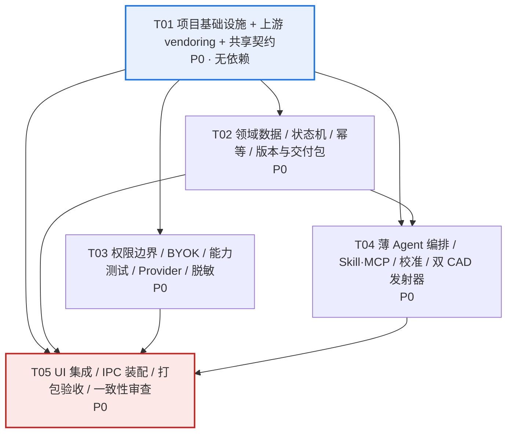

# 编码前调研表 · 选型结论 · 风险清单 · Windows 技术路线

> 文档状态：第 1 轮（调研 / 选型 / 风险 / 技术路线）。系统架构设计与任务分解两节见文末，**待 PRD 定稿后第 2 轮补齐**。
> 撰写：架构师 高见远（Gao） | 调研日期：2026-11-07 | 语言：中文

---

## 0. 范围、证据约定与方法

**范围约束**：本轮只输出「调研表 + 选型结论 + 风险清单 + 技术路线」。工作区为空 Git 仓库（0 commit，本轮仅新建本文件 `docs/RESEARCH.md`，未改动 `docs/PRD.md` 及任何其他内容）〔复核：`git status` / `git log` / `ls -la`，2026-11-07〕。

**证据代号**（所有结论均带出处，不用星数、README 自述或搜索摘要当质量证明）：

| 代号 | 一手事实来源 | 本轮复核动作 |
|---|---|---|
| 〔B〕 | `report-base.md`（harness / deepchat / cc-switch / CodexPPP） | 复核 `logs/dsh-*.log`、`logs/dc-*.log`、`logs/ccs-*.log`、`logs/cpp-cargo.log`、LICENSE/engines/BRAND_GUIDELINES/SAFETY 原文 |
| 〔C〕 | `report-cad.md`（Autocad-MCP / archlang） | 复核 `security.py:480-486`、`README.md:362,522`、`security_lisp.py:54-58`、`server.py:7664-7770`、`config.py:149`、THIRD-PARTY-NOTICES、`cad/out/` 产物 SHA256 |
| 〔D〕 | `report-design.md`（draw2cad / openPlan3D / opencalque / 3d-new-era-ai / roomsmith） | 复核 opencalque `bridge.ts` / `mcp.ts` / `agent.ts` / `floorplan.ts` / `dxf.ts` / `package.json`；openPlan3D `cadExport.ts:248-252`；draw2cad 根目录；3d-new-era-ai `Cargo.toml:9`；archlang `docs/from-an-image.md` |
| 〔复核〕 | 架构师本轮亲自读源码 / 日志 / 产物所得 | 见各条括注 |

**三栏约定**：**【观察到】**＝本地源码或本机命令可核对；**【文档声称】**＝README / 项目描述 / commit message 自述且未独立证实；**【未验证】**＝本机未跑或无法跑，无结论。**「亲自验证」仅指本机真实执行并记录了退出码；CI 配置存在、README 写了测试数字，都不算亲自验证。** 全文不虚构任何构建成功。

---

## 1. 调研表（11 个仓库，一个不少）

### 1.1 主表

| 仓库名与链接 | 调研日期 | 当前版本 / commit | 许可证及商业分发风险 | Windows 支持情况 | 实际可复用的模块（目录/文件） | 不能解决的问题 | 亲自验证：通过了什么 / 失败在哪一步 / 退出码 | 判断 |
|---|---|---|---|---|---|---|---|---|
| **deepseek-ai/deepseek-harness**<br>https://github.com/deepseek-ai/deepseek-harness | 2026-11-07 | `fcc0ad46`（2026-11-04），`0.2.2-rc.1`，最新 tag `dsh-v0.2.2-rc.1`，**无 GitHub Release**〔B§1.1〕 | MIT〔B§1.3 `LICENSE:3,12-13`〕：闭源商业分发允许，但须保留 `Copyright (c) 2026 DeepSeek` + 许可声明；**额外障碍**：`BRAND_GUIDELINES.md:7-10` 全称是注册商标、禁止用作项目名/暗示官方背书〔复核原文〕；`SAFETY.md:7` 自承未过安全审计、非生产就绪〔复核原文〕；`THIRD_PARTY_NOTICES.md` 26 KB + `vendor/*/LICENSE` 未逐条审〔B§1.3,1.8〕 | 有真实 Electron 44 + NSIS 打包链〔B§1.4 `electron-builder-config.mjs:255` `win.target:['nsis']`〕；**但本机 Node 22.22.2 不满足 `engines.node >=24.9.0`**〔复核 `package.json:8-9`〕；`pnpm@11.28.5` + native addon 编译 + `forceCodeSigning` 需证书〔B§1.4,1.7〕 | 仅**架构模式参考**：`packages/mcp/mcp-client/`（stdio/streamable-http）、`packages/acp/acp/src/index.ts:158-174`（一次性审批 `allow-once`/`reject-once`）、`packages/sandbox/sandbox/src/index.ts:30` 三档 SandboxMode + `roots.ts:97-100` 路径 allow-list、`packages/boot/app-boot/` Cordis 插件加载〔B§1.5〕 | 本机连依赖都装不上；无 CAD/DXF 能力；无户型/图纸领域能力；`danger-full-access` 模式 + 第三方插件可加载 + 审批仅一次性〔B§1.5,1.7〕；商标与 dev-preview 破坏性变更〔B§1.3,1.7〕 | **全部失败**：`pnpm install --frozen-lockfile` **EXIT=1** corepack 自带 Node 18.20.8 报 `ERR_VM_DYNAMIC_IMPORT_CALLBACK_MISSING`；`npm install` **EXIT=1** `Cannot read properties of null (reading 'edgesOut')`；`npm run build` **EXIT=1** `'tsx' 不是内部或外部命令`〔复核 `logs/dsh-pnpm.log`/`dsh-npm.log`/`dsh-build.log`；B§1.6〕。未产出任何可运行产物 | **淘汰**（仅参考架构模式） |
| **ThinkInAIXYZ/deepchat**<br>https://github.com/ThinkInAIXYZ/deepchat | 2026-11-07 | `7412727`（2026-11-06），`1.1.4-beta.9`，release `v1.1.3`（2026-10-09）〔B§2.1〕 | Apache-2.0〔B§2.2 `LICENSE:90-104,139-140`〕：闭源商业分发须 (a) 附 LICENSE 全文 (b) 修改文件加显著声明 (c) 若有 NOTICE 须保留归属〔NOTICE 是否存在【未验证】B§2.6〕 (d) 专利授权随专利诉讼终止 (e) **§6 不授予商标权**，"DeepChat" 名称/标识不可自由使用〔复核 `LICENSE:138-141`〕 | Electron 43.8.3 + Vue3 + electron-builder NSIS，`build:win:x64` 脚本齐全〔B§2.3〕；**本机 Node 22.22.2 不满足 `>=24.22.1 <25`**〔复核 `package.json:8-9`〕；`pnpm >=10.34.5 <11` | 仅**模式参考**：`src/main/config/secretStore.ts:1` Electron `safeStorage`、`src/main/config/aes.ts:30` AES、`src/main/provider/`（`@ai-sdk/openai-compatible`）、`src/main/mcp/`、`src/main/agent/`、`src/main/approval/approvalBroker.ts`〔B§2.4〕 | **无产品级白标开关**（精确搜 `white.?label\|brandConfig\|oem` 无命中；改名要动 `electron-builder.yml:1-2`、`package.json:2`、`win.executableName`、i18n、532 个 `.vue` 品牌文案/图标）〔B§2.4〕；本机未构建出程序；无 CAD/DXF | **均未跑完**：`pnpm install` **EXIT=124（超时 100s）** 停在 `Progress: resolved 1343, downloaded 1339, added 387`；`npm install` **EXIT=124（超时 180s）** 无输出〔复核 `logs/dc-pnpm.log` 尾部；B§2.5〕。`build`/`build:win` **未执行**，未产出可运行程序。注意：deepchat 目录内 pnpm 可启动，仅因下载量大+限时未完成，**不是编译报错**〔B§2.5〕 | **淘汰**（仅参考密钥保护模式） |
| **Hortus-Edenensis/cc-switch**<br>https://github.com/Hortus-Edenensis/cc-switch | 2026-11-07 | `955ea26`（2026-06-08），`v3.16.2`，无 GitHub Release；**距今 152 天**〔B§3.1〕 | MIT〔B§3.2 `LICENSE:3` `Copyright (c) 2025 Jason Young`〕：允许，须保留 `:12-13` 声明；**归属疑点**：版权人 Jason Young ≠ owner Hortus-Edenensis，`tauri.conf.json:65` updater 指向 `farion1231/cc-switch`〔B§3.2,3.6【未验证】〕 | Tauri 2 + React18 + Vite7，`bundle.windows.wix.template = wix/per-user-main.wxs` → WiX/MSI〔B§3.3〕；**需 Rust/cargo（本机缺失，EXIT=127）**，完整 `tauri build` 未跑 | 仅**UI 模式参考**：`src/components/providers/AddProviderDialog.tsx:211`、`src/components/providers/forms/ApiKeyInput.tsx`、`src/components/mcp/`、`DeepLinkImportDialog.tsx:210 maskedApiKey`、`src-tauri/src/config.rs:181-208` atomic_write〔B§3.3,3.4〕 | 凭据**明文 JSON 落盘**、无 OS keychain/safeStorage〔B§3.4 后端全量搜索无命中〕；深耦合 `~/.claude/settings.json`、`~/.codex/auth.json`+`config.toml`、`CLAUDE.md`、MCP `mcpServers` 等未公开易变格式〔B§3.4〕；无 CAD/DXF；5 个月未提交、0 issues、3 stars〔B§3.1〕 | **本机唯一通过前端构建的 base 仓**：`npm install` **EXIT=0**（`added 476 packages in 2m`）；`npm run build:renderer` **EXIT=0**（`✓ built in 10.25s`，`dist/assets/index-o8Hegmim.js 4,208.54 kB`，有 >500 kB chunk 警告）〔复核 `logs/ccs-build.log`；B§3.5〕。`pnpm install` **EXIT=1**（上层 `package.json` packageManager=yarn 冲突）；完整 `npm run build = pnpm tauri build` **未执行/未验证**，未产出 MSI | **仅参考** |
| **Alunixa/CodexPPP**<br>https://github.com/Alunixa/CodexPPP | 2026-11-07 | `6f31b98`（2026-07-20），`v1.2.51`；**距今 110 天**；`fork=true, parent=BigPizzaV3/CodexPlusPlus`（父仓同为 AGPL-3.0）〔B§4.1〕 | **AGPL-3.0**〔复核 `LICENSE:1-2`；B§4.2 `LICENSE:44-48,540` §13〕：强 copyleft，分发衍生作品须以 AGPL-3.0 提供完整 Corresponding Source，且 §13 对「通过网络与用户交互的修改版」也触发源码提供义务 → **闭源商业分发冲突** | Rust workspace + Tauri（`apps/codex-plus-manager`），`bundle.targets "all"`，未显式写 wix/nsis 片段【未验证】；**cargo 缺失** | **无**（法律上不可复用）：仅可了解 `crates/codex-plus-core/src/config_backup.rs:10,74-95` 全量配置导出/导入 + 导入前自动备份的思路 | 凭据明文落盘/明文进备份（`settings.rs:870-875` 仅 `unwrap_or_default()`，不做加解密；`config_backup.rs:112-116` 直接把 `config.toml`/`auth.json` 写进 JSON）〔B§4.4〕；强耦合 `~/.codex` 与本机已安装 `ChatGPT.exe`/`Codex.exe`〔`app_paths.rs:14`〕；AGPL 与闭源冲突；fork 滞后上游 | `cargo build --workspace` **EXIT=127** `timeout: failed to run command 'cargo': No such file or directory`〔复核 `logs/cpp-cargo.log`〕；`apps/codex-plus-manager` 的 `npm install` **EXIT=0**（`added 101 packages in 21s`）〔B§4.5〕。Rust 主体**未构建/未验证** | **淘汰** |
| **U-C4N/Autocad-MCP**<br>https://github.com/U-C4N/Autocad-MCP | 2026-11-07 | `6f6a538`（2026-11-06），`v1.8.0`（`releases/latest` 正式版，2026-11-06）〔C A1〕 | MIT〔复核 `LICENSE:1-3` `Copyright (c) 2026 Umutcan Edizsalan`；C A1〕：商业分发风险低，须保留 `:12-13` 声明；无 vendored 第三方代码，但依赖 fastmcp/ezdxf/pydantic/matplotlib/openpyxl/pywin32 各自许可证需随分发核对；`README.md:332` DIN/ISO 标准表故意留空（未捆绑受许可限制数据）〔C A1〕。`Pro` 是产品名，非付费墙 | COM 后端**仅 Windows**，且**只针对 AutoCAD 2026 (25.1) 测试**〔`config.py:9,101`；C A2〕；本机 4 个 ProgID（`AutoCAD.Application`/`ZWCAD`/`GstarCAD`/`BricsCAD`）注册表均为 False、无 pywin32〔C§0〕；ezdxf headless 后端跨平台但本机也导不进 | **延后局部复用**：`backends/ezdxf_backend.py:256+`（headless 真实 DXF 实体/图层/尺寸/文字）、`engineering/arch/draw.py`（12 个 `arch_*` 建筑工具，typed 后端调用、无 SendCommand）、`server.py:132-169` 后端降级逻辑、`policy.py`（工具级白/黑名单 + cost 天花板）、`security.py:209-299` `validate_path`〔C A5,A6〕 | **本机产出 0**：`import server` 即失败；COM-only 工具（含 `system_run_command`/`system_run_lisp`、live 截图、3D solids、`accoreconsole`）永久不可用；1.8.0 **无任何用户确认**（`confirm_large` 是 1.8.1 计划）〔C A4,A8；复核 `README.md:522`〕；denylist 被仓库自身 ≥4 处明文否认是安全边界（见 §3.2） | **全部失败/未产出**：`python -m pytest -q` **EXIT=1** `No module named pytest`；`import server/config/policy/security/http_guard` **EXIT=1** `ModuleNotFoundError: fastmcp`；`pip install --dry-run -e .` **EXIT=2** `BackendUnavailable: Cannot import 'hatchling.build'`；临时 venv 装 `ezdxf 1.4.5` **EXIT=0**（第 2 次 180s cap），但 `import backends.ezdxf_backend` 仍 **EXIT=1**（缺 fastmcp）；COM `GetActiveObject` **EXIT=1** `No module named 'win32com'`〔C A8〕。README 的 `7582 passed, 1 xfailed` / `129/129` 是**【文档声称】**，本机一条未复现〔C A7〕 | **局部复用（延后，不进第一版）** |
| **ChanMeng666/archlang**<br>https://github.com/ChanMeng666/archlang | 2026-11-07 | `349ccd3`（2026-11-07），`v1.57.0`（release 2026-11-06），main HEAD 比 tag 多若干 commit〔C B1〕 | MIT〔`LICENSE:1-23` `Copyright (c) 2026 Chan Meng`；C B1〕：商业分发风险低，须保留许可声明。**`THIRD-PARTY-NOTICES.md:1-37` 声明** `src/import/openplan3d-model.ts`/`-rooms.ts`/`-catalog.ts` 改编自 OpenPlan3D（MIT，theLodgeStudio，commit `98f9cb46`），**须保留 `Copyright (c) 2026 theLodgeStudio` + MIT 全文**〔复核 NOTICE 原文；C B1；D§2.2〕。单维护者项目〔README.md:102【文档声称】〕 | **强**：纯 Node/TS、`engines node >=18`、零运行期外部依赖（核心只用 `node:*`）〔C B1,B4〕；CI 含 `runs-on: windows-latest`〔`ci.yml:388`〕；**本机 Windows 11 + Node 22.22.2 实跑通过** | **采用**：`src/cli.ts` + `src/export/dxf.ts`（820 行手写 ASCII DXF AC1015/R2000，零依赖、不依赖 ezdxf）、`src/backends/svg.ts`、`src/parser.ts`/`src/lint/rules/index.ts`（约 50 条有序 lint + JSON diagnostics + 机器可应用 `fix`）、`schemas/*.json`、`grammars/archlang.gbnf`、`packages/mcp/`（stdio MCP server，11 工具）、`skills/`（5 个 SKILL.md）、`examples/`（42 个 `.arch`）〔C B2-B6〕 | **不读图**（`docs/from-an-image.md:3-4` 原文 "The compiler takes text and has no image decoder, so a photo, a scan, a PDF or a screenshot of a listing is never an input"〔复核原文〕）；无 BIM/IFC、非报建图、不做剖面/立面/坡屋顶；核心只 2D；除可达性/面积外多数几何检查是 advisory〔README.md:76,80〕；DXF 为 AC1015/R12 风格实体（无 LWPOLYLINE，用 LINE 链）、**无原生 DWG 写入**；PNG 需可选原生绑定 `@resvg/resvg-js`〔C Q3〕 | **本机真实产出（唯一产 DXF 的仓）**：`npx -y tsx src/cli.ts compile examples/one-room.arch -o out/one-room.dxf --json` **EXIT=0** 6282 B；再编一次 **EXIT=0** 6282 B，`cmp` BYTE_IDENTICAL=YES；SVG **EXIT=0** 5461 B + 双编一致；PDF 装 `pdfkit` 前 **EXIT=1** `E_PNG_DEPENDENCY`，`npm install pdfkit` **EXIT=0**（`added 224 packages in 28s`）后 PDF **EXIT=0** 8000 B + 双编一致；PNG **EXIT=1** 缺 `@resvg/resvg-js`；`validate --strict --json` **EXIT=0** "no warnings"；3 个故意损坏样本各 **EXIT=2**（`W_ROOM_DISCONNECTED`+`W_NO_ENTRANCE` / `E_WALL_THICKNESS` / `E_PARSE ×4`）；独立 venv `ezdxf.readfile()` **EXIT=0**：AC1015、`$INSUNITS=4`、audit **0 errors / 5 fixes**〔复核 `cad/out/` 产物 SHA256：`one-room.dxf` 与 `.2.dxf` 均 `67ce0c81…76a8`，SVG 均 `7e12fce4…3ee`；C B7〕 | **采用**（DXF 引擎 + MCP + SKILL） |
| **blyfoten/draw2cad**<br>https://github.com/blyfoten/draw2cad | 2026-11-07 | `5bbe889`（2026-11-01），**无 tag / 无 release / 仅 2 条 commit / 0 stars / 0 issues**〔D§1.1〕 | **NONE（无 LICENSE）**〔复核根目录 `ls -a` 仅 `.claude .gitignore README.md bench data draw2cad pyproject.toml tests`；全仓 `find -iname "*license*"` 空；API `license=null`；D§1.1〕：默认「保留所有权利」，他人无授权即不得复制、修改、分发或作商业使用；GitHub 公开可见 ≠ 授予许可 → **法律上不可合法复用/商业分发**，连「实验候选」也不成立（见 §2.6） | 纯 Python + pip，README:15 有 Windows 安装命令，无 OS 分支代码 → 技术跨平台；**但本机规范安装失败** | **无（法律上）**；仅可作为**算法思路参考**：`scale.py`（多线索尺度校准，信任顺序 ①用户校准 ②尺寸注记 ③比例注记 ④外轮廓精修 ⑤瑞典外墙 350mm/门 910mm 先验）、`walls.py`/`openings.py`（OpenCV 规则法）、`ocr.py`（本地 RapidOCR/ONNX）、`dxf.py`（ezdxf 分层写出）、`bench/`（合成数据+评分框架）〔D§1.1,1.2〕 | 真实图纸薄内墙漏识别、房间合并〔README:9 自述〕；README:7-9 的 `Mean F1 0.52`/`10 of 12` **无提交结果文件**（`bench/run.py:130` 运行时才写 `results.json`）→ **【文档声称】未核实**；尺度依赖用户校准/尺寸注记；无 DWG；无 CI；`standards/se.yaml` 自述 "unverified starting values"、`layers.py:95` 注释占位〔D§1.2〕 | **半段通过**：`python -m venv .venv` **EXIT=0**；`pip install -e ".[dev]"` **EXIT=1** `Could not find a version that satisfies the requirement rapidocr-onnxruntime>=1.3`（索引最高 1.2.3）；钉 1.2.3 大 wheel 下载 >11 min 未完成；最小装 ezdxf+shapely **EXIT=0**；补 opencv/scipy/pymupdf/pytest 4m51s 终止 → **pytest 未执行【未验证】**；**DXF smoke EXIT=0**：`plan_to_dxf()` 写出 `design/draw2cad_smoke.dxf` 70353 B，`ezdxf.readfile()` 回读 AC1032 / `$INSUNITS=4` / `LWPOLYLINE,LINE,ARC,TEXT` / 瑞典语图层〔复核 `design/draw2cad_smoke.dxf` 文件头；D§1.3〕。**端到端 image/PDF→识别→DXF 未跑通**；上表只证明「Plan→DXF 写出器」可用 | **淘汰**（法律不可复用） |
| **laanlabs/openPlan3D**<br>https://github.com/laanlabs/openPlan3D | 2026-11-07 | `98f9cb46`（2026-10-22），`v1.0.0`，**releases 0**〔D§2.1〕 | MIT〔`LICENSE:1-21` `Copyright (c) 2026 theLodgeStudio`〕：商业分发允许，须保留版权+许可全文；`package.json` repository.url 指向 `theLodgeBots/open3dFloorplan.git`（归属线索需法务核实）〔D§2.1〕。archlang NOTICE 已示范保留其通知 | SvelteKit + `adapter-node` Web app，`src/` 内无 `process.platform`/`node:fs`/`.exe` 命中 → 浏览器/Node 可跑；**依赖 Firebase 云后端，非原生桌面**〔D§2.1〕 | **仅数据模型**：`src/lib/models/types.ts:1-285`（纯 TS interface、无 import、自包含：`Point/Wall/Room/Door/Window/FurnitureItem/Stair/Column/BackgroundImage/Floor/Project` 等）、`roomDetection.ts`/`furnitureCatalog.ts`/`interchange.ts` 纯算法；`cadExport.ts` 导出逻辑**难抽**（依赖 `$lib/*` 别名、`svelte/store`、浏览器 `document`、i18n/visibility stores、约 20 个内部 util）〔D§2.2〕 | 无图片/PDF 自动识别（背景图 + 两点校准**手动描图**）；**`exportDWG()` 是陷阱**：`cadExport.ts:251-252` 函数体只有 `return exportDXF(project, language, visibility)`，全仓无 DWG 二进制写出器〔复核原文；D§2.2〕；组件与 SvelteKit store/工具/i18n 深耦合，`FloorPlanCanvas.svelte:2-41` 约 40 条 import、`ThreeViewer.svelte` 约 30 个内部模块 + `openaiClient.ts`；Firebase 云耦合〔D§2.2,6.1〕 | **全绿**：`npm ci --no-audit --no-fund` **EXIT=0**（`added 261 packages in 34s`）；`npm test`（vitest run）**EXIT=0** `Test Files 164 passed (164)` / `Tests 1596 passed (1596)` / 7.70s〔复核 `design/openPlan3D_test.log` 尾部〕。`vite build`/`playwright test` 受 `vite.config.ts` `NODE_ENV=production` + Firebase 环境约束 **未跑【未验证】**〔D§2.3〕 | **局部复用**（仅 `types.ts` 数据模型，且须保留通知） |
| **laurent512/opencalque**<br>https://github.com/laurent512/opencalque | 2026-11-07 | `924d2d1`（2026-11-06），`v1.6.0`（release 2026-11-06），28 tags / 3 releases，创建 2026-10-09〔D§3.1〕 | MIT〔`LICENSE:1-21` `Copyright (c) 2026 OpenCalque contributors`〕：商业分发允许；根目录 `THIRD-PARTY-NOTICES.txt` 87 KB，grep 强 copyleft（`AGPL/GPL/LGPL/MPL/SSPL/CDDL/Commons Clause`）**无命中**，以 MIT/BSD-3-Clause/Boost/CC0 为主；`apps/desktop/package.json:40-42` `extraResources` 已把 `LICENSE`→`LICENSE.txt` 与 `THIRD-PARTY-NOTICES.txt` 打进安装包〔复核原文；D§3.1,3.2〕 | **强、原生桌面**：Electron 44 / electron-vite / electron-builder，`build.win.target = ["nsis","portable"]`，`artifactName OpenCalque-${version}-windows-{setup\|portable}`，`fileAssociations .opencalque`，`.github/workflows/release.yml` 按 tag 出各系统包〔复核 `apps/desktop/package.json:57-62`；D§3.1〕；**本机 Node 22.22.2 + pnpm@9.14.2 全部跑通** | **采用**：`apps/desktop/`（Electron 壳 + NSIS/portable）、`apps/web/src/ai/`（`agent.ts` Agent Loop、`chat.ts` 会话、`anthropic.ts`/`compatible.ts`/`claudecli.ts` 三 Provider、`pictures.ts`）、`apps/web/src/floorplan.ts`（`placeFloorPlan` + `applyCalibration` 两点已知距离校准）、`packages/core/`（纯 TS + zod + 3 个 JSON Schema；`dxf.ts:27 toDXF()` 手写 ASCII DXF(R12)、`dxf-import.ts:281 dxfOps()` 手写 group-code 解析）、`packages/cli/src/mcp.ts`（官方 `@modelcontextprotocol/sdk` stdio **MCP Server**）、`apps/desktop/src/main/bridge.ts`（本地 HTTP 桥）、`schema/*.json`〔复核全部；D§3.1-3.2〕 | **无图片/PDF 自动识别户型**（`import` 只吃 DXF 矢量；2D 编辑器是人工绘制/Figma-like）〔D§3.1〕；**是 MCP Server 不是 MCP Client**（`packages/cli/src/mcp.ts:5-6` 用 `Server`+`StdioServerTransport`，本仓自有源码中无 `@modelcontextprotocol/sdk/client` 命中〔复核 grep〕）；**无 SKILL.md / Skill Runtime**〔复核 grep 零命中〕；**助手默认不请求确认**：`apps/web/src/ai/agent.ts:76` 原文 "it is fine to act on a clear request without asking for confirmation first"、`docs/ARCHITECTURE.md:891` "The assistant edits without asking first (undo is the safety net)"〔复核原文〕；`@opencalque/cli` 未发布、bin 是 TypeScript，打包 MCP server 需先 build〔`ARCHITECTURE.md:889`〕 | **全绿（本机最完整）**：`pnpm --version`（corepack 下载 `pnpm-9.14.2.tgz`）**EXIT=0** 输出 9.14.2；`npx --yes pnpm@9.14.2 install --frozen-lockfile` **EXIT=0** `Scope: all 7 workspace projects` / `Packages: +454` / `Lockfile is up to date`；`pnpm test`（vitest run）**EXIT=0** `Test Files 71 passed (71)` / `Tests 664 passed (664)` / 14.00s〔复核 `design/opencalque_test.log`；架构师本轮再次 `npx --yes pnpm@9.14.2 --version` **EXIT=0**〕。`electron-builder dist`/playwright e2e **未跑【未验证】**〔D§3.3〕 | **采用**（桌面底座 + Agent 基础设施 + DXF 导入导出 + 校准） |
| **leandrodaf/3d-new-era-ai**<br>https://github.com/leandrodaf/3d-new-era-ai | 2026-11-07 | `81711b4`（2026-11-02），`v3.3.0`（release 2026-11-02）〔D§4.1〕 | **双许可 `MIT OR Apache-2.0`**〔复核 `Cargo.toml:9`；根目录 `LICENSE-APACHE`（11358 B）+ `LICENSE-MIT`（1104 B）〕；GitHub API 只报 Apache-2.0，**全仓 `find -iname "*NOTICE*"` 为空 → 无 NOTICE 文件**〔D§4.1〕。含义：可只选 MIT 条款从而不触发 Apache §4/NOTICE 义务；若选 Apache-2.0 须附 LICENSE-APACHE + 修改文件加标记 + 保留源码版权/专利/商标/归属声明 | **强、原生**：`packaging/msix/AppxManifest.xml`（Microsoft Store 包、`newera-gui.exe`/`newera.exe`）、`installers.yml:54-69` windows job、`ci.yml:83` matrix 含 windows-latest〔D§4.1〕；**但 Rust workspace，要求 rust-version 1.95，本机 cargo/rustc 缺失 → 未构建** | 仅**思路/未来参考**：`crates/newera-render/`（本地 CPU 路径追踪，`photo.rs:1-3`，**不调外部生图 API**）、`crates/newera-ergonomics/`（NBR 9050 人体工学/布局检查 + golden fixtures）、`crates/newera-mcp/`（rmcp 官方 Rust MCP SDK，完整工具面）、`crates/newera-catalog`（家具/橱柜）、egui 桌面壳、MSIX 安装脚本〔D§4.1,4.2〕 | **不输出可编辑平面 DXF/DWG**：唯一 DXF 写出是 `crates/newera-joinery/src/cutlist.rs:220,337` 的**木工下料板件排样**（CNC 用），`DWG` 字面全仓 **0 处**〔D§4.2〕；`background`/`trace_walls` 是「粗暗带→墙段」规则法半自动描墙，需人工 `render_plan bg=0.5` 核对，无精度声明/基准〔`tools/background.rs:111-135`〕；Rust 1.95 工具链门槛；双许可合规选择 | `cargo --version` **EXIT=127** `command not found`；`rustc --version` **EXIT=127**；**未执行 `cargo build`/`cargo test`，未贴任何虚构结果**〔D§4.3〕。本仓所有代码结论均为本地源码阅读【观察到】，README 能力属【文档声称】 | **仅参考（延后）** |
| **Rumeasiyan/roomsmith**<br>https://github.com/Rumeasiyan/roomsmith | 2026-11-07 | `0e1c042`（2026-08-27），**无 tag / 无 release**；27 条 commit 全落在 2026-08-25~27 三天，**距今约 72 天无提交**〔D§5.1〕 | MIT〔`LICENSE:1-21` `Copyright (c) 2026 Rumeasiyan`〕：商业分发允许，须保留版权+许可声明 | 纯 Python CLI 跨平台、零第三方依赖；**但 SVG→PNG 与 HTML→PDF 硬依赖 `google-chrome\|chromium\|chromium-browser\|chrome`**，本机 4 个命令均 `command not found`〔`drawings.py:360-372`；D§5.1,5.3〕；无 GUI、无 Windows 安装包 | 仅**流程/提示词资产**：`.claude/skills/interior-design/SKILL.md:1-40`（pipeline `intake → survey → strategy → author → pilot pack → full render → report` + **6 道审批门** `brief/room-model/direction-set/pilot/spend/report`）、`.claude/agents/*.md`（6 Agent）、`docs/WORKFLOW.md`、`engine/cli.py`/`engine/project.py`（`project.yml`/`STATE.json`/审批门）、`engine/drawings.py:1-9`（"DRAWN, not generated by an image model"）、`engine/prompts.py`（`must_appear`/solid-wall clause/scale 钉进 prompt）、成本上限〔D§5.1,5.2〕 | **不是桌面底座**：无 GUI、无 DXF/DWG（仅 SVG/PNG 展示图 + PDF 报告）、无桌面打包；硬依赖 Claude Code + 外部生图后端（OpenRouter `gpt-image-2` / Codex CLI）+ Chrome；无内置模型/权重，`.env.example` 只有占位 key；`README.md:221` 自述 "not a CAD package ... every dimension read from a photograph is flagged for verification on site"；停更 72 天、无 CI、0 issues〔D§5.1,5.2〕 | `python3 --version` **EXIT=0**（3.13.14）；`bash tests/run.sh` **EXIT=0**「all checks passed」：`test_config.py` **5 tests passed**、example project 校验 `room 3.40 × 3.80 m 8 walls 2 openings`、room/kitchen 模板 scaffold+validate 通过〔D§5.3〕。**但**：`projects/study-terrace/drawings/` 实际只生成 **6 个 `.svg`**、无 `_shell-plan.png`，本机 Chrome 缺失 → `drawings.py:360-372` 光栅化为空操作，PDF 报告同样未产出〔D§5.3【观察到】〕 | **仅参考**（门控工作流 / 提示词资产） |

### 1.2 亲自验证明细（真实退出码 / 失败点 / 日志位置）

| 仓库 | 命令 | EXIT | 真实结果 |
|---|---|---|---|
| deepseek-harness | `pnpm install --ignore-scripts --frozen-lockfile` | **1** | `ERR_VM_DYNAMIC_IMPORT_CALLBACK_MISSING` / `Node.js v18.20.8`（corepack 自带旧 Node）〔`logs/dsh-pnpm.log`〕 |
| deepseek-harness | `npm install --ignore-scripts --no-audit --no-fund` | **1** | `npm error Cannot read properties of null (reading 'edgesOut')`〔`logs/dsh-npm.log`〕 |
| deepseek-harness | `npm run build` | **1** | `> tsx scripts/build.ts` → `'tsx' 不是内部或外部命令`〔`logs/dsh-build.log`〕 |
| deepchat | `pnpm install --frozen-lockfile` | **124** | 100s 超时，停在 `Progress: resolved 1343, downloaded 1339, added 387`（未到完成）〔`logs/dc-pnpm.log`〕 |
| deepchat | `npm install --ignore-scripts` | **124** | 180s 超时、无输出〔`logs/dc-npm.log`〕 |
| cc-switch | `npm install --ignore-scripts` | **0** | `added 476 packages in 2m`〔`logs/ccs-npm.log`〕 |
| cc-switch | `npm run build:renderer` | **0** | `✓ built in 10.25s`，`index-o8Hegmim.js 4,208.54 kB` + chunk>500kB 警告〔`logs/ccs-build.log`〕 |
| cc-switch | `pnpm install --frozen-lockfile` | **1** | `This project is configured to use yarn because C:\Users\wang\package.json has a "packageManager" field`〔`logs/ccs-pnpm.log`〕 |
| CodexPPP | `cargo build --workspace` | **127** | `timeout: failed to run command 'cargo': No such file or directory`〔`logs/cpp-cargo.log`〕 |
| CodexPPP | `npm install`（apps/codex-plus-manager） | **0** | `added 101 packages in 21s`〔`logs/cpp-npm.log`〕 |
| Autocad-MCP | `python -m pytest -q` | **1** | `No module named pytest`〔C A8 #1〕 |
| Autocad-MCP | `python -c "import server"` 等 6 模块 | **1** | `server.py:25` / `config.py:354 → policy.py:42` / `http_guard.py:41` 全部 `ModuleNotFoundError: No module named 'fastmcp'`〔C A8 #2〕 |
| Autocad-MCP | `pip install --dry-run --no-build-isolation -e .` | **2** | `BackendUnavailable: Cannot import 'hatchling.build'`〔C A8 #4〕 |
| Autocad-MCP | 临时 venv `pip install "ezdxf>=1.4,<2"`（第 2 次 180s） | **0** | `Successfully installed ezdxf-1.4.5 fonttools-4.68.0 numpy-2.5.4 pyparsing-3.3.3 typing_extensions-4.16.0`〔C A8 #7〕 |
| Autocad-MCP | `import backends.ezdxf_backend` | **1** | 仍缺 `fastmcp`〔C A8 #8〕；COM `GetActiveObject` **1** `No module named 'win32com'`〔#9〕 |
| archlang | `npx -y tsx src/cli.ts compile … --json` ×(DXF/SVG/PDF) | **0 / 0 / 1→0** | DXF 6282 B、SVG 5461 B、PDF 8000 B（装 `pdfkit` 后）；三种均双编字节一致〔`cad/out/`；C B7〕 |
| archlang | `validate --strict --json` / 3 个损坏样本 | **0 / 2 / 2 / 2** | "no warnings" / `W_ROOM_DISCONNECTED`+`W_NO_ENTRANCE` / `E_WALL_THICKNESS` / `E_PARSE ×4`〔C B7 #9-12〕 |
| archlang | venv `ezdxf.readfile(one-room.dxf)` + `audit()` | **0** | AC1015 / `$INSUNITS=4` / **0 errors, 5 fixes** / `{'LINE':20,'TEXT':2,'INSERT':2,'HATCH':1,'DIMENSION':2}`〔C B4,B7 #13〕 |
| archlang | PNG 导出 | **1** | `PNG export needs the optional dependency '@resvg/resvg-js'`〔C B7 #8〕 |
| draw2cad | `pip install -e ".[dev]"` | **1** | `No matching distribution found for rapidocr-onnxruntime>=1.3`（索引最高 1.2.3）〔`design/draw2cad_install.log`〕 |
| draw2cad | DXF smoke（`Plan` + `plan_to_dxf`） | **0** | `design/draw2cad_smoke.dxf` 70353 B，回读 AC1032 / `$INSUNITS=4`〔复核文件头；D§1.3〕 |
| draw2cad | `pytest` | **未执行【未验证】** | 补 opencv 43.8 MB wheel 限速 4m51s 终止〔`design/draw2cad_pytest.log`〕 |
| openPlan3D | `npm ci --no-audit --no-fund` | **0** | `added 261 packages in 34s`〔`design/openPlan3D_test.log`〕 |
| openPlan3D | `npm test`（vitest run） | **0** | **164 文件 / 1596 用例全过** / 7.70s〔复核日志尾部〕 |
| opencalque | `pnpm --version` / `npx --yes pnpm@9.14.2 --version` | **0** | 输出 `9.14.2`〔`design/opencalque_test.log`；本轮复核〕 |
| opencalque | `npx --yes pnpm@9.14.2 install --frozen-lockfile` | **0** | 7 workspaces / +454 packages / Lockfile up to date |
| opencalque | `pnpm test`（vitest run） | **0** | **71 文件 / 664 用例全过** / 14.00s〔复核日志尾部〕 |
| 3d-new-era-ai | `cargo --version` / `rustc --version` | **127 / 127** | `command not found` → 未构建、未测试〔D§4.3〕 |
| roomsmith | `bash tests/run.sh` | **0** | 5 单测 + example project + 模板校验通过；但 PNG/PDF 光栅化空操作、仅 6 个 SVG〔D§5.3〕 |

### 1.3 补充一手证据（主理人 2026-11-07 实测 ＋ 架构师本轮复核）

> 第一轮交付后，主理人亲自补跑了一批 opencalque 端到端与 Windows 打包验证。以下为**新增证据**，用于细化 §1.1 中 opencalque 的「亲自验证」列、§2 的引擎分工与 §4 的 Windows 路线；不覆盖既有结论。EXIT 码由主理人记录，架构师本轮复核了产物文件、日志与源码行号。

| 验证项 | 命令 / 产物 | 真实结果 | 架构师复核 |
|---|---|---|---|
| opencalque CLI 15 命令 | `new / validate / describe / check / quantities / apply / import / svg / png / pdf / dxf / schema / guide / mcp / --version` | **全部 EXIT=0** | `packages/cli/src/cli.ts:39-60` 命令清单一致〔复核〕 |
| CLI 结构化输出 | `describe examples/apartment.opencalque` / `quantities` / `check` | describe 输出完整 JSON；quantities 输出房间/墙/门/家具统计；**`check` 返回 `[]`**（房间闭合、墙重复、门是否在墙等几何检查通过） | `cli.ts:124-145`；`check` 有问题则 `process.exitCode=1`（`:137-142`）〔复核〕 |
| CLI 出图 | `dxf --out` / `svg --out` | **DXF 137125 B**、**SVG 112561 B** | `cli.ts:203-208` 调 `toDXF(doc, page, registry)`〔复核〕 |
| `guide`（Agent 编辑指南） | `guide [--type]` | 专为 AI Agent 写的图纸编辑指南：节点类型、单位 mm、墙由 `a→b` 中线+`thickness`+`justify` 定义、共享角点坐标必须完全相同、门/窗 `cutWalls`、30+ 参数化构件（arch.door/window/stair/washbasin/…、note.scalebar/level、elec.socket/switch/light、furn.table/bed/shelf 等） | `packages/core/src/guide.ts`〔复核 `DRAWING_TOOLS` 同用 `drawingGuide`/`nodeTypeSchema`〕 |
| `apply`（Agent 改图接口） | `apply <file> <ops.json>` | 结构化操作改图；另有 3 个 JSON Schema（document/ops/extension）与官方 SDK 的 `mcp` 服务 | `ops.ts:46-48,70` `OpSchema = z.discriminatedUnion('op', [add_node / update_node / remove_node])`；`cli.ts:127-131` 调 `applyEdit`〔复核〕 |
| **`pnpm build`（electron-vite build）** | `apps/desktop/dist/win-unpacked/OpenCalque.exe` | **EXIT=0**，exe **246302208 B**，目录含完整 Chromium 运行时 → **可运行免安装形态成立**（**不是安装包**） | 本轮 `ls -la` 复核 exe 大小与 `dist/`、`@opencalquedesktop-1.6.0-x64.nsis.7z`、`builder-debug.yml`〔复核〕 |
| `electron-builder --publish never` 第 1 次 | 宿主 `C:\Users\wang\package.json` 含 `"type":"module"` | **EXIT=1**：缓存里 `icon-tool.js` 被当 ESM、`require is not defined`；用隔离 `ELECTRON_BUILDER_CACHE` + 该目录 `{"type":"commonjs"}` 绕过（**未改动用户任何文件**） | 本轮复核 `eb-cache/package.json` 内容确为 `{"type":"commonjs"}`〔复核〕 |
| `electron-builder --publish never` 第 2 次 | NSIS 阶段 | **EXIT=1**：`!include: could not open FileAssociation.nsh`，但该文件确实存在（app-builder-lib `templates/nsis/include/`，4943 B），疑似临时长路径 / NSIS 路径解析问题 → **nsis / portable 安装包未产出** | 本轮 `find` 复核该文件确实存在〔复核〕 |
| `pnpm smoke` → **三分法** | **三分法（主理人裁决，不得混淆）**：① `pnpm smoke`（经 pnpm 包装）在本机**未跑通**，根因宿主预设 `ELECTRON_RUN_AS_NODE=1` 使脚本被当纯 Node 执行、`app undefined`；② 但 `env -u ELECTRON_RUN_AS_NODE -u NODE_OPTIONS timeout 100 <electron.exe> scripts/smoke.cjs`（清除宿主变量后**直接调用 Electron 二进制运行同一个 `smoke.cjs`**）**EXIT=0**，输出 `Screenshots: …/opencalque-smoke-4UlY9I`，真实生成 4 张 PNG（120428 / 122691 / 109772 / 84485 B）；③ 该证据证明的是**上游 opencalque 桌面壳在本机可启动并完成鼠标键盘交互**，**本产品自身的 GUI 冒烟仍未验证**，仍列 T05 待验收。→「上游壳已实测通过 / 包装命令未跑通 / 产品自身待验证」三者并列；**不得把上游通过写成产品通过，也不得把真实 EXIT=0 抹成「未验证」**。 | 启动桌面/GUI 冒烟必须先显式移除该环境变量〔`docs/VALIDATION.md` §5；`logs/smoke-opencalque.log` 初次记录〕；**本产品自身 GUI 冒烟列 T05 待验收** |
| archlang DXF 独立核验 | `compile` 两次 + ezdxf | `$ACADVER=AC1015`；实体 `LINE×20 / TEXT×2 / INSERT×2 / HATCH×1 / DIMENSION×2`；AIA 图层 `A-WALL-EXTR/A-DOOR/A-GLAZ/A-ANNO-DIMS/A-FLOR`；**两次编译 sha256 完全一致** | 本轮复核 `cad/out/one-room.dxf` 头部 `0/SECTION/2/HEADER/9/$ACADVER/1/AC1015/9/$INSUNITS/70/4`；全文件 0-group 统计含 `LINE 50 / TEXT 4 / DIMENSION 2 / HATCH 1 / INSERT 2 / LAYER 19 / BLOCK 6 / TABLE 5`（含 BLOCKS 段，与主理人 ezdxf 实体口径不同，**不矛盾**）〔复核〕 |
| opencalque DXF 结构 | `toDXF()` | **R12 最简**：从 `SECTION/ENTITIES` 直接开始、图层标 `0`、无 TABLES/DIMENSION | 本轮复核 `packages/core/test/fixtures/drawings/every-kind.page_1.dxf` 头部即 `0/SECTION/2/ENTITIES/0/LINE/8/Walls`；`dxf.ts:27` `toDXF()` 首行 `['0','SECTION','2','ENTITIES']`〔复核〕 |
| **架构师新发现的打包前提** | archlang `package.json:33,46-49` | codeload zipball **不含 `dist/`**（main/bin 指向 `dist/index.js` / `dist/cli.js`，构建脚本 `tsup`）。`tsup build` 出 `dist/` 在本机**尚未验证**；尽调阶段 DXF/SVG/PDF 双编、validate、破例检测全部由 `npx -y tsx src/cli.ts` 从 `src/` 直接跑通（`VALIDATION.md` §3）→ **T01 回退顺序（主理人裁决）**：优先 **`npx -y tsx src/cli.ts` 子进程**（本机已验证、零风险）→ 其次 **in-process 引入 `src/` 由 electron-vite 打包**→ 最后才考虑 **`tsup build` 出 `dist/`**（本机**尚未验证**，**不得放在关键路径上**）。 **标为待验证假设**（见 `docs/ARCHITECTURE.md` §7/§9） | 本轮 `ls dist` 返回 `No such file or directory`；`tsup.config.ts` entry 为 `src/index.ts,src/cli.ts,…`，`external` 含 pdfkit/@resvg/resvg-js〔复核〕 |

### 1.4 证据更新：`docs/VALIDATION.md`（主理人落盘，架构师本轮读到）

> 第二轮撰写期间，工作区新增 `docs/VALIDATION.md`（187 行，主理人亲自执行）。以下为相对 §1.3 的**更新/补充**，全部纳入 `docs/ARCHITECTURE.md` §0 与 §7。

| 新证据 | 内容 | 对架构的影响 |
|---|---|---|
| **MCP Server 真实启动（此前标【未验证】）** | stdio `initialize` 返回 `serverInfo{name:"opencalque",version:"1.6.0"}`、`instructions` 含 "Call read_guide once before your first edit"；`tools/list` 返回 `read_guide/open_drawing/describe_drawing/apply_operations/check_drawing/measure_drawing/view_drawing`〔VALIDATION.md §4〕 | 第 1 轮「archlang/opencalque MCP 未在本机运行」的限制**解除其一**：opencalque MCP 已实测可用，L1 `McpClientAdapter` 的可行性证据增强；archlang MCP 仍未实测 |
| **双引擎闭环全部 EXIT=0** | `archlang one-room.dxf (6282 B) → opencalque import roundtrip.opencalque → "47 objects" → describe(line:20/polyline:2, 7 图层) → validate "OK" → dxf --out roundtrip.dxf (4692 B)`〔VALIDATION.md §4〕 | **强化** §2.5.1 的分工结论：证实「结构化方案→确定性 DXF→可编辑文档→人工修正→再导出」成立，无需自研 DXF 解析器；`docs/ARCHITECTURE.md` T04 验收补此闭环路径 |
| **`apply` ops 实测** | `new fresh.opencalque --force` EXIT=0 → `apply fresh.opencalque examples/studio.ops.json` EXIT=0 `Applied 23 operations` → `describe` 得 `wall:5/instance:2` → `check` `[]` → `dxf` 8868 B；首次 `apply` 打到已有内容文档 EXIT=1 `Layer "furniture" already exists`（测试输入用错，非缺陷，如实保留）〔VALIDATION.md §4〕 | `OpencalqueProjector` 的 `toOps→apply→check` 路径有真实退出码支撑；**投影器必须先 `new` 空文档再 apply**，写入 T04 实现约束 |
| **GUI 冒烟口径：主理人最终裁决为三分法** | **三分法（主理人裁决，不得混淆）**：① `pnpm smoke`（经 pnpm 包装）在本机**未跑通**，根因宿主预设 `ELECTRON_RUN_AS_NODE=1` 使脚本被当纯 Node 执行、`app undefined`；② 但 `env -u ELECTRON_RUN_AS_NODE -u NODE_OPTIONS timeout 100 <electron.exe> scripts/smoke.cjs`（清除宿主变量后**直接调用 Electron 二进制运行同一个 `smoke.cjs`**）**EXIT=0**，输出 `Screenshots: …/opencalque-smoke-4UlY9I`，真实生成 4 张 PNG（120428 / 122691 / 109772 / 84485 B）；③ 该证据证明的是**上游 opencalque 桌面壳在本机可启动并完成鼠标键盘交互**，**本产品自身的 GUI 冒烟仍未验证**，仍列 T05 待验收。→「上游壳已实测通过 / 包装命令未跑通 / 产品自身待验证」三者并列；**不得把上游通过写成产品通过，也不得把真实 EXIT=0 抹成「未验证」**。 | §1.3 / §3.4 / §3.5 / §4.3 / §5.0 / §6 及 `docs/ARCHITECTURE.md` §0/§7/§9 **统一按三分法表述**；**本产品自身 GUI 冒烟列 T05 待验收**。注意：**这仍不改变 nsis / portable 安装包未产出** |
| **`safeStorage` 探针 EXIT 成功** | 清除 `ELECTRON_RUN_AS_NODE` 后 `{"available":true,"roundtripOK":true,"ciphertextHex":"76313030…","plaintextLeaked":false}`；**Electron 内置 Node 24.21.0**（与命令行 22.22.2 不同，应用运行时不受宿主 Node 门槛约束）〔VALIDATION.md §6〕 | `SecretVault` 复用 `index.ts:180-208` 有本机实证；但**构建仍用命令行 Node 22.22.2**，不改变「不升级 Node / 淘汰 harness-deepchat」结论 |
| **NSIS 修复方向** | 主理人建议把工程放短路径（如 `C:\oc\`）再打包或以 `--dir` 形态分发〔VALIDATION.md §5〕 | 写入 `ARCHITECTURE.md` §7/§9 待验证项 |
| **联调还需生图接口文档** | 「各服务商生图接口文档（请求/响应/任务轮询格式）未提供」〔VALIDATION.md §7〕 | 补进 `ARCHITECTURE.md` §7.2 最少信息清单 |

**诚实边界（据新增证据修订）**：11 仓中，本机**仍没有任何一个产出可分发安装包（nsis / portable / MSI / MSIX）**；opencalque 已产出 **246 MB 可运行的 `win-unpacked` 免安装目录**（`pnpm build` EXIT=0）且**上游 opencalque 壳** GUI 交互冒烟清除宿主 `ELECTRON_RUN_AS_NODE` 后 EXIT=0（4 张截图为证；**本产品自身 GUI 冒烟仍未验证**），但 `electron-builder` 两次 EXIT=1（原因已定位），故 **DoD-1「独立安装包」当前只能以免安装目录形态交付，不能写「打包通过」**。真正产出过 CAD 文件的只有 archlang（DXF/SVG/PDF，且字节级确定性）与 draw2cad（仅 DXF 写出半段），另有 opencalque CLI 产出 DXF/SVG（137125 B / 112561 B）与双引擎闭环回导 DXF（4692 B）。README/CI 里的 `7582 passed`、`Production-grade`、`F1 0.52` 一律标为【文档声称】，不作质量证明。

---

## 2. 选型结论

### 2.1 用户 8 条原始假设逐条裁决

| # | 原始假设 | 裁决 | 依据与说明 |
|---|---|---|---|
| 1 | 首选 **DeepSeek Harness** 作 Agent Runtime/桌面基础 | **推翻** | 〔B§1.6〕3 条构建命令全 EXIT=1（Node 22.22.2 < `>=24.9.0`）；〔复核 `BRAND_GUIDELINES.md:7-10`〕全称注册商标、禁止用作项目名/暗示官方背书；〔复核 `SAFETY.md:7`〕自承未过安全审计、非生产就绪；`0.2.2-rc.1` + 无 Release + dev-preview 破坏性变更；20665 tracked files / 53 子包 / pnpm@11.28.5 / Windows 代码签名链；DeepSeek 账号+遥测耦合。→ 淘汰，仅参考其 MCP Client / 一次性审批 / 三档沙箱 / 插件加载的**架构模式** |
| 2 | 首选 **AutoCAD-MCP Pro** 作 AutoCAD 自动化候选（先查权限与安全） | **调整（降为延后候选，不进第一版）** | 权限查证结果负面：〔C A4〕仓库自身 ≥4 处明文否认 denylist 是安全边界；`ALLOWED_PATHS` 默认空；1.8.0 无任何用户确认；含 `system_run_command`/`system_run_lisp` 两个 escape 工具；COM 只测 AutoCAD 2026 (25.1)。〔C A8〕本机 4 个 ProgID 全 False、无 pywin32、缺 fastmcp → **连 import 都做不到，产出 0 DXF**。故第一版不接；若未来接，必须先完成 §3.2 的 7 项封装改造，且只能走 `AUTOCAD_MCP_BACKEND=ezdxf` |
| 3 | 首选 **ArchLang** 作结构化户型→DXF 候选引擎 | **确认（采用）** | 〔C B7〕本机 Node 22.22.2 真产出 DXF 6282 B / SVG / PDF，双编字节一致，`validate --strict` EXIT=0、损坏样本 EXIT=2 带可应用 fix，独立 `ezdxf.readfile()` audit **0 errors**；零运行期依赖、手写 ASCII DXF、不依赖 ezdxf/COM/CAD；CI 含 windows-latest。**但**：`docs/from-an-image.md:3-4` 明说不读图 → 它解决的是「结构化文本→DXF」，不是「图片→户型」 |
| 4 | **draw2cad** 只作为图片/PDF 识别实验候选，不默认用于生产 | **推翻（比用户更严格：连实验候选也降级为淘汰）** | 〔复核根目录 `ls -a`；D§1.1〕**无 LICENSE / API `license=null`** → 默认保留所有权利，复制代码做「实验」本身即无授权；且 `pip install -e ".[dev]"` EXIT=1、仅 2 commits、无 CI、F1 数字无提交结果文件。→ **淘汰，仅可读算法思路**；不是「不默认用于生产」而是「法律上不可复用」 |
| 5 | **openPlan3D / opencalque / 3d-new-era-ai** 作编辑与 3D/渲染候选，按真实运行结果决定复用范围 | **调整** | 按真实运行结果：opencalque `pnpm test` **664/664 EXIT=0** + Electron NSIS/portable + MIT → **升为桌面底座（采用）**；openPlan3D `npm test` **1596/1596 EXIT=0** 但仅 `types.ts` 可抽、Firebase 云耦合、`exportDWG()` 假 DWG → **局部复用（数据模型）**；3d-new-era-ai `cargo` **EXIT=127 未构建/未测试**、不输出平面 DXF → **仅参考/延后** |
| 6 | **Roomsmith** 作装修 Agent 工作流参考 | **确认** | 〔D§5.1-5.3〕`bash tests/run.sh` EXIT=0（5 单测）、6 道审批门 + `must_appear` + 几何由代码算 + 成本上限，MIT 可用；但无 GUI/DXF/DWG、硬依赖 Claude Code + 生图后端 + Chrome、停更 72 天 → **仅参考（流程/提示词资产）**，不作底座 |
| 7 | **DeepChat** 作 Harness 的 Agent 桌面底座备选 | **推翻（备选也不保留）** | 〔B§2.5〕2 次依赖安装均 EXIT=124 超时、`build:win` 未执行；Node `>=24.22.1 <25` 不满足；〔B§2.4〕**无产品级白标开关**，改名需动 532 个 `.vue` + electron-builder.yml + i18n；Apache-2.0 §6 商标限制。→ **淘汰**，仅参考 `safeStorage`/AES 密钥保护模式 |
| 8 | **CC Switch 与 Codex++** 仅参考配置管理 | **确认并收窄** | cc-switch：〔B§3.5〕`npm run build:renderer` EXIT=0 是 4 个 base 仓唯一实测通过的前端构建，可作 Provider/MCP 配置 UI 参考；但明文凭据、深耦合私有格式、152 天停更 → **仅参考**。CodexPPP：**AGPL-3.0 + §13 与闭源商业分发冲突**，且 `cargo` EXIT=127、明文备份、110 天滞后 fork → **淘汰（连「参考配置管理」都不建议，避免代码污染）** |

### 2.2 采用 / 淘汰清单

| 结论 | 仓库 | 核心原因（证据） |
|---|---|---|
| **采用** | `laurent512/opencalque` v1.6.0 | 本机唯一「能装、能测、有 Windows 桌面壳、MIT 且第三方无强 copyleft、已自带 DXF 导入导出 + 图片/PDF 校准 + Agent 基础设施」的工程窗〔D§3.1-3.3；复核 664/664〕 |
| **采用** | `ChanMeng666/archlang` v1.57.0 | 本机唯一真实产出确定性 DXF 的引擎，零依赖、Node 22 可跑、`ezdxf audit 0 errors`〔C B7〕；附带 MCP server 与 5 个 SKILL.md |
| **局部复用** | `laanlabs/openPlan3D` v1.0.0 | 只取 `src/lib/models/types.ts:1-285`（纯 TS、无 import）；1596/1596 测试通过但整体是 Firebase Web app，`exportDWG` 是 DXF〔D§2.2-2.3〕 |
| **局部复用（延后，不进 v1）** | `U-C4N/Autocad-MCP` v1.8.0 | MIT + 258 工具 + 真实 headless ezdxf 几何有价值，但本机不可运行、安全边界缺失、COM 未测；须先做 §3.2 七项改造 |
| **仅参考** | `Rumeasiyan/roomsmith`、`Hortus-Edenensis/cc-switch`、`leandrodaf/3d-new-era-ai`、`deepseek-ai/deepseek-harness`、`ThinkInAIXYZ/deepchat` | 分别只取：门控工作流/提示词；Provider 配置 UI 模式；本地 CPU 渲染/人体工学思路；MCP Client/审批/沙箱模式；safeStorage/AES 模式。**不复制其桌面主体** |
| **淘汰** | `Alunixa/CodexPPP`（AGPL-3.0）、`blyfoten/draw2cad`（无 LICENSE） | 法律层面即不可进入商业闭源分发产物 |

### 2.3 关键必答题：两个 Agent 底座都应淘汰吗？淘汰后如何不「从零重写通用 Agent」？

#### 2.3.1 结论：**都淘汰，且不升级 Node**

**是，deepseek-harness 与 deepchat 第一版都应淘汰。** 五条独立理由：

1. **本机不可构建 / 不可验证**：Node 22.22.2 对 `>=24.9.0` 与 `>=24.22.1 <25` 均 `semver.satisfies === false`〔B§0〕；harness 3 命令全 **EXIT=1**、deepchat 2 次安装 **EXIT=124**，两者**都未产出可运行程序**〔B§1.6,2.5〕。选一个在本机连依赖都装不完的底座，意味着交付前无法做任何集成测试。
2. **商标/白标障碍**：harness `BRAND_GUIDELINES.md:7-10` 全称注册商标、禁止作项目名与官方背书暗示；deepchat Apache-2.0 §6 不授予商标权且**无白标开关**（532 个 `.vue` 品牌文案）〔复核 LICENSE:138-141；B§2.4〕。MIT/Apache 只解决代码，**不解决产品名**。
3. **安全与稳定性**：`SAFETY.md:7` 自承未过安全审计、可加载第三方插件、存在 `danger-full-access`、审批仅一次性〔B§1.5,1.7〕；版本 `0.2.2-rc.1`、无 GitHub Release、README:13 dev-preview 会有破坏性变更。给装修公司交付的产品不能以此为基础。
4. **维护成本**：harness 20665 tracked files / 53 个子包 / pnpm 11 / Electron 44 / native addon / Windows 代码签名 / electron-updater / DeepSeek 账号遥测；deepchat 4835 files / Vue3 + 大量原生 optionalDependencies / `better-sqlite3` / `node-pty` / `sharp`。**为了复用而复用，会把整套上游发布节奏、品牌资产、账号体系、签名链背进产品**——这正是「不要盲目拼凑」要拒绝的情形。
5. **能力重叠且无领域价值**：两者都没有 DXF/CAD/户型能力；而它们最值钱的那部分通用 Agent 能力（桌面 UI、Agent Loop、会话、Provider、工具调用、本地存储）**在 opencalque 里已经存在并在本机 664/664 通过**。

#### 2.3.2 opencalque 作为 Windows 桌面壳的可行性 —— 逐项对照 PRD 九项能力

PRD 要求「优先复用选定 Agent 底座的桌面 UI、Agent Loop、会话管理、本地项目存储、Provider 管理、MCP Client、Skill Runtime、权限确认和工具调用能力」。逐项核实（**【观察到】全部来自本轮本人读源码，非 README 自述**）：

| PRD 能力 | opencalque 现状 | 证据（文件:行号） | 结论 |
|---|---|---|---|
| 桌面 UI | **已有**：Electron 44 + React + Canvas 2D 编辑器 + 停靠面板 + `AssistantPanel.tsx` + i18n + MenuBar/Preferences；NSIS + portable 双目标 | `apps/desktop/package.json:57-62`；`docs/ARCHITECTURE.md:93,119,145,723`〔复核〕 | ✅ 直接复用 |
| Agent Loop | **已有**：`runRequest()` 多步循环、`MAX_STEPS`、stop reason `done/tools/refused/truncated`、`AbortController`、拒绝/截断不执行任何工具 | `apps/web/src/ai/agent.ts:76,228-243`；`agent.test.ts:30,90-95,130`〔复核〕 | ✅ 直接复用 |
| 会话管理 | **已有**：`chat.ts` 持有会话与当前会话、`opencalque.chats` 本地存储最近 30 条、`ChatSession.snapshot()`/`shorten`、`createSession({history})`、`/new /resume /model /clear /help`、切换会话在请求运行中拒绝 | `docs/ARCHITECTURE.md:683,687,690`；`README.md:200`〔复核〕 | ✅ 直接复用 |
| 本地项目存储 | **已有**：`.opencalque` JSON 文档 + 3 个 JSON Schema、原子写 `writeSafely()`（Windows `EPERM/EBUSY/EACCES` 重试）、autosave、`backups/` 保留 30 份、`recent.json`、崩溃恢复 | `apps/desktop/src/main/index.ts:47-91,166,383,392`；`docs/ARCHITECTURE.md:731`〔复核〕 | ✅ 直接复用 |
| Provider 管理 | **已有**：`types.ts` 定义 `Provider`/`ChatSession` 接缝；`anthropic.ts` 官方 SDK（流式/prompt caching/thinking）、`compatible.ts` 覆盖所有 OpenAI 兼容端点含 Ollama、`claudecli.ts` 走 Claude Code CLI `--resume`；`prefs.ts` 每 Provider 独立 key；`listModels` GET `{baseUrl}/models`；桌面 `safeStorage` 加密 `secrets.json`（`anthropic`/`compatible`） | `docs/ARCHITECTURE.md:683-690,797`；`apps/desktop/src/main/index.ts:180-208,444-446`〔复核〕 | ✅ 直接复用（新增 DeepSeek 只需在 `compatible.ts` 加配置项） |
| 工具调用能力 | **已有**：`DRAWING_TOOLS` 统一工具集 + `runDrawingTool(name, input, host)` + `DrawingHost` 接缝；`applyOrThrow` / `parseOps` 对不可信 JSON 先解析；新增工具「A new tool goes here, so that every agent has it」 | `docs/ARCHITECTURE.md:698-715`；`packages/cli/src/mcp.ts:8,50`〔复核〕 | ✅ 直接复用 |
| **MCP Client** | **缺口**：opencalque 是 **MCP Server**（`Server` + `StdioServerTransport` + 本地 HTTP 桥），**自有源码中无 `@modelcontextprotocol/sdk/client`**（grep 仅命中 `node_modules` 内 `@anthropic-ai/sdk` 的 `.d.ts` 示例）〔复核〕。但 `@modelcontextprotocol/sdk ^1.32.2` 已是 `packages/cli` 依赖，Client 类同一包内可用 | `packages/cli/src/mcp.ts:5-6`；`apps/desktop/src/main/bridge.ts:1-90`；`docs/ARCHITECTURE.md:712-715` | ⚠️ **薄层 #1**：加一个 MCP Client adapter（或 v1 直接调 archlang CLI/library 更省） |
| **Skill Runtime** | **缺口**：本仓无 `SKILL.md` / skill runtime（grep 零命中），只有 `extensions/` 声明式 JSON 扩展机制 | 复核 grep；`docs/ARCHITECTURE.md:145` | ⚠️ **薄层 #2**：front-matter markdown loader，加载 archlang 5 个 SKILL.md + roomsmith 门控资产 |
| **权限确认** | **部分有、但默认关闭**：桌面已有网络出站确认（`labels.connect` / `allow` / `deny` + `allowed-hosts.json`）；**但助手编辑明确不确认** —— `agent.ts:76` "it is fine to act on a clear request without asking for confirmation first"、`ARCHITECTURE.md:891` "The assistant edits without asking first (undo is the safety net)" | `apps/desktop/src/main/index.ts:33-38,100`；`apps/web/src/ai/agent.ts:76`；`ARCHITECTURE.md:891`〔复核〕 | ⚠️ **薄层 #3**：必须加预执行确认门（undo ≠ 安全边界） |

**另外两项经本人复核的「底座加分项」**（队长的题面已点名，此处确认属实）：

- **本地 HTTP 桥**：`apps/desktop/src/main/bridge.ts` —— `createServer` 只 `listen(0, '127.0.0.1')`；`randomBytes(32)` token；`timingSafeEqual` 常量时间比对；**带 `Origin` 头一律 403**（"A web page can reach a local port but can neither read that file nor hide that it is a web page"）；`bridge.json` 以 `mode: 0o600` 写入、仅 `POST /tool`、32 MiB body 上限；用户需在 Preferences › AI 显式开启「Let agents on this computer work on the open drawing」〔复核 `bridge.ts` 全文 + `README.md:153`〕。**这是比 Autocad-MCP 默认无鉴权 HTTP 更干净的本机边界，可直接复用。**
- **手写 DXF 导入导出**：`packages/core/src/dxf.ts:27 toDXF()`（ASCII DXF R12 实体、mm、Y 向上、非 ASCII 转 `\U+XXXX`、 fills/线宽/图片不携带）、`dxf-import.ts:281 dxfOps()`（自写 group-code 解析、`$INSUNITS` 表、`DXF_LIMIT=20000`）；`packages/core/package.json` 依赖仅 `clipper-lib`/`fractional-indexing`/`zod`，全仓无 `dxf-parser`/`ezdxf` import〔复核；D§3.2〕。
- **664 测试全过**已复核 `design/opencalque_test.log`（`71 passed / 664 passed / 14.00s`），且 `npx --yes pnpm@9.14.2 --version` 本轮再次 **EXIT=0**。

#### 2.3.3 需要自研的薄层边界到底有多薄

**结论：不写 Agent Loop、不写会话状态机、不写 Provider 抽象、不写桌面壳、不写 DXF 读写器、不写画布编辑器、不写图片/PDF 放置与校准。** 自研只落在 5 个「胶水/策略」模块，且都挂在 opencalque 已有接缝（`DRAWING_TOOLS` / `runDrawingTool` / `systemPrompt` / `Provider` / `ChatSession`）上：

| # | 薄层模块 | 做什么 | 挂点 | 为什么不算「重写通用 Agent」 |
|---|---|---|---|---|
| L1 | **MCP Client adapter**（约 1 个文件） | 用已在依赖树里的 `@modelcontextprotocol/sdk/client` 连 archlang 的 stdio MCP server（11 工具）与（未来加固后的）Autocad-MCP；把外部工具注册进 `DRAWING_TOOLS` | `runDrawingTool()` / `DRAWING_TOOLS`〔`ARCHITECTURE.md:698`〕 | 只是工具源适配器；循环、调度、错误处理全用现成 `runRequest()` |
| L2 | **Skill / 提示词加载器**（约 1 个文件） | 读 archlang `skills/*/SKILL.md` 与 roomsmith SKILL.md 的 front-matter，注入 `systemPrompt` 或映射为 `/` 斜杠命令 | `agent.ts` `systemPrompt`、`AssistantPanel.tsx` slash commands〔`ARCHITECTURE.md:690`〕 | 纯 markdown 装载，非 Agent Runtime |
| L3 | **权限确认中间件**（约 1 个文件 + 1 个 UI 弹窗） | 在 `runDrawingTool` 前按工具 cost / destructive / 外部 MCP / 文件导出 分级弹确认并写审计日志；把 `agent.ts:76` 的「不确认」策略改为白名单放行 + 其余确认 | `runDrawingTool` 前置切面；已有 `labels.connect`/`allow`/`deny` 弹窗可作样板〔`index.ts:33-38`〕 | 策略层，不是新 Agent；roomsmith 6 道门直接给设计稿 |
| L4 | **CAD 编排工具**（约 1-2 个文件） | 把「结构化户型 → archlang `compile` → DXF → `dxfOps()` 导入编辑器」和「编辑器 → `toDXF()` 导出」串成 2-3 个 `DRAWING_TOOLS`；附带 `.arch` 源码 + SHA256 + 产物来源记录 | `DRAWING_TOOLS` 新增工具 + `packages/core/src/dxf-import.ts` | 业务工具，复用现成编译器与现成 DXF 读写 |
| L5 | **项目 glue / 验收脚本**（约 1 个文件） | 持久化 `.arch` 文本、DXF 路径、校准参数、审批记录；跑 `pnpm test` + archlang 双编字节比对 + `ezdxf.audit()` 三条回归 | 现有 `userData` / `backups/` / schema 机制 | 无新运行时 |

**「薄」的量化**：新增约 5-7 个文件、无新增运行时语言（仍是 Node 22 + TypeScript）、无新增原生依赖、无新增云服务；**通用对话 Agent 的 6 项能力（UI / Loop / 会话 / 存储 / Provider / 工具调用）零重写**，只有 3 项（MCP Client / Skill Runtime / 权限确认）是补缺，其中权限确认还是「加门」而非「造门」（桌面已有 `connect` 确认样板）。相比「升级 Node + 白标改造 2 万文件或 532 个 .vue」，薄层成本可忽略。

#### 2.3.4 其它组合能补齐什么

| 组合 | 能补的 | 不能补的 / 代价 | 结论 |
|---|---|---|---|
| **cc-switch 前端**（`AddProviderDialog` / MCP 面板 / `ApiKeyInput`） | Provider 与 MCP 配置的 UI 交互模式；本机 `npm run build:renderer` **EXIT=0** 是其可用性的真实证据〔B§3.5〕 | 明文 JSON 凭据、深耦合 `~/.claude`/`~/.codex` 私有格式、Tauri/Rust（cargo EXIT=127，MSI 未构建）、152 天停更、版权归属待核 | **仅参考 UI 模式**；opencalque 已有 `prefs.ts` + `safeStorage`，不需引入 |
| **archlang 的 MCP 与 SKILL** | 11 个 MCP 工具（`compile/validate/lint/score/repair/fix/finish/suggest/complete/link/describe`）+ 5 个 SKILL.md，正好填 L1/L2 的工具与提示词资产〔C B5〕 | MCP server 本轮**未在本机运行【未验证】**（已验证的是 CLI 编译）；其 README 自述 "a thin stdio MCP shim over the LIBRARY ... discoverability channel, not a replacement for CLI" → v1 用 CLI/library 更稳 | **采用为工具/资产来源**；v1 走 CLI（已 EXIT=0），MCP 作为扩展性通道 |
| **roomsmith 门控工作流** | 6 道审批门 `brief/room-model/direction-set/pilot/spend/report`、`must_appear`、4-of-7 轴方向差异、几何由代码算、成本上限 → 直接给 L3 确认门与 CAD 交付门的设计稿〔D§5.1,5.2〕 | 无 GUI/DXF、硬依赖 Claude Code + 生图后端 + Chrome、72 天停更 | **仅参考流程/提示词** |
| **openPlan3D `types.ts`** | 自包含的户型数据模型（Wall/Room/Door/Window/FurnitureItem/BackgroundImage/Floor/Project），可作 archlang `.arch` ↔ opencalque Document 的中间表示参考〔D§2.2〕 | 整仓是 Firebase SvelteKit Web app；`exportDWG()` 假 DWG；组件深耦合 | **局部复用数据模型**，须保留 theLodgeStudio 通知 |
| **deepseek-harness 的 sandbox/approval、deepchat 的 safeStorage** | 三档 SandboxMode + 路径 allow-list + 一次性审批；OS 级密钥加密模式〔B§1.5,2.4〕 | 只是模式，代码不可搬（Node/商标/审计） | **仅参考模式**；opencalque 桌面已用 `safeStorage` |

#### 2.3.5 备选分支 B：若坚持升级 Node 保留 harness/deepchat（**不推荐，但给出可执行路径**）

**可执行升级与验证路径**（需用户执行，本轮**不可在本机验证**）：

1. 安装 **Node 24.22.1 ≤ v < 25**（同时满足 harness `>=24.9.0` 与 deepchat `>=24.22.1 <25`），例如 nvm-windows `nvm install 24.22.1 && nvm use 24.22.1`，`node -v` 确认。
2. 清掉 `C:\Users\wang\package.json` 的 `packageManager` 字段（它导致 cc-switch 的 pnpm EXIT=1）；用 Node 24 自带的 corepack 重新 `corepack prepare pnpm@11.28.5 --activate`（harness）/ `pnpm@10.34.5`（deepchat），确保不再落到 corepack 捆绑的 Node 18.20.8（那是 `ERR_VM_DYNAMIC_IMPORT_CALLBACK_MISSING` 的根因）。
3. 重跑 `pnpm install --frozen-lockfile` → `pnpm run build`（harness 还需 `build:native-system` 编译 native addon、装 VS Build Tools） → `package:desktop:win:x64:unsigned`（harness 默认 `forceCodeSigning:true`，须用 `:unsigned` 变体或自备 `DSH_DESKTOP_WINDOWS_CER_FILE`/`SIGNTOOL`/`TOKEN_PIN`）；deepchat 走 `build:win:x64`。
4. 白标改造：harness 改 `productName`/`appId`/`protocols schemes ['dsh']`/`copyright`/`artifactName`/`win.icon`/`installer.nsh`/`installer-ui`/品牌字体/`packages/client/ui-brand-official`，移除或替换 electron-updater、遥测、DeepSeek 账号依赖；deepchat 改 `electron-builder.yml:1-2`、`package.json:2`、`index.html:5`、nsis shortcutName、i18n、532 个 `.vue` 品牌文案。
5. 合规：harness 保留 MIT 声明 + 26 KB `THIRD_PARTY_NOTICES.md` + 逐一核对 `vendor/*/LICENSE`，按 `BRAND_GUIDELINES.md` 用缩写或自有品牌，随包保留 `SAFETY.md` 免责；deepchat 附 Apache-2.0 LICENSE、修改文件加显著声明、核实并保留 NOTICE、停用 "DeepChat" 商标。
6. 验收：完整 `pnpm test`（harness `build:native-system && vitest run`）、`electron-builder --dir` 冒烟、启动桌面并实际填入一个自建 OpenAI 兼容端点请求成功、产出 NSIS 安装包并卸载重装。

**对交付的影响**：① 引入用户侧工具链升级步骤，本轮无法验证，交付前多一个不可控前置；② 背上 20665 文件 / 53 子包（或 4835 文件 / Vue3 + 大量原生 optionalDeps）的上游维护面与 RC/dev-preview 破坏性变更；③ 商标/白标是法务+大批量 UI 工作，不是配置开关；④ `SAFETY.md` 的「未过安全审计、非生产就绪」仍随产品存在；⑤ **升级完仍要自己补 CAD / DXF / 校准 / archlang 编排（即 L4/L5 全部照做）**，且还要额外做品牌与签名链。→ **综合成本显著高于分支 A，第一版不采用**；仅当未来需要企业级插件生态/多 Agent 平台时再评估。

### 2.4 最终组合为什么是「维护成本最低、功能边界清楚、能实际打包和测试」

**最终组合（不盲目拼凑）**：`opencalque v1.6.0`（桌面 + Agent 基础设施 + DXF 导入导出 + 校准）＋ `archlang v1.57.0`（结构化户型→确定性 DXF，含 MCP/SKILL 资产）＋ 5 个薄层模块 ＋ `roomsmith`（门控流程参考）/ `openPlan3D types.ts`（数据模型参考）/ `cc-switch`·`harness`·`deepchat`（模式参考）。**明确排除**：Autocad-MCP（v1）、draw2cad、CodexPPP、3d-new-era-ai、openPlan3D 整应用、Firebase、AutoCAD COM、Node 24 升级。

| 维度 | 论证 |
|---|---|
| **维护成本最低** | 单一语言/运行时：TypeScript + **本机已验证的** Node 22.22.2 + npm 10.9.7 + `pnpm@9.14.2`（`npx --yes pnpm@9.14.2 --version` EXIT=0）。**不需要** Rust/cargo（cc-switch/CodexPPP/3d-new-era-ai 全 EXIT=127）、不需要 .NET SDK（EXIT=145）、不需要 Python 运行时（ezdxf 仅作验收测试依赖）、不需要 Node 24 升级、不需要 Windows 代码签名证书、不需要 Firebase 项目、不需要 AutoCAD 授权、不需要 Chrome（opencalque 用 `pdfjs-dist` 读 PDF、Electron 自带 Chromium）。上游只需 pin 两个 tag。 |
| **功能边界清楚** | opencalque 负责：桌面 UI / Agent Loop / 会话 / 本地项目存储 / Provider / 工具调用 / 画布编辑 / DXF 导入导出 / 图片-PDF 放置与两点校准。archlang 负责：`.arch` 结构化文本 → 确定性 DXF/SVG/PDF + lint/validate + 错误码与 fix。薄层只负责：MCP Client、Skill 加载、权限确认、CAD 编排、项目 glue。**第一版明确不做**：图片自动识别户型、DWG、3D/渲染、BIM/IFC、AutoCAD COM 自动化。每个被排除组件都有可核对的排除理由（§2.2），不是「因为代码现成就拼进来」。 |
| **能实际打包和测试** | 本机可无人值守跑通：`pnpm install --frozen-lockfile`（EXIT=0）→ `pnpm test`（**664/664**，EXIT=0）→ archlang `compile`（EXIT=0，产出 6282 B DXF）→ `ezdxf.readfile().audit()`（**0 errors**）→ 双编 SHA256 比对（确定性回归基线）。Windows NSIS + portable 目标配置齐全、`extraResources` 已把 LICENSE + THIRD-PARTY-NOTICES 打进包〔复核 `apps/desktop/package.json:40-42,57-62`〕。**唯一未在本机验证的是 `electron-builder dist`/NSIS 安装器本体与 playwright e2e**（见 §3.5），这是打包环节而非功能环节，且可用 `--dir` 免安装目录先冒烟。 |
| **不盲目拼凑的证据** | 没有把 `npm test 1596/1596` 的 openPlan3D 整仓塞进来（Firebase + SvelteKit + 假 DWG）；没有把 `exportDWG()` 当 DWG 能力；没有把 258 工具的 Autocad-MCP 当「开箱即用」（本机 import 即失败）；没有把 draw2cad 的 CV 模块当「实验候选」（无 LICENSE）；没有因 harness 星数/插件体系漂亮就接受 Node 24 + 商标 + 未审计。 |

### 2.5 第一版 CAD 输出只能是 DXF；DWG 能力状态与陷阱

**结论：第一版 CAD 交付格式只有 DXF（ASCII），外加 SVG/PDF 用于预览与打印；不提供、不宣称 DWG。** 逐仓核实：

| 仓库 | DWG 真实状态 | 证据 |
|---|---|---|
| **openPlan3D** | **陷阱**：`exportDWG()` 函数体只有 `return exportDXF(project, language, visibility)` → 产出的仍是 `dxf-writer` 写的 ASCII DXF；全仓**无 DWG 二进制写出器** | 复核 `src/lib/utils/cadExport.ts:251-252`；D§2.2 |
| archlang | 手写 ASCII DXF **AC1015 (R2000)**，LINE/ARC/CIRCLE/INSERT/DIMENSION/TEXT/HATCH；用 LINE 链而非 LWPOLYLINE；**无原生 DWG 写入** | `src/export/dxf.ts:147-251,428-445`；C B4,Q3 |
| opencalque | 手写 `toDXF()`（R12 实体）、`dxf-import.ts` 只解析 DXF group code；**无 DWG 读写** | `packages/core/src/dxf.ts:22-35`、`dxf-import.ts:281`；D§3.2 |
| Autocad-MCP | 有 `drawing_export_dwg(path)` 工具名（`server.py:12884`），但走 COM/`accoreconsole`，本机不可用；`README.md:522` 把 **"DWG export and AUDIT through accoreconsole" 列为 1.8.1 计划** → 1.8.0 无可用 DWG 导出 | C A3,A7；复核 `README.md:522` |
| draw2cad | `plan_to_dxf()` 产出 AC1032 (R2018) DXF（ezdxf），**无 DWG** | `draw2cad/dxf.py:60-68,124`；D§1.2 |
| 3d-new-era-ai | 唯一 DXF 写出是木工下料板件排样 `cutlist.rs:220,337`；**`DWG` 字面全仓 0 处**；不输出平面图 DXF/DWG | D§4.2 |
| roomsmith | 输出 SVG/PNG/PDF 展示图；`report.py:179` 的 `.dwg3` 是 **CSS 类名，不是 DWG 文件** | D§5.2 |

**产品要求**：DWG 是 Autodesk 专有二进制格式，11 仓无一能真正写出；UI、导出菜单、交付清单、合同文案必须统一写「导出 DXF（AutoCAD R2000 / R12 兼容）」，并注明「如需 DWG，请在 AutoCAD / ZWCAD 中打开本 DXF 后另存为 DWG，该步骤由用户完成」。**任何名为 `exportDWG` 的函数都不得当作 DWG 能力宣传。** 另外注意 opencalque `docs/ARCHITECTURE.md:842` 自列「导出的 DXF 在其它 CAD 程序中打开（含 AutoCAD 中文文字）」为 **"Not verified, treat as untested"** → 第一版必须用 `ezdxf.audit()` + 真实 CAD 打开做验收（见 §4 验收脚本）。

### 2.5.1 两个 DXF 引擎的互补分工（**不是二选一、不是重复实现**）

主理人补充的能力差异核验显示二者产出的是**不同定位的 DXF**，架构上按「一个权威数据源、两条发射器」分工，而非把两者都塞进产品：

| 维度 | **archlang**（交付用标准图纸） | **opencalque**（交互编辑与 Agent 操作面） |
|---|---|---|
| DXF 形态 | `$ACADVER=AC1015`(R2000)，有 HEADER/TABLES/BLOCKS/ENTITIES，`$INSUNITS=4`(mm)，19 个 AIA 图层（`A-WALL-EXTR`/`A-DOOR`/`A-GLAZ`/`A-ANNO-DIMS`/`A-FLOR`…)，`DIMENSION`/`HATCH`/`INSERT` 实体 | **R12 最简**，从 `SECTION/ENTITIES` 直接开始、图层标 `0`（或文档图层名），无 TABLES / DIMENSION / HEADER |
| 强项 | **确定性**（双编 sha256 一致）、带尺寸标注与图层语义、`validate --strict`/lint/`fix` 可自检、零运行期依赖、满足 PRD S3「墙/门窗/家具/图层/标注/尺寸」6 类元素 | **可交互编辑的文档模型**（`.opencalque` JSON + 3 Schema）、`apply <ops.json>` 全有或全无的 Agent 改图、`guide` Agent 编辑指南、`check` 几何自检、`quantities` 统计、图片/PDF 放置与两点校准、画布人工修正、undo |
| 定位 | **面向交付 / 面向第三方 DXF 阅读器的权威产物**，由结构化平面数据确定性生成 | **面向人机协作的工作文档**，承载校准、人工修正、Agent 工具调用与可视化预览 |
| 不作为 | 不做交互画布、不做图片校准、不做会话/Agent 编排 | 不作为「带标注的交付 DXF」（R12 缺 TABLES/DIMENSION，不满足 S3 验收） |

**分工结论**：以本产品自定义的 `StructuredPlan`（mm、版本化、校准后确认）为**唯一权威数据源**，两条发射器各司其职——
- `ArchSourceEmitter` → `.arch` 文本 → `archlang compile` → **`plan.dxf`（交付）+ plan.svg / plan.pdf（预览）**，双编字节比对作回归基线；
- `OpencalqueProjector` → `ops.json`（`add_node`/`update_node`）→ `opencalque apply` → **`drawing.opencalque`（工作文档）** → `check`/`quantities`/`describe` 供几何自检与 Agent 工具面；其 R12 DXF **只用于把用户已有 DXF 作为候选输入解析回来**（`dxf-import.ts:281 dxfOps()`），不用于交付。

这样两个引擎**不重复实现同一件事**：archlang 负责「算得准、可复现、符合 CAD 交付习惯」，opencalque 负责「改得动、看得见、Agent 能操作」。二者由同一份 `StructuredPlan` 驱动，避免双向同步与二次转换误差。〔证据：§1.3 主理人实测 + 架构师复核；C B4/B7；D§3.2；复核 `dxf.ts:27`/`dxf-import.ts:281`/`ops.ts:70`〕

### 2.6 图片/PDF → 带尺寸结构化平面：无可靠开源方案；draw2cad 的法律后果

**结论：11 仓中没有任何一个能可靠地把用户上传的户型图片/PDF 自动转成带尺寸的结构化平面。** 第一版必须做「**用户校准 + 人工修正**」，不得承诺「上传即自动出图」。

| 仓库 | 实际能力 | 为什么不可靠（证据） |
|---|---|---|
| draw2cad | 确有 image/PDF→CV→DXF 流水线（`raster.py`/`ocr.py`/`scale.py`/`walls.py`/`openings.py`/`dxf.py`） | README:7-9 自述 `first working version`、合成基准 `Mean F1 0.52 @50mm`、**真实图纸薄内墙常漏识别、房间合并**；F1/0.09/10-of-12 **无提交结果文件**（`bench/run.py:130` 运行时才写 `results.json`）→【文档声称】；尺度以用户校准/尺寸注记/比例注记为前提，`scale.py:243-251` 甚至兜底「瑞典典型外墙 350mm/门 910mm 先验」；规范 `pip install -e ".[dev]"` **EXIT=1**、端到端未跑通、仅 2 commits、无 CI〔D§1.1-1.3,6.2〕 |
| archlang | **明确不读图** | `docs/from-an-image.md:3-4` 原文 "The compiler takes text and has no image decoder, so a photo, a scan, a PDF or a screenshot of a listing is never an input"〔复核〕；`tools/mask-to-plan` 只吃**已语义标注的 label mask** 且 "Nothing here is part of the npm package"；`docs/from-an-image.md:54` "They cannot tell you whether it matches the building in the image"〔C Q3〕 |
| openPlan3D | 背景图 + 两点校准**手动描图** | `types.ts:187 BackgroundImage`；`FloorPlanCanvas.svelte:1136-1138,1868-1869`；无自动识别〔D§6.2〕 |
| opencalque | `import` 只吃 DXF 矢量；2D 编辑器人工绘制 | `cli.ts:47,148`、`dxf-import.ts:281`；无光栅识别〔D§3.1,6.2〕。**但它已实现第一版所需的校准 UI**（见下） |
| 3d-new-era-ai | `background`/`trace_walls`：「粗暗带 → 墙段(plan cm)」规则法 | 需设背景图、拼缝、人工 `render_plan bg=0.5` 核对，无精度声明/基准；且本机未构建〔`tools/background.rs:111-135`；D§6.2〕 |
| roomsmith | 照片由 Claude(LLM) 读后建 room model | README:221 明确 "every dimension read from a photograph is flagged for verification on site"；输出是展示图非 CAD；6 道人工审批门〔D§5.2,6.2〕 |

**第一版可执行流程（全部落在已验证组件上，不引入 CV/模型推理）**：用户拖入 PDF/PNG/JPG → opencalque `placeFloorPlan()`（PDF 经 `pdfjs-dist` 渲染单页、支持 `pdf/png/jpg/jpeg/webp/gif/bmp`，`PLAN_EXTENSIONS` 见 `floorplan.ts:102`）→ `tool.calibrate` 两点 + 输入已知真实距离 → `applyCalibration(real)` 按 mm 缩放背景图〔复核 `apps/web/src/floorplan.ts:116,152,163-183`、`commands.ts:337`、`Properties.tsx:208-218`、`canvas/gestures/measure.ts:20-26`、`docs/ARCHITECTURE.md:667`〕→ 用户在 Canvas 上人工补漏薄内墙 / 合并拆分房间 / 核对门窗洞口与尺寸链 → 得到带 mm 尺寸的结构化 JSON 文档 → 交给 archlang `.arch` 或 `toDXF()` 导出。**尺度来源必须是用户提供的已知距离，不得由软件猜测**；所有自动推测（比例注记、门宽先验）只能作为「待人工确认的初值」并显著标注。

**draw2cad 无 LICENSE 的法律后果（明确）**：根目录无 `LICENSE`/`COPYING`/`NOTICE`、API `license=null` → 依著作权法默认「保留所有权利」，**任何复制、修改、分发、商业使用（包括内部「实验性」复制代码）均无授权**。因此：① 不得把其 `scale.py`/`walls.py`/`ocr.py`/`dxf.py` 拷进产品、不得打包、不得作为「实验候选」检出到工作区；② 若确需其实现，必须先联系作者 `blyfoten` 取得**书面许可**（建议要求补一个明确的开源许可证，如 MIT/Apache-2.0），在此之前只能**阅读算法思路后独立重写**；③ 其 `bench/` 合成数据生成 + 评分方法同样受此限制，不能作为评测代码复用（可作为「应自建评测集」的方法论提醒）；④ 安装包里**无需保留任何 draw2cad 内容**，因为根本不采用。〔D§1.1,6.1；复核根目录 `ls -a`〕

---

## 3. 风险清单

### 3.1 许可证与分发 —— 逐条「采用时必须在安装包里保留什么」

| 项目 | 风险 | 采用时安装包内必须保留的东西 | 本组合处置 |
|---|---|---|---|
| **draw2cad 无 LICENSE** | 默认保留所有权利，不可复用/不可商业分发/不可「实验性」复制 | **无**（不采用）；若将来采用，需先取得作者书面授权并补许可证，届时保留该许可证全文 | 淘汰，仅阅读思路 |
| **CodexPPP AGPL-3.0** | 强 copyleft；§13 对网络交互的修改版也触发 Corresponding Source 提供义务；**与闭源商业分发冲突**；父仓同为 AGPL | 若采用须随包以 AGPL-3.0 提供完整 Corresponding Source（含 `crates/`、`apps/`、构建脚本），并开放衍生作品源码 | 淘汰，不进入产物 |
| **deepseek-harness 商标 + THIRD_PARTY_NOTICES** | `BRAND_GUIDELINES.md:7-10` 全称注册商标、禁作项目名/暗示官方背书；MIT 不解决商标；26 KB 第三方通知未逐条审 | ① `LICENSE` 全文含 `Copyright (c) 2026 DeepSeek` + 许可声明（`LICENSE:12-13`）；② `THIRD_PARTY_NOTICES.md` **全文**；③ 逐一核对并保留 `vendor/cordis`、`vendor/cosmokit`、`vendor/hmr`、`vendor/group` 等各自 LICENSE；④ 产品名/图标/`appId`/`protocols`/`installer.nsh` 全部改为自有品牌（可用 `DSH` 缩写描述关系但不得作主名称）；⑤ 随包保留 `SAFETY.md` 的免责与「未过安全审计」告知 | 淘汰（仅参考模式）；若未来采用按左列执行 |
| **deepchat Apache-2.0 §6 / NOTICE** | §4 再分发义务 + §6 不授予商标权 + 专利诉讼终止；**NOTICE 是否存在【未验证】**〔B§2.6〕 | ① `LICENSE` 全文（Apache-2.0）；② 每个**修改文件加显著声明**（§4(b)）；③ 若上游存在 `NOTICE` 文件，保留其中全部归属声明并附于安装包/文档〔需先核实 B§2.6 未验证项〕；④ 不得使用 "DeepChat" 名称与标识；⑤ 保留源码中版权/专利/商标/归属声明 | 淘汰（仅参考 `safeStorage`/AES 模式） |
| **archlang 的 THIRD-PARTY-NOTICES** | `src/import/openplan3d-*.ts` 改编自 OpenPlan3D（MIT，**theLodgeStudio**，commit `98f9cb46`），通知义务随改编代码走 | ① archlang 自身 `LICENSE`（MIT，`Copyright (c) 2026 Chan Meng`）；② **`THIRD-PARTY-NOTICES.md` 全文**，其中含 `Copyright (c) 2026 theLodgeStudio` + MIT 许可全文〔复核 NOTICE 原文；C B1；D§2.2〕；③ 若直接复用 openPlan3D `types.ts`，再单独保留 openPlan3D `LICENSE:1-21` 的 theLodgeStudio 版权+许可全文；④ 保留 `archlang/src/import/openplan3d-model.ts:1-25` 顶部内嵌的 MIT 许可注释 | **采用**，随包附 NOTICE + 两份 MIT |
| **openPlan3D MIT（theLodgeStudio）** | 归属线索：`package.json` repository.url 指向 `theLodgeBots/open3dFloorplan.git`，与当前 owner `laanlabs` 不同〔D§2.1〕 | 保留 `LICENSE:1-21` 全文（`Copyright (c) 2026 theLodgeStudio`）；法务核实归属后再决定是否在自有 NOTICE 里并列两个来源 | 局部复用 `types.ts`，附许可 |
| **3d-new-era-ai 双许可 `MIT OR Apache-2.0`** | GitHub API 只报 Apache-2.0，但 `Cargo.toml:9` 实际双许可；**全仓无 NOTICE 文件**〔复核 `find -iname "*NOTICE*"` 空；D§4.1〕 | **建议只选 MIT 条款**：附 `LICENSE-MIT`、保留版权声明即可，**不触发** Apache §4(d) NOTICE 义务（该义务仅在上游 Work 实际含 NOTICE 文本时触发，本仓无）。若选 Apache-2.0：附 `LICENSE-APACHE` 全文、修改文件加显著标记、保留源码版权/专利/商标/归属声明，且所依赖 Apache 组件自带 NOTICE 须一并携带 | 仅参考，v1 不采用 → 无随包义务 |
| **opencalque MIT + 87 KB 通知** | 第三方以 MIT/BSD-3-Clause/Boost/CC0 为主，grep 强 copyleft 无命中〔D§3.2〕 | ① `LICENSE` 全文（`Copyright (c) 2026 OpenCalque contributors`）；② **`THIRD-PARTY-NOTICES.txt` 全文**；③ **沿用** `apps/desktop/package.json:40-42` 的 `extraResources` 配置把两者作为 `LICENSE.txt` / `THIRD-PARTY-NOTICES.txt` 打进安装包〔复核〕；④ 追加自有 LICENSE、archlang/roomsmith/openPlan3D 的上述通知，合一为产品级 `THIRD-PARTY-NOTICES.txt` | **采用**，必须保留 |
| **Autocad-MCP MIT** | 无 vendored 第三方代码；依赖 fastmcp/ezdxf/pydantic/matplotlib/openpyxl/pywin32 各自许可随分发核对；`README.md:332` DIN/ISO 表故意留空 | `LICENSE` 全文（`Copyright (c) 2026 Umutcan Edizsalan`）+ 各 Python 依赖许可证清单 | 延后；若接入按左列 |
| **cc-switch MIT / roomsmith MIT** | cc-switch 版权人 `Jason Young (2025)` 与 owner / updater 归属不一致〔B§3.2,3.6【未验证】〕 | 若复制代码/提示词资产：cc-switch 保留 `LICENSE:3` `Copyright (c) 2025 Jason Young`；roomsmith 保留 `Copyright (c) 2026 Rumeasiyan` + MIT 全文；若不复制代码则无义务 | 仅参考，倾向「不复制代码、只借鉴流程」，故无随包义务；若复制提示词文本则保留 roomsmith 许可 |

> **统一交付物**：产品安装包内一个 `LICENSE.txt`（自有）+ 一个合并的 `THIRD-PARTY-NOTICES.txt`，至少包含 opencalque / archlang / theLodgeStudio(openPlan3D) 三份 MIT 全文与版权声明；若采用 roomsmith 提示词文本，追加 Rumeasiyan MIT。**不得包含**任何 draw2cad 或 CodexPPP 代码。

### 3.2 安全 —— Autocad-MCP 封装层必须做的最小改造清单

**前提（用户明确要求「不能把项目自身的 denylist 当作安全边界」，源码判断依据充分）**〔C A4；本轮复核〕：

- 仓库自身 **≥4 处明文否认**：`security.py:482-484` "This denylist is a guardrail against accidental destruction, **not a security boundary**"；`README.md:362` "… are a guardrail, not a security boundary"；`security_lisp.py:56-57` "**not a sandbox**"；`server.py:7666-7668` / `:7755` 两个 escape 工具 docstring "NOT a security boundary"〔复核 `sed -n '7664,7770p' server.py | grep` 命中两处〕。
- 命令侧只是 **36 个动词的黑名单**（`security.py:340-383`），`command_verbs()` 按换行/`;` 切段取首 token，「凡不在集合里的一律放行」；面对「AutoCAD 接受数百条命令」。
- **三个开关可彻底关闭**：`DANGEROUS_COMMANDS_ENABLED=true`（`security.py:472-474,546-550`）、`LISP_POLICY=off`（`config.py:22,285`）、`MAX_TOOL_COST=escape` **默认全开**（`policy.py:111-124`）。
- `DISCOVERY_MODE=search` 的「隐藏」不是访问控制：`config.py:327-328` 自述 "a hidden tool stays directly callable"。
- 路径沙箱 **`ALLOWED_PATHS` 默认空 = 默认无沙箱**（复核 `config.py:149` `os.environ.get("ALLOWED_PATHS", "").strip()`）；`README.md:362` 原文 "With `ALLOWED_PATHS` empty (the default), the only positive bound is a ten-entry system-directory denylist that does not include `C:/Users`, `/home`, `/root` or `/var`"〔复核〕。
- **无任何用户确认**：1.8.0 无 consent/approval/elicit/HITL；`confirm_large` 仅是 **1.8.1 计划**〔复核 `README.md:522`〕。
- 两个 `escape` 工具 `system_run_command(command)`（`server.py:7644-7652`）/ `system_run_lisp(expression)`（`:7725-7737`）是 **COM-only**，一旦在接了 AutoCAD 的环境暴露就是最高风险面。
- COM 只对 **AutoCAD 2026 (25.1)** 测试（`config.py:9,101`）；本机 4 个 ProgID 注册表全 False、无 pywin32〔C§0,A2〕。

**封装层最小改造清单（7 项，缺一不可）**〔C Q2，按源码行号核对〕：

| # | 改造 | 具体做法 | 依据 |
|---|---|---|---|
| 1 | **工具白名单（自建，不依赖命令 denylist）** | 强制 `TOOL_ALLOWLIST` 只暴露业务所需 typed 工具；`TOOL_DENYLIST=system_run_command,system_run_lisp` 摘除两个 escape 工具；`MAX_TOOL_COST` 压到 `mutate` 或更低（默认 `escape` 全开必须改）；**不得**把 `DISCOVERY_MODE=search` 隐藏当限制 | `README.md:362`、`policy.py:47,111-124,181-227`、`config.py:327-328` |
| 2 | **钉死逃生开关** | 启动时固定 `DANGEROUS_COMMANDS_ENABLED=false`、`LISP_POLICY≠off`、`MAX_TOOL_COST≠escape`、`READ_ONLY` 视场景；这些 env 由封装层控制，**不可交给模型/调用方修改** | `config.py:158-160,268-285`、`security.py:472-474` |
| 3 | **路径沙箱** | `ALLOWED_PATHS` 显式设到专用输出根目录（默认空＝无沙箱）；复用 `validate_path()` 已有的 traversal / `%2e%2e` / `\\?\` / UNC / ADS / 系统目录 / `WRITE_REFUSED_SUFFIXES`（`.lsp/.fas/.vlx/.scr/.arx/.dll/.exe/.bat/.ps1` 等）/ 按工具扩展名检查；对 `drawing_open`、`drawing_save_as`、`drawing_export_dxf/pdf/dwg`、`xref_attach`、`image_attach`、`data_extract`、`drawing_understand` 的 path 再做自有根目录白名单。**注意 free-text 命令通道不过 `validate_path`**（`security.py:329` "A free-text `SAVEAS C:\...` routes through nothing"）→ 更印证 #1 必须移除 escape 工具 | `config.py:149-155`、`security.py:209-299,329,144-153,599-661` |
| 4 | **参数校验（保留 + 追加）** | 保留 pydantic `Annotated`/`Field`、`@cad_tool` cost 卡、`sanitize_symbol_name`/`sanitize_macro_argument`、`MAX_DXF_BYTES`(512 MB)、`MAX_LIST_LIMIT`(5000)、`MAX_QA_ENTITIES`(2e6)、`MAX_SPEC_ITEMS`(2000)、各类 timeout；**追加业务级校验**：单位恒为 mm、坐标范围、面积/实体数上限、输出文件大小、文件后缀白名单 | `config.py:157-260`、`security.py:599-661` |
| 5 | **用户确认（项目完全没有，必须自建）** | 自建 human-in-the-loop：对 `destructive`/`escape` 类、批量删除、覆盖写、大图纸交付、外部文件加载（xref/image/APPLOAD）先弹确认并记**审计日志**；不能假设项目会弹确认，也不能把「撤销/undo」当安全边界 | `README.md:522`（`confirm_large` 1.8.1 计划）、C A4 |
| 6 | **传输层** | HTTP 默认 loopback（`127.0.0.1`）；设 `MCP_AUTH_TOKEN` / `MCP_AUTH_TOKEN_READONLY`、`HTTP_ALLOWED_ORIGINS` / `HTTP_ALLOWED_HOSTS`、8 MiB body 限额 | `config.py:262-265,287-307`、`http_guard.py` |
| 7 | **本机现实** | 强制 `AUTOCAD_MCP_BACKEND=ezdxf`，接受全部 COM-only 工具永久不可用；且本机还需先补齐 `fastmcp + ezdxf + pydantic` 才能 `import`（A8 全失败）；未来接真 AutoCAD 时须用户自备 AutoCAD 2026 并做 ProgID/版本适配测试 | `server.py:132-169`、C A8、Q2 #7 |

> **opencalque 侧对应风险（不能忽略）**：其助手默认不弹确认（`agent.ts:76`、`ARCHITECTURE.md:891`），且 `ARCHITECTURE.md:889` 指出「an agent on a file has no undo, and nothing stops it and the app writing over each other」；web 版 API key 明文存 localStorage（`ARCHITECTURE.md:892`）。→ **第一版只发布桌面版**，并在 L3 权限确认中间件里对「导出 DXF / 覆盖项目文件 / 调用外部 MCP / 大批量 ops」强制确认；本地 HTTP 桥沿用其 `Origin` 403 + `timingSafeEqual` + `0o600` token 文件设计，不关闭这些检查。

### 3.3 维护状态 / Windows / 测试不足 / 闭源依赖

| 类别 | 风险项 | 证据 / 影响 |
|---|---|---|
| **维护状态** | cc-switch **152 天**未提交、3 stars/0 issues；CodexPPP **110 天**且是滞后 fork（父仓 2026-11-06 仍推送）；roomsmith **72 天**且 27 commits 集中 3 天（一次性发布特征）；draw2cad 仅 **2 commits**、无 tag/release/CI；archlang **单维护者**〔README.md:102【文档声称】〕；opencalque 创建仅约 1 个月但 28 tags/3 releases/HEAD 1 天前（年轻但工程化高）；harness `0.2.2-rc.1` 无 Release + dev-preview 破坏性变更，且 86 天 275067 stars / 0 issues、13 天 482 commits 等异常观察（**stars 时间分布因 stargazers API 401【未验证】**，不作刷量结论）〔B§1.2,1.8；D§3.2,5.1〕 | 上游停更 → 安全补丁与格式兼容无人维护；年轻项目 → 需 pin tag 并自建回归 |
| **Windows 支持** | cargo/rustc 缺失（EXIT=127）→ cc-switch WiX/MSI、CodexPPP Tauri、3d-new-era-ai MSIX(Rust 1.95) 均无法在本机构建；Node 22.22.2 → harness/deepchat 不可构建；`dotnet --version` **EXIT=145** `No .NET SDKs were found`；pywin32/COM 缺失 → Autocad-MCP 不可运行；4 个 Chrome/Chromium 命令均 `command not found` → roomsmith PNG/PDF 光栅化空操作；openPlan3D 是 Firebase Web app 非原生桌面；**opencalque NSIS/portable 配置齐全但 `electron-builder dist`/e2e 本机未跑【未验证】**〔B§0；C§0；D§0,3.3,5.3〕 | 只有 opencalque + archlang 是本机可真实构建/运行的组合 |
| **测试不足** | 本机实测通过的只有：opencalque **664/664**、openPlan3D **1596/1596**、roomsmith **5 tests**（但 PNG/PDF 空操作）、archlang compile+validate+`ezdxf audit 0 errors`、cc-switch `vite build`、draw2cad DXF smoke、CodexPPP 前端 `npm install`。**未跑**：Autocad-MCP 全部（其 `7582 passed,1 xfailed`/`129/129`/`Production-grade` 是【文档声称】，本机 pytest EXIT=1）、archlang 完整 vitest 套件（941 测试文件，只做了 `npx tsx` 局部执行）、harness/deepchat 完整 build/test、3d-new-era-ai `cargo test`、draw2cad `pytest`、所有仓的 `electron-builder`/`tauri build`/e2e。opencalque `docs/ARCHITECTURE.md:842` 自列长串 **"Not verified, treat as untested"**：含「导出的 DXF 在其它 CAD 程序打开（含 AutoCAD 中文文字）」「真实 Anthropic API / 真实 Ollama / 真实 Claude Code CLI」「安装程序安装与更新」等〔C A7；D§3.3,4.3；复核 `ARCHITECTURE.md:842`〕 | 必须自建验收：DXF 双编字节比对 + `ezdxf.audit()` + 真实 CAD 打开；不能把上游 CI 配置当本机验证 |
| **闭源 / 外部依赖** | **Firebase**（openPlan3D 云后端）；**AutoCAD 2026 商业软件 + COM**（Autocad-MCP live 路径，需授权且仅测 25.1）；**Chrome/Chromium**（roomsmith SVG→PNG、HTML→PDF）；**Claude Code CLI / OpenRouter `gpt-image-2` / `OPENROUTER_API_KEY`**（roomsmith 渲染）；**DeepSeek 账号 + 官方 API Key**（harness）；**Anthropic / Ollama / 任意 OpenAI 兼容端点**（opencalque 助手 BYO key，桌面用 `safeStorage`）；**Windows 代码签名证书/token**（harness `forceCodeSigning` + `DSH_DESKTOP_WINDOWS_CER_FILE`）；**`C:\Users\wang\package.json` 的 packageManager 字段**（导致 cc-switch pnpm EXIT=1、harness corepack 落到 Node 18.20.8）〔B§0,1.4,1.7；C A2；D§2.1,5.2〕 | 本组合**不引入** Firebase / AutoCAD COM / Chrome / DeepSeek 账号 / 代码签名证书；AI 由用户 BYO key，无 key 时全部离线编辑功能仍可用 |

### 3.4 本机可真实构建 / 验证的组件清单（**全部有退出码**）

| 组件 | 可复现命令与结果 |
|---|---|
| 工具链 | `node -v` = **v22.22.2**；`npm -v` = **10.9.7**；`npx --yes pnpm@9.14.2 --version` = **9.14.2 EXIT=0**；`python --version` = 3.13.14；`java -version` = 9.0.1〔B§0；本轮复核〕 |
| opencalque | `npx --yes pnpm@9.14.2 install --frozen-lockfile` **EXIT=0**（7 workspaces / +454）；`pnpm test` **EXIT=0** `71 files / 664 tests / 14.00s` |
| openPlan3D | `npm ci` **EXIT=0**（261 pkgs/34s）；`npm test` **EXIT=0** `164 files / 1596 tests / 7.70s` |
| archlang | `npx -y tsx src/cli.ts compile … --json` **EXIT=0** → DXF 6282 B / SVG 5461 B / PDF 8000 B（装 pdfkit 后），三份双编 SHA256 一致；`validate --strict --json` **EXIT=0**；损坏样本 **EXIT=2**；`ezdxf.readfile()` + `audit()` **EXIT=0**（0 errors / 5 fixes） |
| roomsmith | `python3 --version` **EXIT=0**；`bash tests/run.sh` **EXIT=0**（5 单测 + example project + 模板），但仅 6 个 SVG、无 PNG/PDF |
| cc-switch | `npm install` **EXIT=0**（476 pkgs）；`npm run build:renderer` **EXIT=0**（`✓ built in 10.25s`） |
| CodexPPP | `apps/codex-plus-manager` 的 `npm install` **EXIT=0**（101 pkgs）；`cargo build` **EXIT=127** |
| draw2cad | DXF smoke **EXIT=0**（70353 B，AC1032、`$INSUNITS=4`、`ezdxf.readfile` 回读通过）；`pip install -e ".[dev]"` **EXIT=1** |
| Autocad-MCP | 临时 venv 装 `ezdxf 1.4.5` **EXIT=0**；其余全部失败（pytest 1 / import 1 / pip dry-run 2 / backend import 1 / COM 1）→ **0 DXF** |
| 源码获取 | `git clone` 被代理 `http://127.0.0.1:14770` 拦（`CONNECT tunnel failed, response 502`，**EXIT=128**）；但 `api.github.com` / `raw.githubusercontent.com` / **`codeload.github.com`** 均 HTTP 200 → **zipball 快照可用**（无 `.git` 历史，元数据由 GitHub API 补齐）〔C§0；D§0〕 |
| **opencalque CLI 全链路（主理人补测，全部 EXIT=0）** | `new fresh.opencalque "装修方案" --force` → `apply fresh.opencalque examples/studio.ops.json` **`Applied 23 operations`** → `describe`（`wall:5`/`instance:2`，含 `arch.door`/`arch.window`/`dimension`）→ `check` 返回 `[]` → `dxf --out fresh.dxf` **8868 B**〔`docs/VALIDATION.md` §4〕。首次 `apply` 打到已有内容文档 **EXIT=1** `Layer "furniture" already exists`（测试输入用错，非缺陷，如实保留）→ **结构化方案→可编辑平面→导出 DXF 不依赖任何模型 Key 即可跑通** |
| **opencalque MCP Server 真实启动（stdio）** | `opencalque mcp <file>` 的 `initialize` 返回 `{"protocolVersion":"2024-11-05","serverInfo":{"name":"opencalque","version":"1.6.0"},"instructions":"… Call read_guide once before your first edit …"}`；`tools/list` 返回 `read_guide / open_drawing / describe_drawing / apply_operations / check_drawing / measure_drawing / view_drawing`〔`VALIDATION.md` §4〕→ 第 1 轮「MCP 未在本机运行」的限制**解除** |
| **`guide` 是现成 Agent 编辑规范** | 输出专为 AI Agent 写的图纸编辑规范：毫米单位、墙由 `a→b` 中线 + `thickness` + `justify` 定义、共享角点须坐标完全相同、门/窗 `cutWalls`、30+ 参数化构件（`arch.door/window/stair/washbasin/…`、`note.scalebar/level`、`elec.socket/switch/light`、`furn.table/bed/shelf`）〔`VALIDATION.md` §4〕→ **装修 Skill 的现成素材，不需另写 DSL** |
| **双引擎闭环（全部 EXIT=0）** | `archlang one-room.dxf (AC1015, 6282 B)` → `opencalque import roundtrip.opencalque one-room.dxf` **`47 objects`**（describe `line:20`/`polyline:2`、7 图层）→ `validate` **`OK`** → `dxf --out roundtrip.dxf` **4692 B**〔`VALIDATION.md` §4；产物在 `…/cli-verify/roundtrip.*`〕→ 证实「结构化方案→确定性 DXF→可编辑文档→人工修正→再导出」成立，**无需自研 DXF 解析器** |
| **Windows 桌面真实启动 + GUI 交互冒烟（主理人实测）** | `pnpm build` **EXIT=0** → `apps/desktop/dist/win-unpacked/OpenCalque.exe` **246302208 B**（含完整 Chromium 运行时）；`dist/.icon-ico/icon.ico` **22178 B**。**宿主预设 `ELECTRON_RUN_AS_NODE=1`**（WorkBuddy 自身 Electron 37.10.3）会使 `require('electron')` 返回路径字符串、报 `TypeError: Cannot read properties of undefined (reading 'setPath')` → **必须先 `env -u ELECTRON_RUN_AS_NODE`**（Windows 上为子进程显式移除该变量，不能继承宿主 env）。清除后 `env -u ELECTRON_RUN_AS_NODE -u NODE_OPTIONS timeout 100 <electron.exe> scripts/smoke.cjs` **EXIT=0**，输出 `Screenshots: …/opencalque-smoke-4UlY9I`，真实生成 4 张 PNG（s1-drawing 120428 B / s2-selected 122691 B / s3-component 109772 B / s4-instances 84485 B）〔`VALIDATION.md` §5〕→ **上游壳 GUI 交互冒烟 EXIT=0**；`pnpm smoke` 包装命令未跑通；**本产品自身 GUI 冒烟仍待 T05 验收**（三分法，见 §1.4） |
| **`safeStorage` 密钥保护实测** | 清除 `ELECTRON_RUN_AS_NODE` 后，Electron **44.7.0 / win32**：`safeStorage.isEncryptionAvailable()=true`、`encryptString→decryptString` `roundtripOK=true`、密文 `763130301b039cd3a92c8a44…`、`plaintextLeaked=false`；**Electron 内置 Node 24.21.0**（≠ 命令行 22.22.2，应用运行时不受宿主 Node 门槛约束）〔`VALIDATION.md` §6〕→ `SecretVault` 复用 `apps/desktop/src/main/index.ts:180-206` 有本机实证 |

### 3.5 不可验证 / 需用户提供的条件清单

| 条件 | 谁提供 / 现状 | 影响 |
|---|---|---|
| 本机 **AutoCAD / ZWCAD / GstarCAD / BricsCAD** 安装 + 4 个 COM ProgID 注册 + `pywin32` | 用户声明全未安装；PowerShell `Test-Path Registry::HKEY_CLASSES_ROOT\<ProgID>` 4 项全 **False**〔C§0〕 | Autocad-MCP 全部 COM-only 工具（含两个 escape、live 截图、3D solids、`accoreconsole` DWG）**永久不可用**；第一版不接 |
| **API Key**（Anthropic / DeepSeek / OpenRouter / 任意 OpenAI 兼容端点）或本地 Ollama | 用户自备；本轮无 key | 无法验证真实模型请求、助手多步工具调用、archlang MCP server 在线行为；离线编辑/DXF 全流程不受影响 |
| **Node 24.9+ / 24.22.1<25 升级**、pnpm 11.28.5 / 10.34.5、corepack 与 `C:\Users\wang\package.json` packageManager 冲突消解 | 需用户执行；本轮不可验证 | 若走备选分支 B 才有；分支 A 不需要 |
| **cargo / Rust 1.95**、**.NET SDK**（EXIT=145）、**Chrome/Chromium** | 本机缺失 | cc-switch MSI、CodexPPP、3d-new-era-ai MSIX 不可构建；roomsmith PNG/PDF 不可产出 |
| **fastmcp / pydantic / pytest / `rapidocr-onnxruntime>=1.3`** | 本机缺；PyPI 索引最高 1.2.3；大 wheel（opencv 43.8 MB、onnxruntime 12.3 MB、fonttools）经代理限速，`pip install -e .` 12m16s 卡死 | Autocad-MCP 与 draw2cad 的完整安装/测试不可在本机完成 |
| **electron-builder NSIS/portable 安装包、playwright e2e、archlang 完整 vitest(941 文件)、tauri build、MSIX** | 本轮**均未执行【未验证】** | 打包环节需用 `--dir` 免安装目录先冒烟；正式安装包需在有签名/无签名条件下由用户环境验证 |
| **GitHub stargazers API 匿名 401** | 需认证 | star 时间分布 / 是否刷量【未验证】；本报告不作相关质量结论 |
| **第三方安全审计 / 法务审读** | 无；三份报告均声明未逐条审读 `THIRD_PARTY_NOTICES`、全部 vendor LICENSE、NOTICE 文件；Autocad-MCP "production-grade" 为自述且 `README.md:507` 自承 live COM "never in CI" | 上线前需法务复核 §3.1 全部通知，并对 Autocad-MCP 若接入做独立安全评估 |
| **导出的 DXF 在真实 CAD 中打开（含中文文字）** | opencalque `ARCHITECTURE.md:842` 明列 "Not verified, treat as untested" | 第一版验收必须补这一条（§4 验收脚本） |
| **nsis / portable 安装包** | `electron-builder --publish never` 两次 EXIT=1（ESM `icon-tool.js` 已绕过；NSIS `!include: could not open FileAssociation.nsh` 未解，文件本身存在）〔§1.3〕 | DoD-1 当前只能交 `win-unpacked` 免安装目录；需短路径缓存 / 显式 include / 单目标出包再验证 |
| **GUI 交互冒烟（三分法）** | **三分法（主理人裁决，不得混淆）**：① `pnpm smoke`（经 pnpm 包装）在本机**未跑通**，根因宿主预设 `ELECTRON_RUN_AS_NODE=1` 使脚本被当纯 Node 执行、`app undefined`；② 但 `env -u ELECTRON_RUN_AS_NODE -u NODE_OPTIONS timeout 100 <electron.exe> scripts/smoke.cjs`（清除宿主变量后**直接调用 Electron 二进制运行同一个 `smoke.cjs`**）**EXIT=0**，输出 `Screenshots: …/opencalque-smoke-4UlY9I`，真实生成 4 张 PNG（120428 / 122691 / 109772 / 84485 B）；③ 该证据证明的是**上游 opencalque 桌面壳在本机可启动并完成鼠标键盘交互**，**本产品自身的 GUI 冒烟仍未验证**，仍列 T05 待验收。→「上游壳已实测通过 / 包装命令未跑通 / 产品自身待验证」三者并列；**不得把上游通过写成产品通过，也不得把真实 EXIT=0 抹成「未验证」**。 | 启动桌面应用或跑 GUI 冒烟**必须**为子进程显式移除 `ELECTRON_RUN_AS_NODE`（及 `NODE_OPTIONS`），否则被当纯 Node 执行。**本产品自身 GUI 冒烟列 T05 待验收**；Playwright `pnpm e2e` 仍未跑【未验证】 |
| **archlang `dist/` 打包进安装包** | codeload zipball 不含 `dist/`；`package.json:33,46-49` 指向 `dist/index.js`/`dist/cli.js`，构建脚本 `tsup`；`tsup build` 本机**尚未验证**〔§1.3 复核〕 | **T01 回退顺序（主理人裁决）**：优先 **`npx -y tsx src/cli.ts` 子进程**（本机已验证、零风险）→ 其次 **in-process 引入 `src/` 由 electron-vite 打包**→ 最后才考虑 **`tsup build` 出 `dist/`**（本机**尚未验证**，**不得放在关键路径上**）。 **列为架构假设 A1、T01 必验** |

---

## 4. Windows 安装 / 运行 / 升级技术路线建议（仅基于本机实测可行的组合）

**前提**：不升级 Node、不装 Rust、不装 .NET、不装 CAD、不装 Firebase、不需要 API Key 即可跑通离线主流程。源码获取走 **codeload zipball**（`git clone` 被代理 502 拦截，EXIT=128）。

### 4.1 技术栈基线（本机已验证）

| 项 | 版本 / 来源 |
|---|---|
| OS | Windows 11 + Git Bash（PortableGit 1.3.0） |
| Node / npm | **v22.22.2** / **10.9.7**（`node -v` / `npm -v` 实测） |
| pnpm | **`npx --yes pnpm@9.14.2`**（EXIT=0，输出 9.14.2）；opencalque 根 `packageManager` 字段与之匹配，勿改用系统 corepack 全局 pnpm |
| 桌面 | opencalque `apps/desktop` Electron 44 + electron-vite + electron-builder（NSIS + portable） |
| DXF 引擎 | archlang `src/cli.ts` 经 `npx -y tsx`（无需 `npm install` 整个 workspace，实测 EXIT=0） |
| DXF 验收 | 独立 Python venv + `ezdxf 1.4.5`（本机第 2 次安装 EXIT=0） |

### 4.2 首次安装与启动（可照抄执行）

1. **取源码快照**（按 tag pin，不跟 main HEAD）：
   - `opencalque v1.6.0` → `https://codeload.github.com/laurent512/opencalque/zip/refs/tags/v1.6.0`
   - `archlang v1.57.0` → `https://codeload.github.com/ChanMeng666/archlang/zip/refs/tags/v1.57.0`
   - 校验 zipball HTTP 200；解压后无 `.git`，元数据/后续升级以 GitHub API `/repos/.../tags` 为准。
2. **装依赖并跑回归**：`npx --yes pnpm@9.14.2 install --frozen-lockfile`（预期 **EXIT=0**，`Scope: all 7 workspace projects, Packages: +454`）→ `npx --yes pnpm@9.14.2 test`（预期 **EXIT=0**，`71 passed / 664 passed`）。
3. **开发启动**：`npx --yes pnpm@9.14.2 dev`（Electron 桌面）。
4. **接 DXF 引擎**：在薄层 L4 注册 2-3 个 `DRAWING_TOOLS`，调用 `npx -y tsx <archlang>/src/cli.ts compile <plan>.arch -o <out>.dxf --json`（本机 **EXIT=0**），再用 `packages/core/src/dxf-import.ts:281 dxfOps()` 把 DXF 加为 page；导出走 `packages/core/src/dxf.ts:27 toDXF()`。
5. **图片/PDF 输入**：直接用现成 `apps/web/src/floorplan.ts:116 placeFloorPlan()`（PDF 经 `pdfjs-dist`）+ `commands.ts:337 tool.calibrate` + `applyCalibration()`；**不做自动识别承诺**，尺度由用户输入两点 + 已知真实距离。
6. **补三个缺口**：L1 MCP Client adapter（用已在依赖树里的 `@modelcontextprotocol/sdk/client`）、L2 SKILL.md 加载器（archlang 5 个 + roomsmith 门控）、L3 权限确认中间件（对导出/覆盖/外部 MCP/批量 ops 弹确认 + 审计日志；把 `agent.ts:76` 的「不确认」改为白名单放行）。

### 4.3 打包与分发

- **打包实测（主理人 2026-11-07，如实记录，不得写成「打包通过」）**：
  - `pnpm build`（electron-vite build）**EXIT=0** → `apps/desktop/dist/win-unpacked/OpenCalque.exe` **246302208 B** 已产出，目录含完整 Chromium 运行时 → **可运行的免安装形态成立**〔架构师本轮复核 exe 与 `dist/`〕。
  - `electron-builder --publish never` **两次均 EXIT=1**：① 宿主 `C:\Users\wang\package.json` 的 `"type":"module"` 使缓存 `icon-tool.js` 被当 ESM → `require is not defined`；已用隔离 `ELECTRON_BUILDER_CACHE` + 该目录 `{"type":"commonjs"}` 绕过（**未改动用户任何文件**，本轮复核 `eb-cache/package.json` 一致）。② 随后 NSIS 报 `!include: could not open FileAssociation.nsh`，但该文件确实存在于 `app-builder-lib/templates/nsis/include/`（4943 B，本轮 `find` 复核），疑似临时长路径 / NSIS 路径解析问题 → **nsis / portable 安装包未产出**。
  - **GUI 交互冒烟（三分法，主理人裁决）**：**三分法（主理人裁决，不得混淆）**：① `pnpm smoke`（经 pnpm 包装）在本机**未跑通**，根因宿主预设 `ELECTRON_RUN_AS_NODE=1` 使脚本被当纯 Node 执行、`app undefined`；② 但 `env -u ELECTRON_RUN_AS_NODE -u NODE_OPTIONS timeout 100 <electron.exe> scripts/smoke.cjs`（清除宿主变量后**直接调用 Electron 二进制运行同一个 `smoke.cjs`**）**EXIT=0**，输出 `Screenshots: …/opencalque-smoke-4UlY9I`，真实生成 4 张 PNG（120428 / 122691 / 109772 / 84485 B）；③ 该证据证明的是**上游 opencalque 桌面壳在本机可启动并完成鼠标键盘交互**，**本产品自身的 GUI 冒烟仍未验证**，仍列 T05 待验收。→「上游壳已实测通过 / 包装命令未跑通 / 产品自身待验证」三者并列；**不得把上游通过写成产品通过，也不得把真实 EXIT=0 抹成「未验证」**。
  - **启动前置（QA 必读）**：启动桌面应用或跑任何 GUI 冒烟，**必须先 `env -u ELECTRON_RUN_AS_NODE`**；Windows 上等价地为子进程显式移除该环境变量（**不能继承宿主 env**），必要时同时移除 `NODE_OPTIONS`。这是本机特有的宿主干扰，不是产品缺陷。
  - → **DoD-1「独立安装包」当前只能以 `win-unpacked` 免安装目录交付**，并列入 §3.5「不可验证/需用户提供条件」。
  - **§4.3 NSIS 规避建议（均**未在本机验证**，供 QA 逐个试）**：① **把工程放到短路径（如 `C:\oc\`）再打包** —— `FileAssociation.nsh` 确实存在（4943 B）却 `!include` 找不到，属临时长路径 / NSIS 路径解析问题，短路径最直接；② 以 **`--dir` 免安装形态作为第一版交付**（已产出 246 MB `win-unpacked`，且**上游壳** GUI 冒烟 EXIT=0、产品自身待验收）；③ 保持隔离 `ELECTRON_BUILDER_CACHE`（其 `package.json` 写 `{"type":"commonjs"}`）绕开 ESM 报错；④ 显式 `nsis.include` 指向存在的 include 目录，或先只出 `dir`/`portable` 单目标绕开 NSIS include。
  - **密钥存储实证**：Electron **44.7.0 / win32** 上 `safeStorage.isEncryptionAvailable()=true`、`encryptString→decryptString` `roundtripOK=true`、密文 `763130301b039cd3a92c8a44…` 且 `plaintextLeaked=false`；Electron 内置 **Node 24.21.0**（≠ 命令行 22.22.2），故应用运行时不受宿主 Node 版本门槛约束〔`VALIDATION.md` §6〕。→ `SecretVault` 复用 `apps/desktop/src/main/index.ts:180-206` 有本机实证；但**构建仍用命令行 Node 22.22.2**，不改变「不升级 Node / 淘汰两底座」结论。
- `npx --yes pnpm@9.14.2 dist`（根 `package.json:24` = `pnpm build && pnpm --filter @opencalque/desktop dist`，`apps/desktop` 的 `dist = electron-builder --publish never`，`win.target = ["nsis","portable"]`）→ 依上条结果，**只有 `build` 阶段通过**。`forceCodeSigning` 在 opencalque 未见强制要求，无证书可先发未签名包并告知用户 SmartScreen 提示。
- **合规随包**（沿用 `apps/desktop/package.json:40-42` 的 `extraResources`）：`LICENSE.txt` + 合并后的 `THIRD-PARTY-NOTICES.txt`（至少含 opencalque MIT、archlang MIT、theLodgeStudio/openPlan3D MIT 全文与版权声明；若复制 roomsmith 提示词文本再加其 MIT）。**不含** draw2cad / CodexPPP 任何代码。
- **白标**：MIT 允许改名，需改 `productName` / `appId` / `artifactName` / `win.icon` / `fileAssociations` / NSIS 配置 / i18n 品牌词条；不引入 harness/deepchat 的商标问题。
- **运行前提**：纯本地，无账号、无遥测、无 Firebase、无 AutoCAD/COM、无 Chrome。AI 能力由用户 BYO key（桌面 `safeStorage` 加密存 `secrets.json`）或本地 Ollama；**无 key 时全部离线编辑/校准/DXF 导出功能仍可用**〔`README.md:31-32`、`ARCHITECTURE.md:731,797`〕。

### 4.4 升级路径

1. **pin tag 升级**：opencalque `v1.6.0`、archlang `v1.57.0`（其 main HEAD 比 tag 多 commits，勿跟 main）；Autocad-MCP 若未来接入 pin `v1.8.0`。
2. 每次升级用 codeload 按新 tag 重拉 zipball，重跑 **三条无人值守回归**：
   - `npx --yes pnpm@9.14.2 test`（664 基线，若上游测试数变化需重新记录基线）；
   - archlang `compile` 双编 SHA256 比对（当前基线 DXF `67ce0c81…76a8` / SVG `7e12fce4…3ee`）；
   - `ezdxf.readfile(out.dxf).audit()` 期望 **0 errors**。
3. 每次升级重查 `THIRD-PARTY-NOTICES` 是否新增/变更（archlang 的 NOTICE 已点名 openPlan3D commit `98f9cb46`，升级时需重新核对）。
4. **不引入** Node 24 / pnpm 11 / Rust / .NET / Firebase / AutoCAD 等新工具链，避免把「升级」变成「重建环境」。

### 4.5 验收脚本（本机可跑，作为 DoD 基线）

```
npx --yes pnpm@9.14.2 install --frozen-lockfile     # 预期 EXIT=0
npx --yes pnpm@9.14.2 test                          # 预期 EXIT=0, 664 passed
npx -y tsx <archlang>/src/cli.ts compile <plan>.arch -o out/plan.dxf --json   # 预期 EXIT=0
npx -y tsx <archlang>/src/cli.ts compile <plan>.arch -o out/plan.2.dxf --json  # 双编 cmp 一致
python -c "import ezdxf; d=ezdxf.readfile('out/plan.dxf'); print(d.audit().errors)"  # 预期 0 errors
```

**明确不做**：不接 Autocad-MCP COM、不宣称 DWG、不做图片自动识别、不引入 draw2cad/CodexPPP 代码、不升级 Node 去迁就 harness/deepchat、不把 opencalque 的「undo 即安全网」当作权限确认。

---

## 5. 系统架构设计（第 2 轮完整正文）

> 依据 `docs/PRD.md`（425 行）、`docs/RESEARCH.md` §1~§4 及主理人多轮一手实测证据撰写。
> 本节为**完整正文**；`docs/ARCHITECTURE.md` 是同一设计的展开版（含 §0 证据基线、§10 PRD 逐条对齐）。
> 配套图：`docs/class-diagram.mermaid`、`docs/sequence-diagram.mermaid`（与下方嵌入内容字节一致）。

### 5.0 证据基线（只列本机真实跑通的组合）

| 项 | 一手证据 |
|---|---|
| 命令行运行时 | Node **22.22.2** / npm 10.9.7 / `npx --yes pnpm@9.14.2 --version` = **9.14.2 EXIT=0**；cargo **EXIT=127**、.NET SDK **EXIT=145**、4 个 CAD COM ProgID 全 False、无客户 API Key |
| 源码获取 | `git clone` 被代理 502 拦（EXIT=128）；`codeload.github.com` zipball **HTTP 200** → vendoring 走 zipball（无 `.git`） |
| opencalque | `pnpm install --frozen-lockfile` **EXIT=0**；`pnpm test` **71 文件 / 664 用例全过**；CLI **15 命令全部 EXIT=0**；`new→apply(23 ops)→describe→check([])→dxf 8868 B` 全链路 EXIT=0；MCP Server stdio 真实启动（`serverInfo{name:"opencalque",version:"1.6.0"}`、`tools/list` 7 工具）；`guide` 输出 Agent 编辑规范；`pnpm build` **EXIT=0** → `win-unpacked/OpenCalque.exe` **246302208 B**；**上游壳** GUI 冒烟清除宿主 `ELECTRON_RUN_AS_NODE=1` 后 EXIT=0（4 张 PNG），`pnpm smoke` 包装命令未跑通、**本产品自身 GUI 冒烟待 T05 验收** |
| archlang | `compile` **EXIT=0**：AC1015 / AIA 图层 / `LINE,TEXT,INSERT,HATCH,DIMENSION`、双编 sha256 一致、`ezdxf.audit()` **0 errors**；`validate --strict` EXIT=0，坏例 EXIT=2 带 fix |
| 双引擎闭环 | `archlang one-room.dxf → opencalque import(47 objects) → describe → validate OK → dxf roundtrip.dxf 4692 B`，全部 EXIT=0 |
| 密钥 | Electron **44.7.0 / win32** `safeStorage.isEncryptionAvailable()=true`、往返 `roundtripOK=true`、`plaintextLeaked=false`；Electron 内置 **Node 24.21.0**（≠ 命令行 22.22.2，运行时不受宿主门槛约束）→ `SecretVault` 复用 `index.ts:180-206` 有实证 |
| 打包 | `electron-builder --publish never` **两次 EXIT=1**：① 宿主 `"type":"module"` → `icon-tool.js` ESM 报错（隔离 `ELECTRON_BUILDER_CACHE` + `{"type":"commonjs"}` 已绕过，未改动用户文件）；② NSIS `!include: could not open FileAssociation.nsh`（文件确实存在 4943 B，属临时长路径）→ **nsis/portable 安装包未产出**，V1 以 `win-unpacked` 免安装目录交付 |

> **与 PRD 第 44 行的冲突（如实标注）**：PRD 写「Electron + Windows nsis/portable 打包方案测试通过」，但后续一手实测 `electron-builder` 两次 EXIT=1。本架构按更严格证据处理：DoD-1 以免安装目录交付，安装包列待验证。

### 5.1 实现方案与框架选型

**核心技术难点与对策**

| # | 难点 | 对策 | 承载文件 |
|---|---|---|---|
| D1 | 不重写通用 Agent（harness/deepchat 均不可用） | 复用 opencalque 现成**六项**通用 Agent 能力，只补一层薄「任务编排」（见 §5.1.1） | `src/main/agent/AgentOrchestrator.ts` + 对上游 `agent.ts` **单处**前置钩子 |
| D2 | PRD 12 态状态机 + 防重复扣费 | 纯函数显式转移表 + append-only 事件日志 + 预写幂等账本；`subProgress` 只由真实计数驱动，**无 setInterval / 百分比 / ETA** | `task/state-machine.ts`、`TaskEventLog.ts`、`IdempotencyLedger.ts` |
| D3 | 「调用本机 CAD 能力」不能是 COM | 程序化生成：唯一权威 `StructuredPlan` → 两条发射器（archlang 交付 DXF / opencalque 可编辑工作文档）+ SVG/PDF 预览，全程 in-process | `cad/*`、`vendor/archlang/` |
| D4 | 校准是正式必经阻塞步骤 | `AWAITING_CALIBRATION` 由 `CalibrationService` 产生待确认项并硬阻塞；比例来自用户两点+已知距离（复用 `placeFloorPlan`/`tool.calibrate`/`applyCalibration`），确认前候选值不写入结构化数据 | `calibration/*` + 上游 `floorplan.ts` |
| D5 | 权限边界 | **白名单**（非 denylist）+ 规范化路径沙箱 + zod 参数校验 + **预执行用户确认门**（覆盖 `agent.ts:76` 默认）+ append-only 审计；**V1 完全不嵌入 Autocad-MCP** | `security/*` |
| D6 | BYOK 两组 + 5 项能力独立测试 + Key 零明文 | `SecretVault`(safeStorage) + `ModelSettingsStore`（配置与密钥分离）+ `CapabilityTester` + `Redactor` + `ImageGenTool`（调用时读 Key 发 HTTP，Skill 不存 Key） | `settings/*`、`model/*` |
| D7 | 双 DXF 引擎不重复实现 | 单一权威源 `StructuredPlan`；archlang = 确定性标准交付图纸；opencalque = 可交互文档模型 + Agent 工具面 + 校准（分工表见 §2.5.1） | `cad/ArchSourceEmitter.ts`、`cad/OpencalqueProjector.ts` |
| D8 | 无客户 API Key 仍要可交付 | 生图链路做成「可配置、可调用、待联调」：请求组装/幂等/记录/错误映射全实现，用**模拟端点**验收 | `model/ImageGenTool.ts` + `tests/fixtures/mock-endpoint.mjs` |
| D9 | 版本与人工编辑保护 | 每次生成写 `versions/<versionId>/` 新目录永不覆盖；人工编辑带 `manualEdited` + 内容哈希；导出前 Key 明文自检 | `project/VersionStore.ts`、`DeliveryPackager.ts` |

**框架选型（只用本机已验证能跑的）**

| 层 | 选型 | 依据 |
|---|---|---|
| 桌面容器 | **Electron 44.7 + electron-vite 5 + electron-builder 26.15.3**（复用 `apps/desktop`） | `pnpm build` EXIT=0 已产出 246 MB `win-unpacked`，**上游壳** GUI 冒烟 EXIT=0（产品自身待 T05 验收）；不用 Tauri（cargo EXIT=127）、不用 harness/deepchat（Node≥24 且未构建通过） |
| 渲染 UI | **React 18 + Vite 7**（复用 `apps/web` 画布/面板/i18n/prefs）；新增产品页按 PRD 默认用 **MUI + Tailwind CSS**，Tailwind 加 `prefix: 'ida-'` 作用域隔离 | PRD §0 默认；复用画布保持零重写；两套样式以作用域前缀隔离（§5.5 A2） |
| 语言/校验 | TypeScript（沿用上游锁定版本）+ **zod ^4.6.5** | 上游 `packages/core` 已用 zod 产出 3 个 JSON Schema；`OpSchema` 可直接复用于工具参数校验 |
| 状态机 | **自研纯 TS 显式转移表**（不引第三方 FSM 库） | 12 态 + guard 一张表即可表达，纯函数可单测 |
| 本地存储 | JSON 文件 + 上游 `writeSafely()` 原子写（临时文件+rename，Windows EPERM/EBUSY/EACCES 重试）+ `backups/` 30 份 + `recent.json` | 复用 `apps/desktop/src/main/index.ts:47-91,166`；不引 SQLite 原生依赖 |
| 密钥 | `safeStorage.encryptString/decryptString`（Windows DPAPI）→ `secrets.json` | 复用 `index.ts:180-206`，`SECRET_NAMES` 从 `['anthropic','compatible']` 扩为 `['text','image']`；本机探针已实证 |
| 网络 | 主进程 `net.request`（复用 `platform.request` / preload `net:request` IPC） | 避免渲染进程 CORS/Origin 问题 |
| 交付 CAD 引擎 | **archlang v1.57.0** | 本机 EXIT=0、双编字节一致、AC1015 + AIA 图层 + DIMENSION；不用 openPlan3D `exportDWG()`（实为 `return exportDXF()`） |
| 工作 CAD 引擎 | **opencalque `@opencalque/core`** | 664 测试全过；CLI 15 命令 EXIT=0；`guide` 专为 Agent 编写；`apply` 全有或全无 |
| MCP | 复用 opencalque **MCP Server 的工具面** `DRAWING_TOOLS`（SDK ^1.32.2 已在 `packages/cli` 依赖）；新增可选 `McpClientAdapter` 扩展点 | 该 MCP Server 已被主理人实测真实启动（`initialize` + `tools/list`） |
| 测试 | Vitest + Playwright（沿用上游）+ Python `ezdxf` **仅作 QA 验收脚本**（非运行时依赖） | 本机 `ezdxf 1.4.5` 已装成 |

**架构模式**：分层 + 端口/适配器（Hexagonal-lite）+ **单写者状态机**。
- `src/shared/contracts/ports.ts` 定义 `ProjectPort`/`ProviderPort`/`PermissionPort`/`IdempotencyPort`，使 T02/T03/T04 可并行开发、只在 T05 组装；
- 主进程（Node 22）持有全部文件 IO、密钥、网络与状态机；渲染进程只通过 `preload` 的 `contextBridge` 调用窄 IPC，**永不接触 Key 明文、永不直接 spawn**；
- `TaskOrchestrator` 是唯一允许推进状态的对象，各阶段只上报真实计数事件。

#### 5.1.1 必答题：淘汰 harness/deepchat 后如何只补一层薄 Agent 编排

**结论：不写 Agent Loop、不写会话状态机、不写 Provider 抽象、不写桌面壳、不写画布编辑器、不写 DXF 读写器、不写图片/PDF 放置与两点校准。** 只补 **5 组薄模块 + 1 处上游钩子**，通用对话 Agent 六项能力零重写。

**（A）opencalque 已提供、直接复用（六项零重写）**〔证据：`RESEARCH.md` §2.3.2；复核 `agent.ts:76,211,222-243`、`types.ts:33-47`、`ARCHITECTURE.md:683-690,797`〕

| 通用 Agent 能力 | 复用的现成实现 |
|---|---|
| 桌面 UI | `apps/desktop/`（Electron 主进程 + preload + NSIS/portable 配置）+ `apps/web/src/`（React 画布、停靠面板、i18n、prefs） |
| Agent Loop | `apps/web/src/ai/agent.ts::runRequest(session, host, text, events, signal, images, context)`：`MAX_STEPS`、stop reason `done/tools/refused/truncated`、`AbortController`、拒绝/截断不执行任何工具 |
| 会话管理 | `apps/web/src/ai/chat.ts`（`opencalque.chats` 最近 30 条、`snapshot()`/`shorten()`、`createSession({history})`、`/new /resume /model /clear /help`） |
| 本地项目存储 | `apps/desktop/src/main/index.ts::writeSafely()` 原子写 + `backups/` + `recent.json` + 崩溃恢复；文档 JSON + 3 个 Schema |
| Provider 管理 | `apps/web/src/ai/types.ts::Provider/ChatSession` 接缝、`anthropic.ts`（官方 SDK）、`compatible.ts`（任意 OpenAI 兼容端点含 Ollama）、`claudecli.ts`；`prefs.ts` 每 Provider 独立 key；桌面 `safeStorage` 加密 `secrets.json` |
| 工具调用 | `packages/core/src/tools.ts::DRAWING_TOOLS`（7 工具）+ `runDrawingTool(name, input, host)`；`ops.ts::OpSchema` 保证 `apply_operations` 全有或全无 |
| MCP | `packages/cli/src/mcp.ts` 官方 SDK **MCP Server**（stdio）+ `apps/desktop/src/main/bridge.ts`（`127.0.0.1` + `randomBytes(32)` token + `timingSafeEqual` + 带 Origin 一律 403 + `bridge.json` mode 0o600）。**MCP Server 与 in-app 助手共用同一份 `DRAWING_TOOLS`**（`apps/web/src/ai/bridge.ts::startAgentBridge()` 调 `runDrawingTool`），故 in-process 调用即复用其 MCP 能力，无需另起进程 |
| DXF/校准 | `packages/core/src/dxf.ts::toDXF()`、`dxf-import.ts::dxfOps()`、`apps/web/src/floorplan.ts::placeFloorPlan()/applyCalibration()`、`commands.ts:337 tool.calibrate` |

**（B）只补的薄层（5 组模块，无新语言/无新原生依赖）**

| 薄层 | 新增文件 | 做什么 | 挂点 / 为什么薄 |
|---|---|---|---|
| **L1 扩展点** | `src/main/agent/McpClientAdapter.ts` | 用已在依赖树的 `@modelcontextprotocol/sdk/client` 连接外部/自定义 MCP Server（含 archlang MCP 11 工具），工具登记进 `ToolRegistry` | V1 主路径 in-process，仅扩展点；不写协议栈 |
| **L2 Skill** | `src/main/agent/SkillRegistry.ts`、`src/skills/interior-render/SKILL.md`、`src/skills/vendor/archlang-*/SKILL.md` | 读 SKILL.md front-matter → 拼进 `systemPrompt` / 斜杠命令；装修效果图 Skill 按 PRD 4.7 只是**工作流指令**，不存 Key、不发网络 | 纯 markdown 装载；**`guide` 与 archlang 5 个 SKILL.md 是现成素材，不需另写 DSL** |
| **L3 权限门（必须）** | `src/main/security/{ToolWhitelist,PathSandbox,ParamValidator,PermissionGate,AuditLog}.ts` + 对上游 `agent.ts` 的**单处** `runTool()` 前置钩子 | 每次工具调用：白名单 → 路径规范化 → zod 校验 → **弹窗让用户确认** → 审计 → 才执行；覆盖 `agent.ts:76` 默认 | 策略切面，不是新 Agent；桌面已有 `labels.connect/allow/deny` 弹窗样板可复用 |
| **L4 领域工具** | `src/main/cad/*`、`src/main/calibration/*`、`src/main/model/ImageGenTool.ts` | 把「结构化平面→archlang compile→交付 DXF→几何自检」「编辑器工作文档」「生图请求」包装成 `DRAWING_TOOLS` 风格工具 | 新工具登记到 `ToolRegistry`，循环/调度/错误仍用 `runRequest()` |
| **L5 任务编排 glue** | `src/main/task/*`、`src/main/project/*` | 把 PRD 12 态状态机、幂等账本、版本目录、交付包串起来；`LAYOUT_PLANNING` 与「对话修改」两步调用 `runRequest()`，其余为本地确定性计算 | **这是「薄 Agent 编排」的本体**：不是通用对话 Agent，而是把一次 `runRequest()` 嵌进可核对的任务流水线 |

**（C）L3 精确改造点（工程师可直接用，主理人已核到行号）**

| 位置 | 内容 | 改造 |
|---|---|---|
| `apps/web/src/ai/agent.ts:76` | `systemPrompt()` 里 "it is fine to act on a clear request without asking for confirmation first" | 改为「执行前须经权限确认门」；**不能只改文案，必须真的加门** |
| `apps/web/src/ai/agent.ts:211` | `async function runTool(...) { const { note, ...result } = await runDrawingTool(call.name, call.input, drawingHost(host)) }` | **单处前置切面挂点**：在 `runDrawingTool` 之前插入 `whitelist → path → validate → confirm → audit` |
| `apps/desktop/src/main/index.ts:180-206` | `safeStorage` 加/解密 `secrets.json`（本机探针实证可用） | `SECRET_NAMES` 扩为 `['text','image']`；`canEncrypt()` 不可用时拒绝保存并提示 |
| `apps/desktop/src/main/index.ts:100-116` | `mayReach()` 用 `labels.connect` / `labels.allow` / `labels.deny` 弹确认框 | 复用为 P-7 权限确认对话框样板（仅本次允许 / 拒绝 / 记住本次选择） |

**（D）明确不做**：不引入 deepseek-harness（商标 + Node≥24.9 + `SAFETY.md` 未过审计）、不引入 deepchat（Node≥24.22.1<25 + 无白标 + Apache §6）、不升级 Node、不装 Rust/COM/CAD、不写第二个聊天引擎、不把 `undo` 当安全边界。备选分支 B（升级 Node 保留两者）见 `RESEARCH.md` §2.3.5，**不推荐**。

### 5.1.2 双引擎分工（不是二选一、不是重复实现）

| 维度 | **archlang**（交付用标准图纸） | **opencalque**（交互编辑与 Agent 操作面） |
|---|---|---|
| DXF 形态 | `$ACADVER=AC1015`(R2000)，HEADER/TABLES/BLOCKS/ENTITIES，`$INSUNITS=4`(mm)，19 个 AIA 图层，`DIMENSION`/`HATCH`/`INSERT` | **R12 最简**，从 `SECTION/ENTITIES` 直接开始、图层标 `0`，无 TABLES/DIMENSION/HEADER |
| 强项 | 确定性（双编 sha256 一致）、带尺寸标注与图层语义、`validate --strict`/lint/fix 自检、零运行期依赖、满足 PRD S3 六类元素 | 可交互编辑文档模型（`.opencalque` JSON + 3 Schema）、`apply <ops.json>` 全有或全无的 Agent 改图、`guide` Agent 编辑规范、`check` 几何自检、`quantities` 统计、图片/PDF 放置与两点校准、画布人工修正、undo |
| 定位 | **面向交付/第三方 DXF 阅读器的权威产物** | **面向人机协作的工作文档**，承载校准、人工修正、Agent 工具调用与可视化预览 |
| 不作为 | 不做交互画布、不做图片校准、不做会话/Agent 编排 | 不作为带标注的交付 DXF（R12 缺 TABLES/DIMENSION，不满足 S3） |

以本产品自定义的 `StructuredPlan`（mm、版本化、校准后确认）为**唯一权威数据源**，两条发射器各司其职：`ArchSourceEmitter` → `.arch` → `archlang compile` → **`plan.dxf`（交付）+ svg/pdf**；`OpencalqueProjector` → `ops.json` → `opencalque apply` → **`drawing.opencalque`（工作文档）** → `check`/`quantities`/`describe`。主理人实测**双引擎闭环全部 EXIT=0**（`archlang one-room.dxf → import 47 objects → validate OK → dxf roundtrip.dxf 4692 B`），证实「结构化方案→确定性 DXF→可编辑文档→人工修正→再导出」成立，**无需自研 DXF 解析器**。

### 5.2 文件列表（相对工作区根目录；**复用**＝上游 zipball 快照原样使用，**改**＝上游最小改动，**新增**＝本产品编写）

#### 5.2.1 根 / 配置 / 入口（T01，全部集中在一个任务）

| 路径 | 类型 | 说明 |
|---|---|---|
| `package.json` | 新增 | 根 workspace，`packageManager: "pnpm@9.14.2"`，脚本 `dev/build/test/dist/verify:env/acceptance` |
| `pnpm-workspace.yaml` | 新增 | 声明 `apps/*`、`packages/*`、`vendor/opencalque/*`、`vendor/archlang` |
| `tsconfig.json` / `tsconfig.node.json` | 新增 | 沿用上游 TS 版本，不升级 |
| `electron.vite.config.ts` | 新增 | main/preload/renderer 三入口；alias 到 `vendor/opencalque/apps/web/src` 与 archlang `src/`（in-process 为**次选**；首选 `npx -y tsx src/cli.ts` 子进程，见 A1） |
| `electron-builder.yml` | 新增 | `win.target: ["dir"]` 为 V1 已验证目标；`nsis`/`portable` 保留但标待验证；`extraResources` 附 `LICENSE.txt` + `THIRD-PARTY-NOTICES.txt` |
| `tailwind.config.ts` / `postcss.config.cjs` | 新增 | Tailwind `prefix: 'ida-'` 作用域隔离（PRD 默认 UI 栈） |
| `index.html` | 新增 | 渲染进程入口 |
| `.gitignore` | 新增 | 排除 `dist/`、`userData/`、`secrets.json` |
| `LICENSE.txt` / `THIRD-PARTY-NOTICES.txt` | 新增 | 合并 opencalque MIT / archlang MIT / theLodgeStudio(openPlan3D) MIT / roomsmith MIT；**不含** draw2cad / CodexPPP 任何代码 |
| `vendor/opencalque/**` | **复用** | codeload zipball `refs/tags/v1.6.0`（无 `.git`） |
| `vendor/archlang/**` | **复用** | codeload zipball `refs/tags/v1.57.0`（无 `.git`、**无 `dist/`**） |
| `scripts/verify-env.mjs` | 新增 | 开机自检：Node/pnpm 版本、`win-unpacked` 存在性、COM 缺失声明、快照 hash；**并检查宿主 `ELECTRON_RUN_AS_NODE` 是否需清除** |
| `scripts/acceptance.mjs` | 新增 | 三条无人值守回归（见 §5.4.4） |
| `src/renderer/main.tsx` / `App.tsx` | 新增 | 挂载 MUI Theme + Tailwind（作用域前缀）+ 复用画布路由 |
| `src/main/index.ts` | 新增 | 主进程入口（**启动前显式移除子进程 `ELECTRON_RUN_AS_NODE`**） |
| `src/preload/index.ts` | 新增/改 | 复用上游 `contextBridge`；窄 IPC：`task:*`/`settings:*`/`secret:*`/`capability:*`/`gate:*`/`net:request`；不暴露 Key 明文 |

#### 5.2.2 共享契约（T01，供 T02/T03/T04 并行）

| 路径 | 类型 | 说明 |
|---|---|---|
| `src/shared/contracts/ports.ts` | 新增 | `ProjectPort`/`ProviderPort`/`PermissionPort`/`IdempotencyPort`/`TaskEventSink` 接口 |
| `src/shared/types/{task,project,plan,settings,render}.ts` | 新增 | PRD 12 态 + FAILED/CANCELLED、`Task`/`TaskEvent`/`SubProgress`、`Project`/`Version`/`VersionManifest`/`SourceAsset`/`RequirementSpec`（8 字段）/`CandidateValue`、`StructuredPlan`（mm）/`Wall`/`Room`/`Opening`/`Furniture`/`Dimension`/`Layer`/`CalibrationItem`、`ModelGroupConfig`（2 组）/5 项 `CapabilityResult`、`RenderRecord`/`ErrorCode` |
| `src/shared/schema/*.json` | 新增 | zod → JSON Schema，复用上游 `opsJsonSchema()`/`documentJsonSchema()` |
| `src/shared/constants/ui-copy.ts` | 新增 | **UI 禁用词表**：`MCP`/`Skill`/`JSON`/`YAML`/`终端`/`Agent Runtime` 界面命中数须为 0（PRD G1 / P0-01 / 5.2）+ 全部员工可读中文文案 |
| `src/shared/constants/errors.ts` | 新增 | `ErrorCatalog`：PRD 4.5 全部错误码 → 中文文案 + 下一步动作 |

#### 5.2.3 主进程 · 任务与项目（T02）

| 路径 | 说明 |
|---|---|
| `src/main/task/state-machine.ts` | **纯函数**：显式转移表 + guard，覆盖 PRD 4.4 全部边（含 `CAD_CHECKING→STRUCTURE_READY` 回退、`FAILED→*` 仅显式重试、`DONE→INGESTING` 重做） |
| `src/main/task/TaskOrchestrator.ts` | 唯一状态推进者；串联 12 态；每态上报真实计数事件 |
| `src/main/task/TaskEventLog.ts` | append-only `events.ndjson`（脱敏），S2「状态变更 ↔ 日志 1:1」 |
| `src/main/task/IdempotencyLedger.ts` | `taskId+stepId+idempotencyKey`；**提交前** write-ahead 落盘；`chargeSubmittedCount`；超时→`resultUnknown` 禁止直接重提；仅显式重试建新键 |
| `src/main/task/SubProgress.ts` | 只由真实事件计数（文件数/房间数/自检项数/写入文件数）；无定时器/百分比/ETA |
| `src/main/project/ProjectStore.ts` | `userData/projects/<projectId>/`，复用上游 `writeSafely()` 原子写，`recent.json` |
| `src/main/project/VersionStore.ts` | `versions/<versionId>/` 永不覆盖；`manualEdited` + 内容哈希；重做=新 `taskId`+新 `versionId` |
| `src/main/project/DeliveryPackager.ts` | ZIP（DXF+SVG+PDF+效果图+边界声明+版本记录+脱敏自检报告）；导出前 Key 明文自检 |
| `src/main/project/BoundaryNote.ts` | PRD 5.3–5.6 的 CAD/效果图边界声明（UI 与交付包同一份） |

#### 5.2.4 主进程 · 安全与 BYOK（T03）

| 路径 | 说明 |
|---|---|
| `src/main/security/ToolWhitelist.ts` | **白名单**（非黑名单）：仅 `DRAWING_TOOLS` 7 工具 + 本产品领域工具；显式拒绝任意命令/脚本/未受控绝对路径 |
| `src/main/security/PathSandbox.ts` | `realpath` 规范化 → `isWithin(projectRoot)`；拒 `..`/UNC/`\\?\`/ADS/符号链接逃逸/可执行后缀 |
| `src/main/security/ParamValidator.ts` | zod（复用 `OpSchema`）+ 单位恒 mm + 坐标/实体/面积/输出大小上限 + 后缀白名单 |
| `src/main/security/PermissionGate.ts` | 预执行确认门：当前项目**绝对路径** + 白名单 + 禁止项；「仅本次允许」/「拒绝」/「记住本次选择」；拒绝→保持原状态 + 审计，**不得静默放行**；覆盖 `agent.ts:76` |
| `src/main/security/AuditLog.ts` | 每次工具调用记录时间/操作类型/目标路径/结果（允许·拒绝），append-only 脱敏 |
| `src/main/security/Redactor.ts` | 统一脱敏：日志/Agent 对话/项目文件/导出包/错误对象中的 `Authorization`、Key 片段（S4=0） |
| `src/main/settings/ModelSettingsStore.ts` | 两组独立配置（Provider/接口类型、Base URL、模型名、能力说明、测试结论）；**不含 Key**；不硬编码服务商 |
| `src/main/settings/SecretVault.ts` | 复用上游 `index.ts:180-206` `safeStorage`；`SECRET_NAMES` 扩为 `['text','image']`；`canEncrypt()` 不可用时拒绝保存 |
| `src/main/settings/CapabilityTester.ts` | **5 项独立测试**：文本生成/工具调用/图片理解/图片生成/图片编辑；各自 `{pass,unsupported,failed,reason}` 独立存储展示；端点不支持图像能力时**不发出任何生图请求** |
| `src/main/model/TextProviderAdapter.ts` | 复用上游 `compatible.ts`/`anthropic.ts`；按 `InterfaceType` 分发；Key 调用时从 `SecretVault` 取 |
| `src/main/model/ImageProviderAdapter.ts` | 按接口类型区分（`/images/generations`、`/images/edits`、chat-with-image、自定义）；主进程 `net.request` |
| `src/main/model/ImageGenTool.ts` | 生图工具：调用时读 Key、绑定幂等键、组装 CAD 视图/布局图+参考图+需求描述；`IMAGE_GENERATING` 不显示百分比/ETA；**禁止自动重试** |
| `src/main/model/HttpErrors.ts` | 401/403/429/超时/5xx/能力不支持/结果校验失败 → 中文码；超时 `resultUnknown` 交 `IdempotencyLedger` |

#### 5.2.5 主进程 · Agent 薄层 / CAD / 校准（T04）

| 路径 | 类型 | 说明 |
|---|---|---|
| `src/main/agent/AgentOrchestrator.ts` | 新增 | **薄编排本体**：`LAYOUT_PLANNING` 与「对话修改」两步调 `runRequest()`；其余本地确定性计算 |
| `src/main/agent/ToolRegistry.ts` | 新增 | 统一工具表：`DRAWING_TOOLS`（复用）+ 领域工具；所有调用先过 `PermissionGate` |
| `src/main/agent/McpClientAdapter.ts` | 新增 | 可选扩展点，连外部/自定义 MCP Server |
| `src/main/agent/SkillRegistry.ts` | 新增 | 加载 SKILL.md → `systemPrompt`/斜杠命令；Skill **不存 Key、不发起网络** |
| `src/main/agent/agent-hooks.ts` | **改** | 对上游 `vendor/opencalque/apps/web/src/ai/agent.ts:211 runTool()` 加**单处**前置钩子；并改 `:76` systemPrompt 文案 |
| `src/skills/interior-render/SKILL.md` | 新增 | PRD 4.7 装修效果图工作流 6 步，显式写「图像模型可能改变结构与尺寸」「效果图不作为施工依据」 |
| `src/skills/vendor/archlang-*/SKILL.md` | **复用** | archlang 5 个 SKILL.md |
| `src/main/ingest/IngestService.ts` | 新增 | 3.5 格式表：图片缩略图+去重（不自动矢量化）；PDF 逐页渲染（`pdfjs-dist`）+ 文本层；DXF 解析为候选线段（`dxfOps`）；**DWG 不解析**，只提示另存为 DXF |
| `src/main/ingest/CandidateExtractor.ts` | 新增 | 8 字段候选值 + **来源文件标注 + 待确认**；确认前不写入 `StructuredPlan` |
| `src/main/calibration/CalibrationService.ts` | 新增 | 待确认项（比例/尺寸/薄内墙/洞口/结构墙）；**阻塞 `AWAITING_CALIBRATION`**；「确认并继续」必填项完成前不可用 |
| `src/main/calibration/CalibrationEditor.ts` | 新增/复用 | 复用 `floorplan.ts::placeFloorPlan()`、`commands.ts:337 tool.calibrate`、`applyCalibration(real)` 两点已知距离；人工补漏/合并/核对 → `StructuredPlan` |
| `src/main/cad/StructuredPlan.ts` | 新增 | 校准后确认的权威数据（mm、版本化、来源可追溯） |
| `src/main/cad/ArchSourceEmitter.ts` | 新增 | `StructuredPlan` → `.arch`（墙中线+thickness+justify、共享角点坐标相同、门/窗 `cutWalls`、尺寸链）——**用 `guide` 的现成规范，不另写 DSL** |
| `src/main/cad/ArchlangBridge.ts` | 新增 | in-process 调 archlang 编译器（`compile`/`validate --strict`/`lint`/`fix`）；解析 `--json` 信封与退出码 0/2/1/3；产物 `plan.dxf/svg/pdf`；双编 sha256 一致性回归 |
| `src/main/cad/OpencalqueProjector.ts` | 新增 | `StructuredPlan` → `ops.json` → `applyEdit()` → `drawing.opencalque` → `checkDrawing()`/`quantities()`/`describeDrawing()`。**必须先 `new` 空文档再 `apply`**（`VALIDATION.md` §4 首次 apply 打到已有文档 EXIT=1 的教训） |
| `src/main/cad/CadChecker.ts` | 新增 | PRD S3 六类元素 + DXF 可解析性（`ezdxf.audit()` / `dxfOps()`）；不通过 → 回退 `STRUCTURE_READY` 附缺失项清单 |
| `src/main/cad/PreviewRenderer.ts` | 新增 | SVG/PDF 预览；PNG 用已在依赖中的 `@resvg/resvg-js` |

#### 5.2.6 渲染进程 · UI / IPC（T05）

| 路径 | 说明 |
|---|---|
| `src/renderer/pages/{Home,Wizard,Calibration,Chat,Results,Settings}.tsx` | P-1…P-6 六页；P-7 见下 |
| `src/renderer/components/{PermissionDialog,TaskStatusPanel,CapabilityMatrix,ErrorCard}.tsx` | P-7 权限确认模态框、真实状态面板、5 项能力矩阵、中文错误卡 |
| `src/main/ipc/*.ts` | 各 IPC handler，`{code,data,message}` 统一响应 + `Redactor` |
| `tests/fixtures/mock-endpoint.mjs` | 模拟文本/视觉/生图端点，可注入 401/403/429/5xx/超时/能力不支持/错误 Key |
| `tests/acceptance/*.spec.ts` | 状态机、幂等、权限、脱敏、版本哈希、DXF 六类元素验收 |
| `docs/ACCEPTANCE.md` | 边界声明与「待联调」清单（T05 产出） |

### 5.3 数据结构与接口（classDiagram）

> 完整可渲染版本见 `docs/class-diagram.mermaid`；下方嵌入内容与该文件字节一致。含**数据模型**、**服务类**与关系标注（`*--` 组合 / `o--` 聚合 / `-->` 关联 / `..|>` 实现 / `..>` 依赖）。

```mermaid
classDiagram
    direction TB

    class Task {
        +string taskId
        +string projectId
        +string versionId
        +TaskState state
        +string stateEnteredAt
        +SubProgress subProgress
        +TaskEvent[] events
        +string errorCode
        +string idempotencyKey
        +int chargeSubmittedCount
    }
    class TaskEvent {
        +string eventId
        +string at
        +TaskState from
        +TaskState to
        +string reason
        +int done
        +int total
        +string unit
    }
    class SubProgress {
        +int done
        +int total
        +string unit
        +advance(realCount int) void
    }
    class Project {
        +string projectId
        +string name
        +string customer
        +string createdAt
        +string currentVersionId
        +string rootPath
    }
    class Version {
        +string versionId
        +string taskId
        +string createdAt
        +string[] artifactPaths
        +bool manualEdited
        +string contentHash
    }
    class VersionManifest {
        +string versionId
        +Record~string,string~ sha256
        +string cadVersion
        +string boundaryNote
    }
    class SourceAsset {
        +string assetId
        +string path
        +string mime
        +string role
        +bool readable
        +string thumbnail
    }
    class RequirementSpec {
        +float area
        +DimensionSpec dimensions
        +float ceilingHeight
        +string[] roomUses
        +int occupants
        +string style
        +string budget
        +string special
        +CandidateValue[] candidates
    }
    class CandidateValue {
        +string field
        +string value
        +string sourceFile
        +bool confirmed
    }
    class StructuredPlan {
        +string planVersion
        +string units
        +Wall[] walls
        +Room[] rooms
        +Opening[] openings
        +Furniture[] furniture
        +Dimension[] dimensions
        +Layer[] layers
        +CalibrationItem[] calibration
        +confirmedAt string
    }
    class CalibrationItem {
        +string itemId
        +string kind
        +string description
        +bool resolved
        +float knownDistanceMm
    }
    class RenderRecord {
        +string recordId
        +string cadVersionId
        +string[] inputImages
        +string prompt
        +string modelName
        +string at
        +string resultPath
    }
    class ModelGroupConfig {
        +string group
        +string interfaceType
        +string baseUrl
        +string modelName
        +string capabilityNote
        +CapabilityResult[] results
    }
    class CapabilityResult {
        +string key
        +string status
        +string reason
        +string testedAt
    }
    class IdempotencyRecord {
        +string taskId
        +string stepId
        +string idempotencyKey
        +string inputHash
        +string modelName
        +string status
        +string submittedAt
        +bool resultUnknown
    }
    class PermissionScope {
        +string projectRoot
        +string[] allowedTools
        +string[] forbidden
        +bool rememberChoice
    }
    class AuditEntry {
        +string at
        +string tool
        +string targetPath
        +string result
    }

    class TaskStateMachine {
        +transitions Table
        +canTransition(from TaskState, to TaskState, guard Guard) bool
        +next(from TaskState, event string) TaskState
        +assertBlocking(state TaskState) void
    }
    class TaskOrchestrator {
        +Task current
        +start(projectId string) Task
        +transition(to TaskState, evidence Evidence) void
        +retryExplicitly(stepId string) void
        +redo() Task
        +cancel() void
    }
    class TaskEventLog {
        +append(event TaskEvent) void
        +since(stateEnteredAt string) TaskEvent[]
        +redactAndExport() string
    }
    class IdempotencyLedger {
        +beginCharge(taskId string, stepId string, inputHash string) IdempotencyRecord
        +markResult(key string, status string) void
        +markUnknown(key string) void
        +canResubmit(key string) bool
        +countFor(taskId string) int
    }
    class ProjectStore {
        +create(name string, customer string) Project
        +open(projectId string) Project
        +listRecent() Project[]
        +writeSafely(path string, content string) void
    }
    class VersionStore {
        +newVersion(projectId string, taskId string) Version
        +writeArtifact(versionId string, path string, bytes Uint8Array) void
        +hash(versionId string) string
        +markManualEdited(versionId string) void
    }
    class DeliveryPackager {
        +pack(versionId string) string
        +assertNoPlaintextKey(zipPath string) void
        +writeBoundaryNote(versionId string) void
    }
    class SecretVault {
        +available() bool
        +get(group string) string
        +set(group string, key string) void
        +redact(input string) string
    }
    class ModelSettingsStore {
        +load() ModelGroupConfig[]
        +save(config ModelGroupConfig) void
        +capability(group string, key string) CapabilityResult
    }
    class CapabilityTester {
        +testFive(configs ModelGroupConfig[]) CapabilityResult[]
        +assertEnabled(key string) bool
    }
    class TextProviderAdapter {
        +complete(prompt string, tools ToolSpec[]) ChatOutput
        +toolCallsSupported() bool
    }
    class ImageProviderAdapter {
        +generate(req ImageRequest) ImageResult
        +edit(req ImageRequest) ImageResult
        +supports(key string) bool
    }
    class ImageGenTool {
        +name string
        +submit(req ImageRequest) ImageResult
        +readKeyAtCallTime() string
    }
    class ToolWhitelist {
        +allow(name string) bool
        +forbidden() string[]
    }
    class PathSandbox {
        +resolve(projectRoot string, p string) string
        +isWithin(projectRoot string, p string) bool
        +assertContained(p string) void
    }
    class ParamValidator {
        +validate(name string, input unknown) Result
        +assertUnitsMm(input unknown) void
    }
    class PermissionGate {
        +confirm(scope PermissionScope) Decision
        +assertAllowed(name string, input unknown) void
    }
    class AuditLog {
        +record(entry AuditEntry) void
        +list(taskId string) AuditEntry[]
    }
    class AgentOrchestrator {
        +planLayout(plan StructuredPlan, req RequirementSpec) StructuredPlan
        +handleChat(text string) void
        +runToolGuarded(name string, input unknown) ToolResult
    }
    class ToolRegistry {
        +register(spec ToolSpec, handler Handler) void
        +list() ToolSpec[]
        +dispatch(name string, input unknown) ToolResult
    }
    class McpClientAdapter {
        +connect(server string) void
        +listTools() ToolSpec[]
        +callTool(name string, input unknown) ToolResult
    }
    class SkillRegistry {
        +load(dir string) Skill[]
        +systemPrompt() string
        +slashCommands() string[]
    }
    class IngestService {
        +validateAndDedupe(files string[]) SourceAsset[]
    }
    class CandidateExtractor {
        +extract(assets SourceAsset[]) CandidateValue[]
        +attachSource(value CandidateValue, file string) void
    }
    class Redactor {
        +scrub(input string) string
        +assertNoPlaintextKey(path string) void
    }
    class CalibrationService {
        +buildPendingItems(assets SourceAsset[], plan StructuredPlan) CalibrationItem[]
        +assertBlocking(items CalibrationItem[]) bool
        +confirm(items CalibrationItem[], plan StructuredPlan) StructuredPlan
    }
    class ArchSourceEmitter {
        +emit(plan StructuredPlan) string
    }
    class ArchlangBridge {
        +compile(archSource string) CadArtifacts
        +validateStrict(archSource string) Diagnostic[]
        +assertDeterministic(a string, b string) bool
    }
    class OpencalqueProjector {
        +toOps(plan StructuredPlan) Op[]
        +apply(file string, ops Op[]) Document
        +check(doc Document) Problem[]
        +quantities(doc Document) Stats
    }
    class CadChecker {
        +check(dxfPath string) CheckReport
        +assertSixElementClasses(report CheckReport) void
    }
    class PreviewRenderer {
        +svg(plan StructuredPlan) string
        +pdf(plan StructuredPlan) Uint8Array
        +png(plan StructuredPlan) Uint8Array
    }
    class OpencalqueRuntime {
        <<reused upstream>>
        +runRequest(session ChatSession, host AgentHost, text string, events AgentEvents, signal AbortSignal) void
        +runDrawingTool(name string, input unknown, host DrawingHost) ToolResult
        +DRAWING_TOOLS ToolSpec[]
        +placeFloorPlan(file File) void
        +applyCalibration(realMm number) void
        +writeSafely(path string, content string) void
        +safeStorage SafeStorage
    }
    class ArchlangCompiler {
        <<reused upstream>>
        +compile(source string, format string) string
        +validate(source string, strict bool) Diagnostic[]
        +lint(source string) Diagnostic[]
        +guide() string
    }

    class ProjectPort { <<interface>> }
    class ProviderPort { <<interface>> }
    class PermissionPort { <<interface>> }
    class IdempotencyPort { <<interface>> }

    Project *-- Version : contains
    Version *-- VersionManifest : has
    Version o-- RenderRecord : records
    Version o-- SourceAsset : references
    Project *-- RequirementSpec : owns
    RequirementSpec *-- CandidateValue : proposes
    Task *-- TaskEvent : emits
    Task *-- SubProgress : reports
    Task o-- IdempotencyRecord : binds
    StructuredPlan *-- CalibrationItem : requires
    ModelGroupConfig *-- CapabilityResult : holds
    PermissionScope o-- AuditEntry : produces

    TaskOrchestrator --> TaskStateMachine : uses
    TaskOrchestrator --> TaskEventLog : writes
    TaskOrchestrator --> IdempotencyLedger : guards charges
    TaskOrchestrator --> AgentOrchestrator : invokes
    TaskOrchestrator --> CalibrationService : blocks at AWAITING_CALIBRATION
    TaskOrchestrator --> ArchlangBridge : CAD_BUILDING
    TaskOrchestrator --> CadChecker : CAD_CHECKING
    TaskOrchestrator --> ImageGenTool : IMAGE_GENERATING
    TaskOrchestrator --> DeliveryPackager : PACKAGING
    ProjectStore ..|> ProjectPort : implements
    VersionStore ..|> ProjectPort : implements
    TextProviderAdapter ..|> ProviderPort : implements
    ImageProviderAdapter ..|> ProviderPort : implements
    PermissionGate ..|> PermissionPort : implements
    IdempotencyLedger ..|> IdempotencyPort : implements
    AgentOrchestrator --> ToolRegistry : dispatches
    ToolRegistry --> PermissionGate : every call passes
    PermissionGate --> ToolWhitelist : checks
    PermissionGate --> PathSandbox : checks
    PermissionGate --> ParamValidator : checks
    PermissionGate --> AuditLog : writes
    AgentOrchestrator --> SkillRegistry : system prompt
    AgentOrchestrator ..> OpencalqueRuntime : reuses runRequest
    ToolRegistry ..> OpencalqueRuntime : reuses DRAWING_TOOLS
    McpClientAdapter ..> ToolRegistry : optional external tools
    CalibrationService ..> OpencalqueRuntime : placeFloorPlan/applyCalibration
    IngestService --> CandidateExtractor : feeds
    ArchSourceEmitter --> ArchlangBridge : emits .arch
    OpencalqueProjector ..> OpencalqueRuntime : applyEdit/checkDrawing
    ArchlangBridge ..> ArchlangCompiler : in-process
    CadChecker --> ArchlangBridge : audits DXF
    CadChecker ..> OpencalqueRuntime : dxfOps parse
    ImageGenTool --> SecretVault : reads key at call time
    ImageGenTool --> ImageProviderAdapter : HTTP
    ModelSettingsStore --> CapabilityTester : drives
    SecretVault ..> OpencalqueRuntime : safeStorage
    DeliveryPackager --> VersionStore : packs
    DeliveryPackager --> Redactor : plaintext self-check
```



### 5.4 程序调用流程（sequenceDiagram）

> 完整可渲染版本见 `docs/sequence-diagram.mermaid`；下方嵌入内容与该文件字节一致。覆盖：初始化与 BYOK、5 项能力测试、新建/导入/版本/导出 CRUD、**PRD 12 态状态机**、**`AWAITING_CALIBRATION` 硬阻塞**、**权限确认门**、**双 CAD 发射器 + 自检回退**、**幂等预写与超时结果未知禁止重提**、**重做=新 Task+新 versionId**。



#### 5.4.1 权限边界落点（PRD P0-13 / DoD-8 / S7）

**唯一入口**：`AgentOrchestrator::runToolGuarded()` → `PermissionGate::assertAllowed()`。所有工具调用（含 `DRAWING_TOOLS`、领域工具、可选 MCP 外部工具）**必须**按下列 5 道顺序，不可调换：

| 序 | 模块 | 要点 |
|---|---|---|
| 1 | `ToolWhitelist` | **白名单**（`DRAWING_TOOLS` 7 工具 + 本产品登记工具）；未登记一律拒绝；显式禁止任意系统命令、任意脚本执行、未受控绝对路径读写 |
| 2 | `PathSandbox` | `realpath` 规范化 → `isWithin(projectRoot)`；拒 `..`、UNC、`\\?\`、ADS、符号链接逃逸、可执行后缀；输出只写 `versions/<versionId>/` 内 |
| 3 | `ParamValidator` | zod（复用 `OpSchema`）+ 单位恒 mm + 坐标/实体/面积/输出大小上限 + 后缀白名单 |
| 4 | `PermissionGate` | 预执行确认模态框（P-7）：当前项目**绝对路径** + 允许绘图操作白名单 + 禁止项；「仅本次允许」/「拒绝」/「记住本次选择」（仅同范围生效，扩大范围重确认）；拒绝→任务保持原状态 + 审计，**不得降级静默放行**。**覆盖 `agent.ts:76` 的「无需确认」默认与 `ARCHITECTURE.md:891` 的「undo 即安全网」** |
| 5 | `AuditLog` + `Redactor` | 每次调用记录时间/操作类型/目标路径/结果（允许·拒绝），append-only 脱敏，任务面板可展开对照 |

**Autocad-MCP 的 denylist 不得作为边界**：仓库自身 ≥4 处明文否认（`security.py:482-484`、`README.md:362`、`security_lisp.py:56-57`、`server.py:7666/7755`），36 词黑名单可被 `DANGEROUS_COMMANDS_ENABLED=true`/`LISP_POLICY=off`/`MAX_TOOL_COST=escape` 关闭，`ALLOWED_PATHS` 默认空、1.8.0 无用户确认。→ **V1 完全不嵌入 Autocad-MCP**；若未来作为可选后端接入，必须先完成 `RESEARCH.md` §3.2 的 **7 项封装改造**（① 工具白名单 ② 钉死逃生开关 ③ 路径沙箱 `ALLOWED_PATHS` ④ 参数校验 ⑤ HITL 用户确认与审计 ⑥ 传输层 loopback+`MCP_AUTH_TOKEN`+`HTTP_ALLOWED_ORIGINS` ⑦ 强制 `AUTOCAD_MCP_BACKEND=ezdxf`），此处**仅作参考，不引入其运行时**。

**CAD 输出边界**：`DeliveryPackager` 只写 `.dxf`/`.svg`/`.pdf`/`.png`/`.opencalque`；**不改后缀为 `.dwg`、不解析 DWG、不声称任何 DXF 库能读写 DWG**；`BoundaryNote` 与 UI 共用同一份声明（PRD 5.3–5.6、DoD-9）。

#### 5.4.2 「可配置、可调用、待联调」清单与联调所需最少信息

| PRD 项 | 受限于 | V1 已实现（可验收） | V1 **不**承诺 | 承载文件 |
|---|---|---|---|---|
| **P0-02 / P0-04** 真实端点连通 + 5 项能力真实结论 | 无客户 API Key | 两组配置可填/可改/可持久化、Key 存 `safeStorage`、能力测试按钮、5 项独立结论徽标与按结论禁用逻辑；**模拟端点验收交互** | 真实服务商连通性与真实能力结论 | `ModelSettingsStore`/`SecretVault`/`CapabilityTester` |
| **P0-15** 真实生图 | 无客户 API Key | 装修效果图 Skill 工作流、请求组装、`ImageGenTool` 调用路径、`RenderRecord`、防重复收费、界面可触发 | 真实出图效果 / 风格准确度 | `ImageGenTool`/`SKILL.md` |
| **P0-19** Agent 对话编排 | 依赖文本/工具调用模型 | `runRequest` 复用链路、薄编排、权限门、状态推进、重做 | 真实编排质量 | `AgentOrchestrator` |
| **P0-21** 真实错误码 | 无客户 API Key | `ErrorCatalog` 中文映射与可读文案，可用注入错误验收 | 真实服务商各类错误码 | `HttpErrors`/`ErrorCard` |
| **DoD-1** 严格「独立安装包」 | nsis/portable 两次 EXIT=1 | `win-unpacked` 246 MB 免安装目录可运行；**上游壳** GUI 冒烟 EXIT=0，**本产品自身 GUI 冒烟仍待 T05 验收** | NSIS/portable 安装包本体；产品自身 GUI 冒烟 | `electron-builder.yml` |
| **DoD-10** 真实 AutoCAD COM / 原生 DWG | 本机无 CAD、4 个 COM ProgID 全 False | **V1 不做**，只用程序化 DXF | DWG 读写 / CAD 联动 | — |
| **S3** 交付 DXF 被第三方阅读器打开 | 本机无 CAD 软件 | `ezdxf.audit()` 0 errors + 六类元素自检 | 真实 CAD 中打开（含中文文字） | `CadChecker` |

**联调所需最少信息**

| # | 需要的信息 | 用于 |
|---|---|---|
| 1 | **文本/视觉组**：接口类型（OpenAI 兼容 chat / Anthropic messages / 其他）、API Base URL、API Key、模型名；是否支持 `tool_calls`、是否支持图片输入；响应格式（是否流式） | `TextProviderAdapter`/前 3 项能力测试 |
| 2 | **图片生成组**：接口类型（`/images/generations`、`/images/edits`、chat-with-image-output 或自定义）、Base URL、Key、模型名；响应图片编码（`b64_json`/URL/二进制）、尺寸参数、单次计费单位；**各服务商生图接口的请求/响应/任务轮询格式文档**（`VALIDATION.md` §7 列为未提供） | `ImageProviderAdapter`/`ImageGenTool`/后 2 项能力测试 |
| 3 | **是否允许「能力测试」发起可能产生费用的真实请求**（影响 S6 / DoD-7） | `CapabilityTester` 是否用 mock 兜底 |
| 4 | **一个可注入错误的测试端点或沙箱 Key**（能返回 401/403/429/5xx/超时/能力不支持） | DoD-7 / P0-21 验收 |
| 5 | **客户机是否有支持 DXF 的 CAD / DXF 阅读器**，以及中文字体是否可用 | DoD-5 / S3 / Q1 / Q12 |
| 6 | **NSIS 修复环境**：短路径工程目录（如 `C:\oc\`）与 `ELECTRON_BUILDER_CACHE` 权限；**启动须清除 `ELECTRON_RUN_AS_NODE`** | DoD-1 / QA |
| 7 | PRD **Q3**（计费方式）、**Q6**（mm/m 默认）、**Q9**（内置编辑器 vs 外部 CAD 回导）、**Q10**（版本保留策略）、**Q11**（多视角/张数上限）、**Q13**（是否必须便携/免管理员） | 影响 `IdempotencyLedger`/`StructuredPlan`/`CalibrationEditor`/`VersionStore`/状态机与打包目标 |

> **最小可行联调**：只要 **#1 + #2 + #4**（两组 Base URL/Key/模型名/接口类型 + 可注入错误端点），即可完成 P0-02/04/15/19/21 的真实联调；#3/#5/#6/#7 是产品与 QA 决策项，不阻塞代码路径。**主链路（新建项目→导入→校准→DXF→交付）无需任何 Key 即可验证**：opencalque CLI `new→apply→check→dxf` 与双引擎闭环均已 EXIT=0。

#### 5.4.3 Windows 运行前置（QA 必读）

宿主预设 `ELECTRON_RUN_AS_NODE=1`（WorkBuddy 自身 Electron 37.10.3）会让任何 Electron 应用/脚本被当成纯 Node 执行，`require('electron')` 返回路径字符串，报 `TypeError: Cannot read properties of undefined (reading 'setPath')`。**启动桌面应用或跑 GUI 冒烟必须先 `env -u ELECTRON_RUN_AS_NODE`**（Windows 上等价地为子进程显式移除该环境变量，不能继承宿主 env），必要时同时移除 `NODE_OPTIONS`。**三分法（主理人裁决，不得混淆）**：① `pnpm smoke`（经 pnpm 包装）在本机**未跑通**，根因宿主预设 `ELECTRON_RUN_AS_NODE=1` 使脚本被当纯 Node 执行、`app undefined`；② 但 `env -u ELECTRON_RUN_AS_NODE -u NODE_OPTIONS timeout 100 <electron.exe> scripts/smoke.cjs`（清除宿主变量后**直接调用 Electron 二进制运行同一个 `smoke.cjs`**）**EXIT=0**，输出 `Screenshots: …/opencalque-smoke-4UlY9I`，真实生成 4 张 PNG（120428 / 122691 / 109772 / 84485 B）；③ 该证据证明的是**上游 opencalque 桌面壳在本机可启动并完成鼠标键盘交互**，**本产品自身的 GUI 冒烟仍未验证**，仍列 T05 待验收。→「上游壳已实测通过 / 包装命令未跑通 / 产品自身待验证」三者并列；**不得把上游通过写成产品通过，也不得把真实 EXIT=0 抹成「未验证」**。

#### 5.4.4 三条无人值守回归（DoD 基线）

```
npx --yes pnpm@9.14.2 install --frozen-lockfile     # 预期 EXIT=0
npx --yes pnpm@9.14.2 test                          # 预期 EXIT=0, 664 passed
npx -y tsx <archlang>/src/cli.ts compile <plan>.arch -o out/plan.dxf --json   # EXIT=0
npx -y tsx <archlang>/src/cli.ts compile <plan>.arch -o out/plan.2.dxf --json  # 双编 cmp 一致
python -c "import ezdxf; d=ezdxf.readfile('out/plan.dxf'); print(d.audit().errors)"  # 预期 0 errors
```

### 5.5 Anything UNCLEAR（未明确事项与假设）

| ID | 类型 | 内容 | 需确认方 |
|---|---|---|---|
| **A1** | **假设（未验证）** | archlang codeload zipball **不含 `dist/`**；`tsup build` 出 `dist/` 在本机**尚未验证**；尽调阶段 DXF/SVG/PDF 双编、`validate`、破例检测全部由 `npx -y tsx src/cli.ts` 从 `src/` 直接跑通（`VALIDATION.md` §3）→ **T01 回退顺序（主理人裁决）**：优先 **`npx -y tsx src/cli.ts` 子进程**（本机已验证、零风险）→ 其次 **in-process 引入 `src/` 由 electron-vite 打包**→ 最后才考虑 **`tsup build` 出 `dist/`**（本机**尚未验证**，**不得放在关键路径上**）。 **列为 T01 必验项** | 架构师 T01 验证 |
| **A2** | 决策 | PRD §0 默认 UI 为 MUI + Tailwind；复用 opencalque 画布用其原生 CSS → 两套样式系统。本架构用 Tailwind `prefix: 'ida-'` 作用域隔离 | PM / 主理人 |
| **A3** | 事实冲突 | PRD 第 44 行「nsis/portable 打包方案测试通过」与后续一手实测 `electron-builder` 两次 EXIT=1 冲突。本架构按更严格证据：DoD-1 以 `win-unpacked` 交付，安装包列待验证 | 主理人 / PM |
| **Q6** | PRD 待确认 | 尺寸单位默认 mm 还是 m；面积与标注格式 | 用户 |
| **Q9** | PRD 待确认 | 人工修正是「软件内置简易墙/房间编辑器」还是「导出外部 CAD 改后回导」。本架构按**内置编辑器**设计（复用上游画布 + 结构化编辑区）；若选外部回导，`CalibrationEditor` 需大改 | 用户 + 架构师 |
| **Q3 / Q10 / Q11** | PRD 待确认 | 图片模型计费方式；版本保留策略与磁盘上限；是否多视角批量生图及每版本张数上限 | 用户 |
| **Q13 / Q1 / Q12** | PRD 待确认 | 是否必须免管理员/便携版；客户机是否预装 CAD；「打开本地 CAD」兜底是否需内置 DXF 查看器（V1 只「导出 DXF + 无 CAD 时提示」，属 P1） | 用户 + 架构师 |
| **Q2** | PRD 待确认 | 客户实际服务商清单与端点能力 | 用户 |
| **S3 验收** | 待联调 | 导出的 DXF 在真实 CAD / DXF 阅读器中打开（含中文文字）；opencalque `ARCHITECTURE.md:842` 自列 "Not verified, treat as untested" | 用户提供 CAD/阅读器 |
| **NSIS** | 待验证 | `!include: could not open FileAssociation.nsh` 虽文件存在仍失败（4943 B），属临时长路径。规避：把工程放短路径（如 `C:\oc\`）再打包、显式 `nsis.include`、或以 `--dir` 免安装分发 | 用户环境 |
| **e2e** | 待验证 | Playwright `pnpm e2e` 未跑（**上游壳** GUI 冒烟 EXIT=0；**本产品自身 GUI 冒烟仍待 T05 验收**）；需 Chromium / 离线镜像 | 用户环境 |
| **NOTICE 归属** | 法务 | openPlan3D `package.json` repository.url 指向 `theLodgeBots/open3dFloorplan.git`，与 owner `laanlabs` 不同；若复用 `types.ts` 需并列版权线索 | 法务 |

---

## 6. 任务分解（第 2 轮完整正文）

> 按依赖顺序，**5 个任务**（不超上限），每任务 ≥3 个相关文件，**T01 为项目基础设施**（配置 + 入口 + 依赖声明 + 上游快照 vendoring 全部放一个任务）；T02/T03/T04 靠 T01 的 `ports.ts` 解耦可并行，T05 为唯一集成任务。全部落在本机可真实构建的组合上。展开版见 `docs/ARCHITECTURE.md` §8。

### 6.1 Required Packages

```
# 运行时（沿用上游已锁定版本，不升级 Node / 不引入新原生模块）
- electron@^44.7.0            : 桌面容器（win-unpacked 246 MB 已产出、**上游壳** GUI 冒烟 EXIT=0；产品自身待验收）
- electron-vite@^5.0.0        : main/preload/renderer 三入口构建
- electron-builder@^26.15.3   : win dir/nsis/portable（nsis 待验证）
- vite@^7 / react@^18.3 / react-dom@^18.3 : 渲染层（复用 opencalque）
- typescript                  : 沿用 opencalque 锁定版本
- zod@^4.6.5                  : 复用上游 Schema + 工具参数校验
- @modelcontextprotocol/sdk@^1.32.2 : 已在 opencalque packages/cli 依赖中（L1 扩展点）
- @mui/material@^6 + @emotion/react + @emotion/styled : PRD 默认组件库（仅新页面）
- tailwindcss@^3 + postcss + autoprefixer : PRD 默认样式（prefix 'ida-' 作用域隔离）
- pdfjs-dist                  : PDF 逐页渲染（opencalque apps/web 已有）
- @resvg/resvg-js@^2.6.2      : SVG→PNG（opencalque packages/cli 已有）
- pdfkit                      : archlang PDF 后端（本机已 npm install EXIT=0）
- jszip                       : 交付包 ZIP（纯 JS，无原生依赖）
- vitest + @playwright/test   : 测试（沿用 opencalque）
- tsx@^4.23.15               : **首选**（本机已验证）；archlang 以 `npx -y tsx src/cli.ts` 子进程调用（假设 A1）
- tsup                        : 仅**最后回退**用于 `dist/` 构建（本机未验证，不放在关键路径上）
```
> **明确不引入**：cargo/Rust、.NET、pywin32/COM、fastmcp、Firebase、Chrome 外部依赖、deepseek-harness/deepchat、Autocad-MCP、draw2cad、CodexPPP、任何公网后端 SDK、Node 24 升级。`ezdxf` 只作 **QA 验收脚本**的 Python 依赖，不是运行时依赖。

### 6.2 Task List（T01…T05，含依赖、优先级、文件路径与可验收标准）

| Task ID | 任务名称 | 源文件（相对路径） | 依赖 | 优先级 | 可验收标准（工程师据此实现） |
|---|---|---|---|---|---|
| **T01** | **项目基础设施 + 上游 vendoring + 共享契约** | `package.json`、`pnpm-workspace.yaml`、`tsconfig.json`、`electron.vite.config.ts`、`electron-builder.yml`、`tailwind.config.ts`、`postcss.config.cjs`、`index.html`、`.gitignore`、`LICENSE.txt`、`THIRD-PARTY-NOTICES.txt`、`vendor/opencalque/**`(v1.6.0 zipball)、`vendor/archlang/**`(v1.57.0 zipball)、`scripts/verify-env.mjs`、`scripts/acceptance.mjs`、`src/shared/contracts/ports.ts`、`src/shared/types/{task,project,plan,settings,render}.ts`、`src/shared/schema/*.json`、`src/shared/constants/{ui-copy,errors}.ts`、`src/renderer/main.tsx`、`src/renderer/App.tsx`、`src/main/index.ts`、`src/preload/index.ts` | — | **P0** | ① `npx --yes pnpm@9.14.2 install --frozen-lockfile` **EXIT=0**；② `pnpm test` 能加载上游 664 用例不回归；③ `pnpm build` **EXIT=0** 且产出 `dist/win-unpacked/*.exe`；④ `scripts/verify-env.mjs` 打印 Node 22.22.2 / pnpm 9.14.2 / COM 缺失声明，**并检测宿主 `ELECTRON_RUN_AS_NODE` 是否需清除**（启动脚本显式移除该变量，否则 `require('electron')` 报 `TypeError: setPath`）；⑤ **假设 A1 验证与 archlang 接入**：先以 `npx -y tsx src/cli.ts` 子进程跑通 compile/validate/破例检测（本机已验证、零风险），再视需要试 in-process 引入 `src/`；`tsup build` 出 `dist/` 本机未验证、**不得置于关键路径**；逐项记录 EXIT 码；⑥ `LICENSE.txt`/`THIRD-PARTY-NOTICES.txt` 含 opencalque MIT、archlang MIT、theLodgeStudio MIT；⑦ UI 文案全文检索 `MCP\|Skill\|JSON\|YAML\|终端\|Agent Runtime` 命中数 = 0；⑧ 启动脚本显式移除子进程 `ELECTRON_RUN_AS_NODE` |
| **T02** | **领域数据 / 真实状态机 / 幂等账本 / 版本与交付包** | `src/main/task/state-machine.ts`、`TaskOrchestrator.ts`、`TaskEventLog.ts`、`IdempotencyLedger.ts`、`SubProgress.ts`、`src/main/project/ProjectStore.ts`、`VersionStore.ts`、`DeliveryPackager.ts`、`BoundaryNote.ts`、`tests/acceptance/state-machine.spec.ts`、`tests/acceptance/idempotency.spec.ts` | T01 | **P0** | ① 单测覆盖 PRD 4.4 **全部状态边**（含 `CAD_CHECKING→STRUCTURE_READY` 回退、`DONE→INGESTING` 重做、`FAILED→*` 仅显式重试）；② 状态变更与 `events.ndjson` **1:1**；③ 无 `setInterval`/百分比/ETA；④ `beginCharge()` 在 HTTP 前落盘，`resultUnknown` 时 `canResubmit()` 返回 false，`chargeSubmittedCount` 不因超时自增；⑤ 连续 2 次生成后人工编辑文件哈希不变；⑥ 导出包全文检索 Key 片段 = 0 |
| **T03** | **权限边界 + BYOK 两组配置 + 5 项能力测试 + Provider 适配 + 脱敏** | `src/main/security/{ToolWhitelist,PathSandbox,ParamValidator,PermissionGate,AuditLog,Redactor}.ts`、`src/main/settings/{ModelSettingsStore,SecretVault,CapabilityTester}.ts`、`src/main/model/{TextProviderAdapter,ImageProviderAdapter,ImageGenTool,HttpErrors}.ts`、`src/renderer/pages/Settings.tsx`、`src/renderer/components/{CapabilityMatrix,PermissionDialog,ErrorCard}.tsx`、`tests/fixtures/mock-endpoint.mjs`、`tests/acceptance/permission.spec.ts` | T01 | **P0** | ① 构造越权请求（项目路径外 / 任意命令 / 任意脚本）**100% 被拒**并有中文提示 + 审计留痕；② 5 项能力用 `mock-endpoint` 各自独立返回「通过/不支持/失败原因」，不支持时禁用对应功能且**不发出任何生图请求**；③ 故意填错 Key → 401 中文提示且不显示 Key 内容；④ `secrets.json` 为密文（`safeStorage` 本机实证），`settings.json`/日志/对话/导出包无 Key 明文（S4=0）；⑤ 429/超时/5xx → `FAILED` 且 `resultUnknown` 阻断重提，自动重复提交次数 = 0 |
| **T04** | **薄 Agent 编排 + Skill/MCP 扩展 + 校准阻塞 + 双 CAD 发射器与自检** | `src/main/agent/{AgentOrchestrator,ToolRegistry,McpClientAdapter,SkillRegistry,agent-hooks}.ts`（`agent-hooks.ts` 对上游 `agent.ts:211 runTool()` 加单处前置钩子、改 `:76` 文案）、`src/skills/interior-render/SKILL.md`、`src/skills/vendor/archlang-*/SKILL.md`、`src/main/ingest/{IngestService,CandidateExtractor}.ts`、`src/main/calibration/{CalibrationService,CalibrationEditor}.ts`、`src/main/cad/{StructuredPlan,ArchSourceEmitter,ArchlangBridge,OpencalqueProjector,CadChecker,PreviewRenderer}.ts`、`tests/acceptance/cad.spec.ts` | T01、T02（仅 `ProjectPort` 版本号/版本目录接口，用 T01 ports 解耦） | **P0** | ① `AWAITING_CALIBRATION` 在必填项未完成前**真实停住**，不自动推进、无「自动识别成功」文案；② 候选值带来源文件 + 待确认，确认前不写入 `StructuredPlan`；③ `ArchlangBridge` 产 `plan.dxf` **双编 sha256 一致**、`ezdxf.audit()` **0 errors**、`$ACADVER=AC1015`、六类元素齐全；④ `OpencalqueProjector` **必须先 `new` 空文档再 `apply` ops**（`VALIDATION.md` §4 首次 apply 打到已有文档 EXIT=1 的教训），产物 `drawing.opencalque` 的 `checkDrawing()` 返回 `[]`；⑤ **双引擎闭环验收**：archlang DXF → `import` → `describe` → `validate` → 再 `dxf` 回导，全部 EXIT=0；⑥ `DWG` 输入只给提示、不解析；导出物无 `.dwg` 后缀；⑦ 每次工具调用均经 `PermissionGate`（覆盖 `agent.ts:76` 默认）；⑧ Skill 文件内无 Key、无网络调用 |
| **T05** | **UI 页面集成 + IPC 装配 + 打包/验收脚本 + 全局一致性审查** | `src/renderer/pages/{Home,Wizard,Chat,Results,Calibration,Settings}.tsx`、`src/renderer/components/TaskStatusPanel.tsx`、`src/main/ipc/*.ts`、`src/preload/index.ts`(装配)、`scripts/acceptance.mjs`(补齐三条回归)、`tests/acceptance/e2e.spec.ts`、`docs/ACCEPTANCE.md`、`electron-builder.yml`(打包目标复核) | T01、T02、T03、T04 | **P0** | ① P-1…P-7 七页可走通 F2–F10，界面零终端/零配置格式字样（G1）；② `TaskStatusPanel` 每态变化都能在脱敏日志找到对应事件（S2=100%）；③ 交付物含 DXF+SVG+PDF+效果图+边界声明+版本记录，且 `assertNoPlaintextKey` 通过；④ 三条无人值守回归全绿（上游 664 用例 / archlang 双编 SHA256 / `ezdxf.audit()` 0 errors）；⑤ **如实记录 GUI 冒烟三分法**：`pnpm smoke` 包装命令未跑通、清除宿主变量后直接调 Electron 二进制运行同一 `smoke.cjs` EXIT=0 并生成 4 张 PNG（**上游壳**通过）、**本产品自身 GUI 冒烟仍待验收**；nsis/portable 两次 EXIT=1 未产出，DoD-1 以 `win-unpacked` 交付并列入待验证；⑥ 全局一致性：PRD 每条 P0/DoD 在本文档与代码中有承载文件 |

> **并行性**：T02 / T03 / T04 均只依赖 T01 定义的 `src/shared/contracts/ports.ts` 端口接口（T04 额外只需 T02 的 `ProjectPort` 版本号/版本目录契约），三者可并行开发；T05 是唯一集成任务。任务数 = 5（未超上限），每任务文件数 ≥ 3，T01 已含全部配置文件与入口文件。

### 6.3 Shared Knowledge（跨文件约定，工程师必须遵守）

```
1. 【IPC 契约】所有 IPC 响应统一 {code:number, data:unknown, message:string}；
   message 必须是员工可读中文，禁止原始堆栈/英文错误码上屏；错误码取自 ErrorCatalog。
2. 【状态写入】只有 TaskOrchestrator 可推进状态；其它模块只能上报真实事件。
   subProgress 只由真实计数（文件数/房间数/自检项数/写入文件数）驱动；
   禁止 setInterval 造数、禁止按时间递增百分比、禁止 ETA。
3. 【幂等】每个外部付费请求绑定 taskId + stepId + idempotencyKey；
   「已提交」记录必须在发出 HTTP 之前落盘（write-ahead）；
   仅用户显式点击重试可建新键；超时 → resultUnknown=true → canResubmit()=false；
   禁止自动重试/定时补发/循环重提；能力测试不通过时不发出任何生图请求。
4. 【版本】重做 = 新 Task(taskId) + 新 Version(versionId)，旧版本永不覆盖；
   versionId = `v<UTC ISO 紧凑>-<6hex>`；所有时间用 ISO 8601 UTC；
   人工编辑文件标记 manualEdited 并存内容哈希。
5. 【单位与坐标】StructuredPlan 内部恒为毫米(mm)，Y 轴向上；
   界面单位默认 mm（PRD Q6 待确认），换算只在 UI 边界做一次。
6. 【密钥】Key 只存 SecretVault(safeStorage 加密的 secrets.json)；
   调用时读取，不缓存到 Skill/对话/项目文件/日志/导出包；
   所有日志、错误对象、对话、导出包一律经 Redactor；导出前 assertNoPlaintextKey。
7. 【权限】每次工具调用顺序固定：ToolWhitelist → PathSandbox → ParamValidator
   → PermissionGate(用户确认) → AuditLog → 执行；拒绝不得静默放行；
   Autocad-MCP 的 denylist 不是安全边界，V1 不嵌入该仓。
8. 【CAD 边界】单一权威源 StructuredPlan → ArchSourceEmitter(交付 DXF) 与
   OpencalqueProjector(工作文档) 两条发射器；不重复实现同一件 DXF 事；
   输出后缀仅 .dxf/.svg/.pdf/.png/.opencalque；不改名 .dwg、不解析 DWG。
9. 【双引擎契约】archlang compile 退出码 0=ok / 2=用户源码错误(不盲目重试) /
   1=内部IO / 3=用法错误；--json 信封走 stdout、人读信息走 stderr；
   opencalque apply 的 ops 全有或全无、须先 new 空文档；check 有问题则 exitCode=1。
10.【UI 文案】ui-copy.ts 白名单；界面禁止出现 MCP / Skill / JSON / YAML /
   终端 / Agent Runtime；DXF 边界声明与效果图「不作施工依据」提示常驻。
11.【复用优先】不得改写 vendor/ 内上游源码，唯一例外是 T04 对
   apps/web/src/ai/agent.ts:76/:211 的单处前置钩子（须以 patch 文件记录）；
   上游升级 = 替换 zipball + 重跑三条回归 + 重查 THIRD-PARTY-NOTICES。
12.【构建环境】Node 22.22.2 + npx --yes pnpm@9.14.2；源码走 codeload zipball；
   不依赖 cargo / .NET / COM / AutoCAD / Firebase / Chrome / Node 24 / 公网后端。
13.【Electron 启动】宿主预设 ELECTRON_RUN_AS_NODE=1（WorkBuddy 自身 Electron 37.10.3），
   启动桌面应用或 GUI 冒烟必须为子进程显式移除该变量（及 NODE_OPTIONS），
   否则 require('electron') 返回路径字符串并报 TypeError: setPath；
   清除后**上游 opencalque 壳** GUI 交互冒烟 EXIT=0 已实证（4 张 PNG）；
   **本产品自身 GUI 冒烟仍待 T05 验收**，不得把上游通过写成产品通过。verify-env.mjs 须检测此项。
```

### 6.4 Task Dependency Graph



---

## 附录：证据索引

| 类型 | 路径 |
|---|---|
| 事实清单 | `C:/Users/wang/AppData/Local/Temp/reno-repo-audit/report-base.md`、`report-cad.md`、`report-design.md` |
| 构建日志 | 同目录 `logs/dsh-*.log`、`logs/dc-*.log`、`logs/ccs-*.log`、`logs/cpp-*.log`；`design/opencalque_test.log`、`design/openPlan3D_test.log`、`design/draw2cad_*.log` |
| CAD 产物 | `cad/out/one-room.dxf` / `.2.dxf` / `.svg` / `.2.svg` / `.pdf` / `.2.pdf`；`design/draw2cad_smoke.dxf`（70353 B） |
| 源码快照 | `repos/{deepseek-harness,deepchat,cc-switch,CodexPPP}`（git clone，有 `.git`）；`cad/Autocad-MCP-main/`、`cad/archlang/archlang-main/`、`design/repos/*/*-main/`（codeload zipball，无 `.git`） |
| 工具清单 / 元数据 | `cad/_acp_tools.tsv`（258 工具）；`cad/meta/*.json`；`design/meta/*.json` |

> 本轮未创建/修改工作区内除 `docs/RESEARCH.md` 外的任何文件；未触碰 `docs/PRD.md`。全文所有「通过」均对应本机真实退出码，所有上游 README/CI 数字一律标注【文档声称】且不作质量或成熟度证明。
